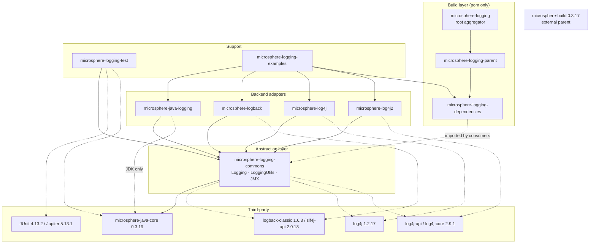
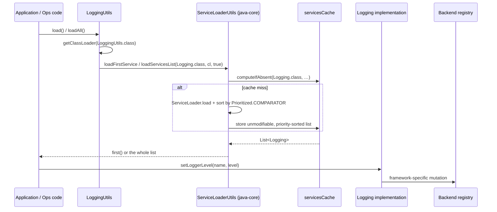
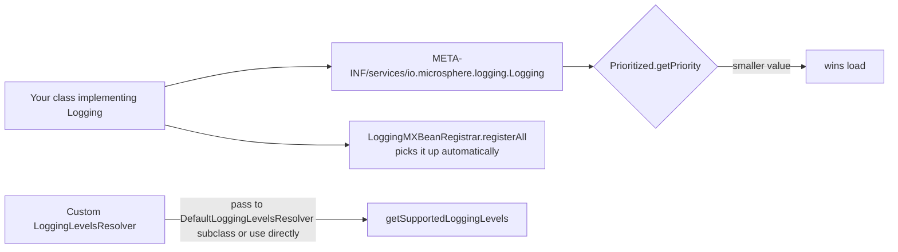

# Architecture

[中文版](./zh/architecture.md)

> Branch analyzed: `release` · Version `0.2.3-SNAPSHOT` (latest published `0.2.2`)
> Java **8** baseline — no POM in this repository declares a compiler release; it is inherited from the external
> `microsphere-build` parent (`pom.xml:6-10`, version `0.3.17` on `release`). CI builds Java 8, 11, 17, 21, 25
> (`.github/workflows/maven-build.yml:25`).

---

## 1. Design goal

The project separates **what is managed** (a logging facility's live configuration) from **how it is managed**
(framework-specific registry access). Everything above the seam is framework-agnostic:

```
callers (ops code / JMX / JUnit)  ->  Logging SPI  ->  backend adapter  ->  Logback / Log4j / Log4j2 / JUL registry
```

Consequences of that split:

- adding a backend never touches `microsphere-logging-commons`;
- an application can carry several backends and still have one management entry point;
- the abstraction is deliberately *lossy* — it models only level query/mutation and logger enumeration, so
  backend-specific power (appenders, filters, markers) is reachable only through the backend's own utils.

## 2. Module dependency graph

Arrows mean "depends on at compile time". `optional` Maven dependencies are drawn dashed; they exist so the module
compiles against a framework that the consumer must provide.



Key structural facts, verified from the module POMs:

- The **root** `pom.xml` is the aggregator (`<revision>0.2.3-SNAPSHOT</revision>`, `:52`); it inherits
  `microsphere-build` (`:6-9`) and lists all nine modules (`:56-66`).
- `microsphere-logging-parent/pom.xml` is **not** the aggregator: it inherits the root POM via
  `<relativePath>../pom.xml</relativePath>` (`:5-10`) and only imports
  `microsphere-java-dependencies` `${microsphere-java.version}` = `0.3.19` (`:22`, `:28-34`). It declares
  **no** `<modules>` section and no `<dependencyManagement>` for the project's own artifacts.
- `microsphere-logging-dependencies/pom.xml` is the BOM: it inherits `microsphere-logging-parent` via
  `<relativePath>../microsphere-logging-parent/pom.xml</relativePath>` (`:4-10`) and pins the six published
  artifacts to `${revision}` (`:26-61`).
- `microsphere-logback` and `microsphere-log4j2` **do not depend on each other**; they are siblings that reach the
  same `Logging` interface through different third-party APIs.

## 3. Runtime layering



The `Logging` implementations are **stateless facades** over a framework's *current* configuration: none of them
holds a logger registry of its own. `JavaLogging` borrows the JDK's `LoggingMXBean` (`JavaLogging.java:56`), while
`LogbackLogging`, `Log4jLogging` and `Log4j2Logging` delegate to `LogbackUtils` / `Log4jUtils` / `Log4j2Utils`,
each of which caches the registry in a static field at class-initialisation time
(`LogbackUtils.java:38`, `Log4jUtils.java:39`).

## 4. Design patterns in use

| Pattern | Where | Evidence |
|---------|-------|----------|
| **Strategy + Provider (Java SPI)** | `Logging` implementations discovered through `META-INF/services` | `microsphere-java-logging/…/META-INF/services/io.microsphere.logging.Logging`, `…/LoggingUtils.java:57-59` |
| **Priority-ordered resolution** | `Prioritized` + `Prioritized.COMPARATOR` (ascending) | `LoggingUtils.java:68-70` → `ServiceLoaderUtils.loadFirstService` |
| **Facade** | `LogbackUtils`, `Log4jUtils`, `Log4j2Utils`, `LoggingUtils`, `LoggingMXBeanRegistrar` | abstract class + private constructor (`LoggingUtils.java:84`, `LogbackUtils.java:159`) |
| **Adapter** | `LoggingMXBeanAdapter` maps `Logging` onto `java.util.logging.LoggingMXBean` | `LoggingMXBeanAdapter.java:34` |
| **Delegating Wrapper** | `Log4j2Logger`, `Log4jLogger`, `LoggingMXBeanAdapter` implement `DelegatingWrapper#getDelegate()` | `Log4j2Logger` + `LoggingMXBeanAdapter.java:126` |
| **Singleton (eager, public field)** | `DefaultLoggingLevelsResolver.INSTANCE` | `DefaultLoggingLevelsResolver.java:37` (not `final`) |
| **Template Method** | `DefaultLoggingLevelsResolver.resolve()` skeleton with a `protected` constructor for subclassing | `DefaultLoggingLevelsResolver.java:39-40,52-59` |
| **Registry / Registrar** | `LoggingMXBeanRegistrar.register/registerAll` | `LoggingMXBeanRegistrar.java:96,77` |
| **Interface-default behaviour as shared template** | `Logging.getParentLoggerName()` default, overridden only by `JavaLogging` | `Logging.java:118-128` |
| **Null-safe degradation** | `LogbackUtils.getLevel(null)` → `null`; `setLoggerLevel(null, …)` → no-op | `LogbackUtils.java:91-99,119-131` |
| **Immutable defensive views** | `unmodifiableSet` / `unmodifiableList` returns | `DefaultLoggingLevelsResolver.java:52-59`, `LoggingMXBeanRegistrar.java:86` |
| **Chain of Statements (JUnit 4)** | `LoggingLevelsRule` → `LoggingLevelsStatement` | `LoggingLevelsRule#apply`, `LoggingLevelsStatement#evaluate` |
| **Extension + InvocationContext + Callback + ParameterResolver (Jupiter)** | `LoggingLevelsExtension`, `LoggingLevelTemplateInvocationContext`, `LoggingLevelCallback`, `LoggingLevelParameterResolver` | `microsphere-logging-test/…/jupiter/extension/logging/*` |
| **Composed (meta-)annotation** | `@LoggingLevelsTest` / `@LoggingLevelsClass` carry `@ExtendWith`; `@DefaultLoggingLevelsClass` composes them | test sources under `microsphere-logging-test/src/test/...` |

Patterns deliberately **not** used: Observer/listener on level changes (level mutation is pull-based), Builder for
`Logging` construction, and any form of global mutable configuration cache other than the SPI cache in java-core.

## 5. Extension points



To add a backend you need exactly four things:

1. a class implementing `io.microsphere.logging.Logging`
   (`getRootLoggerName`, `getLoggerNames`, `getSupportedLoggingLevels`, `getLoggerLevel`, `setLoggerLevel`,
   `getName`, `getPriority`);
2. a `META-INF/services/io.microsphere.logging.Logging` entry — without it `LoggingUtils.load()` throws
   `IllegalArgumentException`;
3. a priority value, remembering that **smaller wins**;
4. optionally a `io.microsphere.logging.LoggerFactory` service entry if you also want `getLogger(...)` to route
   through the unified facade. `microsphere-log4j` and `microsphere-log4j2` register both services and reuse the
   same priority constant for the pair (`Log4jLogging.PRIORITY`, `Log4j2Logging.PRIORITY`).

The JMX layer requires no registration work: `LoggingMXBeanRegistrar.registerAll()` iterates whatever the SPI
loader returns.

## 6. Build and test commands

```bash
# the reactor's own test invocation, as run by CI (Java 8 / 11 / 17 / 21 / 25)
mvn --batch-mode --update-snapshots --file pom.xml \
    -Drevision=0.0.1-SNAPSHOT \
    -Dsurefire.useSystemClassLoader=false \
    test --activate-profiles test,coverage
```

Notes verified against the POMs and workflows:

- No POM in the reactor sets `skipTests`, so `mvn test` runs the module tests, including the `@LoggingLevelsClass`
  and `@LoggingLevelsRule` templates from `microsphere-logging-test`.
- `-Dsurefire.useSystemClassLoader=false` matters here: the adapters are discovered through `ServiceLoader`, and the
  tests assert on class-loader-visible registries.
- `-Drevision=0.0.1-SNAPSHOT` overrides the `${revision}` property (`pom.xml:55`) so CI never publishes a real
  version; a local `mvn package` resolves to `0.2.3-SNAPSHOT`.
- `microsphere-logging-examples` does **not** configure `exec-maven-plugin`; run its `main` classes from an IDE, or
  build the reactor first and use `mvn -pl microsphere-logging-examples -am package` plus a plain `java -cp`.

## 7. Module documents

- [microsphere-logging-commons](./logging-commons.md) — the abstraction, SPI loading, level resolution, JMX
- [microsphere-java-logging](./java-logging.md) — JUL delegation
- [microsphere-logback](./logback.md) — Logback adapter and utils
- [microsphere-log4j](./log4j.md) — Log4j 1.x adapter, `LoggerFactory` SPI
- [microsphere-log4j2](./log4j2.md) — Log4j2 adapter, appender/layout machinery
- [microsphere-logging-test](./logging-test.md) — JUnit 4 rule and Jupiter template extensions
- [microsphere-logging-parent and -dependencies](./parent-and-dependencies.md) — build layer
- [microsphere-logging-examples](./examples.md) — the four-backend demo
