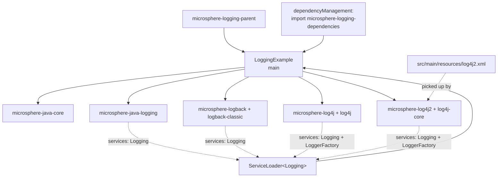
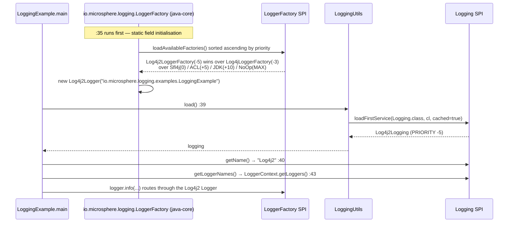

# microsphere-logging-examples — Source Analysis

[中文版](./zh/examples.md)

> Maven module: `io.github.microsphere-projects:microsphere-logging-examples` · Branch `release` · Version
> `0.2.3-SNAPSHOT` · **One production class, no tests** — the repository's integration smoke check.

User-facing reference: [../../user-guide/current/examples.md](../../user-guide/current/examples.md)

---

## 1. Position in the architecture

This module is deliberately the *only* place where all four adapters coexist on one classpath. Everywhere else, each
adapter is tested in isolation against its own backend; here the SPI priority order is exercised for real.



`microsphere-logging-examples/pom.xml` is the repository's own worked example of the consumer pattern documented in
the user guide: it inherits `microsphere-logging-parent` (`:5-10`), imports `microsphere-logging-dependencies` in its
own `<dependencyManagement>` (`:21-34`), and then declares every dependency **without a version** (`:36+`):
`microsphere-java-core`, `microsphere-java-logging`, `microsphere-logback`, `logback-classic`, `microsphere-log4j`,
`log4j`, `microsphere-log4j2`, `log4j-core`.

Two details in that list are load-bearing and easy to miss:

- `microsphere-java-core` is declared **explicitly**. Every other module marks it `optional`, so nothing brings it in
  transitively — a consumer that forgets it gets a `NoClassDefFoundError` on `LoggingUtils`.
- The adapters' framework dependencies are declared by hand (`logback-classic`, `log4j`, `log4j-core`) for the same
  reason: the adapters mark theirs optional too.

## 2. The example itself

```java
// LoggingExample.java:33-45
public class LoggingExample {

    private static final Logger logger = getLogger(LoggingExample.class);   // :35

    public static void main(String[] args) {
        Logging logging = load();                                           // :39
        logger.info("The name of Logging : {}", logging.getName());         // :40
        logger.info("All logger names of Logging : {}", logging.getLoggerNames());  // :43
    }
}
```

Four lines of body, but they traverse every layer of the project, and they resolve **two independent SPI decisions**
that are often confused:



- **Line `:35` picks a `LoggerFactory`**, not a `Logging`. java-core sorts the registered factories by the same
  ascending `Prioritized.COMPARATOR` and drops the ones whose framework cannot be loaded, so `Log4j2LoggerFactory`
  (`-5`) is chosen ahead of `Log4jLoggerFactory` (`-3`), `Sfl4jLoggerFactory` (`0`), `ACLLoggerFactory` (`+5`),
  `JDKLoggerFactory` (`+10`) and `NoOpLoggerFactory` (`MIN_PRIORITY`).
- **Line `:39` picks a `Logging`**, by the identical rule over the `Logging` service file: `Log4j2Logging` (`-5`)
  beats `Log4jLogging` (`-3`), `LogbackLogging` (`0`) and `JavaLogging` (`+10`).

Because the two decisions use the same ordering, the example's own output line and the management object it prints
come from the *same* backend — which is exactly the property a reader should be able to verify by eye.

Given `log4j2.xml` (root level `INFO`, `Console` appender `STDOUT`, pattern `[%t] %p %c - %m%n`), the two `logger.info`
calls are above the root threshold and are printed, so the expected output shape is:

```
[main] INFO io.microsphere.logging.examples.LoggingExample - The name of Logging : Log4j2
[main] INFO io.microsphere.logging.examples.LoggingExample - All logger names of Logging : [...]
```

The second line's list comes from `LoggerContext.getLoggers()` at that instant, i.e. whatever Log4j2 has registered —
it is runtime state, not configuration, and is not stable across runs. That is inherent to the API
(`Logging.getLoggerNames()` is defined over *currently registered* loggers), not a defect of the example.

## 3. Why the module carries only `log4j2.xml`

`src/main/resources` contains exactly one file, `log4j2.xml`. Logback and Log4j 1.x are on the classpath with no
configuration of their own, so they fall back to their defaults. That is intentional: the example demonstrates
`load()` resolving to the highest-priority backend, and the printed `Log4j2` proves it while the other backends stay
silent. Adding a `logback.xml` or `log4j.properties` would make the same run emit three sets of output for one call
and obscure the point.

## 4. What the module does **not** do

| Absent | Consequence |
|--------|-------------|
| `src/test/java` | the reactor never asserts anything about this module; CI only compiles it |
| `exec-maven-plugin` (no POM in the reactor configures it) | running it requires an IDE run configuration or a manual `java -cp` after `mvn -pl microsphere-logging-examples -am package` |
| a `main` per backend | it cannot demonstrate `loadAll()` or the JUL/Logback-only view; the [logging-test guide](./logging-test.md) covers per-backend level matrices instead |
| `microsphere-logging-test` dependency | the example is not a test-support consumer — those two roles never meet |

## 5. Patterns

| Pattern | Where | Note |
|---------|-------|------|
| BOM consumer, worked example | `microsphere-logging-examples/pom.xml:22-33` + versionless dependencies | the canonical snippet the user guide copies |
| Static-initialisation ordering | `LoggingExample.java:35` vs `:39` | the `Logger` exists before `load()` is ever called; two separate SPI lookups |
| Highest-priority-wins demonstration | the whole class | `load()` printing `Log4j2` is the observable proof of the priority table |
| Configuration as documentation | `log4j2.xml` | one console appender, root `INFO`, `%p %c` pattern so the printed line identifies the backend |
