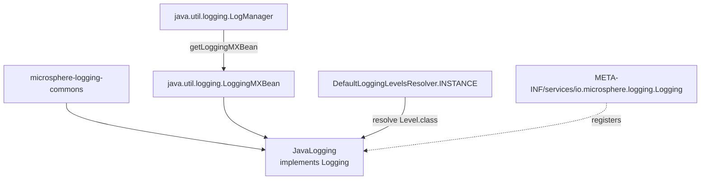

# microsphere-java-logging — Source Analysis

[中文版](./zh/java-logging.md)

> Maven module: `io.github.microsphere-projects:microsphere-java-logging` · Branch `release` · Version
> `0.2.3-SNAPSHOT` · Java 8 · **One production class**: `io.microsphere.logging.jdk.JavaLogging`.

User-facing reference: [../../user-guide/current/java-logging.md](../../user-guide/current/java-logging.md)

---

## 1. Position in the architecture

This is the *reference* adapter: it needs no third-party library at all. Its POM carries `microsphere-logging-commons`
(`${revision}`) as the only non-optional compile dependency, `<optional>true</optional>` entries for
`microsphere-java-annotations` and `microsphere-java-core`, and `junit-jupiter` + `junit-jupiter-engine` in test scope.



Registering only the `Logging` service (and *not* `io.microsphere.logging.LoggerFactory`) is a deliberate asymmetry —
see section 5.

## 2. `JavaLogging` — one static bind, seven one-line delegations

```java
// JavaLogging.java:42,47,54,56
public static final String ROOT_LOGGER_NAME = "";
public static final int PRIORITY = NORMAL_PRIORITY + 10;
public static final Set<String> ALL_LEVELS = INSTANCE.resolve(Level.class);
static final LoggingMXBean loggingMXBean = getLoggingMXBean();
```

The fourth line is the structurally interesting one:

- `loggingMXBean` is **package-private, `static`, and initialised at class-init time**
  (`JavaLogging.java:56`). `JavaLogging` therefore has no constructor state and no instance field; the JDK registry is
  reached through one shared handle. If `LogManager.getLoggingMXBean()` ever failed, the failure would surface as
  `ExceptionInInitializerError` on **first touch of the class**, i.e. during `ServiceLoader` instantiation inside
  `LoggingUtils.loadAll()` — not inside a `Logging` method.
- The bound type, `java.util.logging.LoggingMXBean`, is **deprecated since Java 9** (the SE 11 javadoc carries
  `@Deprecated(since = "9")` on both the interface and `LogManager.getLoggingMXBean()`). It is still present in Java 8
  — which is the project's compile baseline — so the choice is legal everywhere the CI matrix runs
  (Java 8/11/17/21/25), at the cost of a deprecation warning from Java 9 onwards. `Logging.java:31-34` names the same
  interface as the model for the whole abstraction, so this is consistent rather than accidental.

Every instance method delegates unchanged:

| Method | Line | Target |
|--------|------|--------|
| `getRootLoggerName` | `:69-71` | returns the `ROOT_LOGGER_NAME` constant, no MXBean call |
| `getLoggerNames` | `:83-85` | `loggingMXBean.getLoggerNames()` |
| `getSupportedLoggingLevels` | `:98-100` | returns `ALL_LEVELS`, no MXBean call |
| `getLoggerLevel` | `:112-114` | `loggingMXBean.getLoggerLevel(name)` |
| `setLoggerLevel` | `:126-128` | `loggingMXBean.setLoggerLevel(name, levelName)` |
| `getParentLoggerName` | `:141-143` | `loggingMXBean.getParentLoggerName(name)` — **override of the interface default** |
| `getName` | `:155-157` | literal `"Java Logging"` |
| `getPriority` | `:170-172` | `PRIORITY` |

## 3. Why `getParentLoggerName` is overridden here and nowhere else

The three framework adapters accept `Logging`'s default lexical implementation (`Logging.java:118-128`: strip
everything after the last `.`). `JavaLogging.getParentLoggerName` (`:141-143`) instead asks the JDK, whose contract is
*"the name of the nearest **existing** parent logger"*. The observable difference:

```
logger "a.b.c" exists, "a.b" does not, "" (root) does
  lexical default   → "a.b"
  JavaLogging (JUL) → ""        (the root, because a.b was never created)
```

That is why this module is the only one whose parent-walk can be trusted for tree traversal, and why the default
cannot be used to enumerate real ancestors. The test asserts equality with the MXBean for every registered logger,
which pins the delegation rather than the arithmetic:

```java
// test-case evidence — JavaLoggingTest.java:101-106
List<String> loggerNames = this.logging.getLoggerNames();
for (String loggerName : loggerNames) {
    assertEquals(this.logging.getParentLoggerName(loggerName),
                 loggingMXBean.getParentLoggerName(loggerName));
}
```

## 4. `null` and `""` — the one place the interface contract is honoured

`Logging.getLoggerLevel` promises `null` for an unknown logger and `""` for a logger whose level is inherited
(`Logging.java:66-81`); `setLoggerLevel(name, null)` promises to restore inheritance (`:90-93`). JUL is the only
backend that actually behaves that way, because the MXBean implements it.

The test suite is written around exactly this property:

```java
// test-case evidence — JavaLoggingTest.java:85-98
for (String loggerName : loggerNames) {
    String level = this.logging.getLoggerLevel(loggerName);
    if (isBlank(level)) {
        continue;                 // JUL reports "" for inherited loggers — skip, do not "restore" ""
    }
    for (String newLevel : ALL_LEVELS) {
        this.logging.setLoggerLevel(loggerName, newLevel);
        assertEquals(newLevel, this.logging.getLoggerLevel(loggerName));
    }
    this.logging.setLoggerLevel(loggerName, level);
}
```

Two things to read into that `continue`:

1. `isBlank` guards against JUL's inherited-logger `""`. Feeding `""` back through `setLoggerLevel` would reach
   `Level.parse("")` and throw `IllegalArgumentException` — this is the failure `microsphere-logging-test` exposes
   when the *restore* step of a level matrix hits a JUL logger with no declared level.
2. The inner loop asserts round-trip equality for **all nine** level names, so `JavaLogging` is the only adapter whose
   whole `ALL_LEVELS` set is guaranteed writable. On Logback/Log4j/Log4j2 the same loop works only because
   `Level.toLevel(...)` maps a name to a level without validating against the backend's own vocabulary.

The corollary is the divergence documented in the user guide: `setLoggerLevel(name, null)` genuinely re-inherits on
JUL, but resolves to `DEBUG` on Logback / Log4j / Log4j2 (their `toLevel`-style parsing defaults to DEBUG for a null
or unknown string), and an unknown name *throws* on JUL while those three silently degrade.

## 5. What this module deliberately does **not** provide

`JavaLogging` is registered as a `Logging` service only:

```
microsphere-java-logging/src/main/resources/META-INF/services/io.microsphere.logging.Logging
  → io.microsphere.logging.jdk.JavaLogging
```

There is no `io.microsphere.logging.LoggerFactory` entry, unlike `microsphere-log4j` and `microsphere-log4j2`. That
is not an omission: the `Logger`/`LoggerFactory` facade lives in `microsphere-java-core`, which already registers four
factories in its own service file, in ascending priority order:

| Registered `LoggerFactory` | Priority | Effect |
|----------------------------|----------|--------|
| `Log4j2LoggerFactory` *(this repository, `microsphere-log4j2`)* | `-5` (`Log4j2Logging.PRIORITY`) | wins when log4j2 core is loadable |
| `Log4jLoggerFactory` *(this repository, `microsphere-log4j`)* | `-3` (`Log4jLogging.PRIORITY`) | wins over slf4j when log4j 1.x is loadable |
| `Sfl4jLoggerFactory` *(java-core)* | `0` | used when `org.slf4j.Logger` is present |
| `ACLLoggerFactory` *(java-core)* | `+5` | commons-logging |
| `JDKLoggerFactory` *(java-core)* | `+10` | `java.util.logging` — the JUL route needs no adapter module |
| `NoOpLoggerFactory` *(java-core)* | `MIN_PRIORITY` (`Integer.MAX_VALUE`) | always available, last resort |

`LoggerFactory.loadAvailableFactories()` drops any factory whose `isAvailable()` is false, and the default
`isAvailable()` resolves the factory's delegate logger class name through a defensive class load — so a factory
whose framework is absent is filtered out instead of throwing. Adding another `LoggerFactory` for JUL would collide
with `JDKLoggerFactory` at the same `+10` slot and buy nothing.

The management side, by contrast, has no java-core fallback: without this module on the classpath,
`LoggingUtils.load()` can never return a JUL-based `Logging`, and `getSupportedLoggingLevels()` would not expose
`CONFIG`/`FINE`/`FINER`/`FINEST` to any caller.

## 6. Priority: the reason JUL *loses* by design

`PRIORITY = NORMAL_PRIORITY + 10 = 10` (`JavaLogging.java:47`, asserted literally in
`JavaLoggingTest.java:59`). Because `Prioritized.COMPARATOR` sorts **ascending** and `load()` returns the head of the
list, `+10` makes `JavaLogging` the *last* choice among the four adapters:

| Adapter | Priority expression | Value |
|---------|-------------------|-------|
| `Log4j2Logging` | `NORMAL_PRIORITY - 5` | `-5` |
| `Log4jLogging` | `NORMAL_PRIORITY - 3` | `-3` |
| `LogbackLogging` | `NORMAL_PRIORITY` | `0` |
| `JavaLogging` | `NORMAL_PRIORITY + 10` | `10` |

On a classpath carrying several backends, `load()` therefore reports the richest *third-party* backend, not the JDK
one — and `LoggingUtils.loadAll()` + `getName()` is the only way to reach `JavaLogging` explicitly. This is the
single most common source of surprise for readers of the source, so it is worth restating: **smaller int = stronger
claim** (`Prioritized.MAX_PRIORITY == Integer.MIN_VALUE`).

## 7. Tests as specification

| Assertion | File:line | Pins |
|-----------|-----------|------|
| `assertEquals("", ROOT_LOGGER_NAME)` | `JavaLoggingTest.java:58` | root logger is the empty string, not `"root"` |
| `assertEquals(10, PRIORITY)` | `:59` | the losing priority value |
| `assertEquals(JAVA_LOGGING_LEVELS, ALL_LEVELS)` | `:60,47` | the reflective resolver's nine JDK names |
| `logging.getLoggerX(...) == loggingMXBean.getLoggerX(...)` | `:70,81,104` | pure delegation, no translation |
| full `ALL_LEVELS` write/read round-trip | `:85-98` | every JDK level name is accepted, inherited loggers are skipped |
| `assertEquals("Java Logging", getName())` | `:110` | the JMX `type=` key from `LoggingMXBeanRegistrar` |
