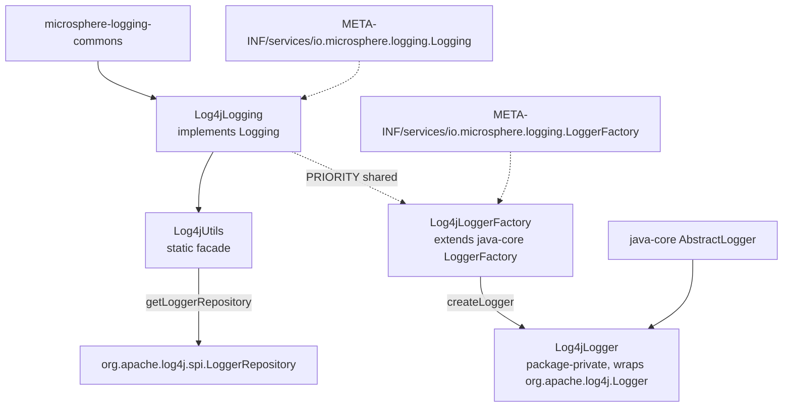

# microsphere-log4j — Source Analysis

[中文版](./zh/log4j.md)

> Maven module: `io.github.microsphere-projects:microsphere-log4j` · Branch `release` · Version `0.2.3-SNAPSHOT` ·
> Java 8 · Log4j **1.2.17** · 4 production classes: `Log4jLogging`, `Log4jUtils`, `Log4jLoggerFactory`, `Log4jLogger`.

User-facing reference: [../../user-guide/current/log4j.md](../../user-guide/current/log4j.md)

---

## 1. Position in the architecture



This is one of only two modules that register **both** SPI services — management (`Logging`) *and* the logger facade
(`LoggerFactory`). `microsphere-log4j` and `microsphere-log4j2` are the only modules that let
`io.microsphere.logging.LoggerFactory.getLogger(...)` return a native-backed `Logger`; `microsphere-java-logging` and
`microsphere-logback` register `Logging` alone.

The two registrations deliberately share one priority constant: `Log4jLoggerFactory.getPriority()` returns
`Log4jLogging.PRIORITY` (`Log4jLoggerFactory.java:76-77`, imported from `Log4jLogging` at `:23`), so moving the
management adapter in the priority order moves the logger factory with it. There is no way for the two roles to end up
in different backends because of a priority slip.

## 2. `Log4jUtils` — two eager statics, and a root name that is *computed*

```java
// Log4jUtils.java:39,44
static final LoggerRepository loggerRepository = LogManager.getLoggerRepository();
public static final String ROOT_LOGGER_NAME = getRootLogger().getName();
```

The second line is the difference that matters when reading this module next to `microsphere-logback`:

- `LogbackUtils.ROOT_LOGGER_NAME` is a **constant borrowed from slf4j** (`"ROOT"`).
- `Log4jUtils.ROOT_LOGGER_NAME` is a **value read out of the live repository at class-init time**, which is `"root"`
  (`Log4JLoggingTest.java:61` asserts `assertEquals("root", ROOT_LOGGER_NAME)`).

Because it is `static final` and initialised once, the constant is effectively a snapshot of Log4j 1.x's own root
logger name — stable in practice (`Hierarchy.getRootLogger()` always returns the logger named `"root"`), but it does
mean class-loading `Log4jUtils` triggers `LogManager.getLoggerRepository()` **and** `getRootLogger()` before any
caller asks for anything. On a misconfigured classpath the first symptom is `ExceptionInInitializerError`, not a
logging call.

`getLogger(String)` (`:63-65`) forwards to `loggerRepository.getLogger(...)`, which is get-or-create. The tests pin
the null-argument behaviour, and it differs from Logback's:

```java
// test-case evidence — Log4jUtilsTest.java:54-57
assertNotNull(getLogger("test"));                                                  // get-or-create
assertThrows(NullPointerException.class, () -> getLogger((Class<?>) null));       // :75 requestClass.getName()
assertThrows(NullPointerException.class, () -> getLogger((String) null));         // repository rejects null
```

Logback raised `IllegalArgumentException` for the same null-name call; Log4j raises `NullPointerException`. Any
generic "reset every logger in this list" code has to tolerate both.

### `getLevel` never reports inheritance

```java
// Log4jUtils.java:97-103
public static Level getLevel(@Nullable Logger logger) {
    Level level = null;
    if (logger != null) {
        level = logger.getEffectiveLevel();   // no logger.getLevel() probe at all
    }
    return level;
}
```

`org.apache.log4j.Logger` *does* have `getLevel()` (which returns `null` when inherited, since `Level` lives on
`Category` as a possibly-null field), yet this utility skips it and returns `getEffectiveLevel()` unconditionally.
The consequence is structural: through this adapter you **cannot distinguish "declared" from "inherited"**, and
`Logging.getLoggerLevel(name)` can only return `null` when the `Logger` argument is `null` — never for an unknown
logger name, and never for an inheriting logger:

```java
// test-case evidence — Log4jUtilsTest.java:62-68
assertNull(getLevel((Logger) null));                       // the only null path
assertEquals(INFO, getLevel("io.microsphere.logging"));    // inherited value surfaced as if declared
assertEquals(TRACE, getLevel("io"));                       // falls through to the configured root
```

Compare with the Logback adapter, whose `getLevel` tries `getLevel()` first and only then
`getEffectiveLevel()` (`LogbackUtils.java:91-100`). Same method name, same javadoc shape, different observable
semantics — the reason the developer guide keeps a per-backend matrix instead of describing `Logging` as if it were
uniform.

### The three `setLoggerLevel` overloads

```
setLoggerLevel(String loggerName, String levelString)  :111-114   get-or-create, then delegate
setLoggerLevel(Logger, String levelString)             :122-124   Level.toLevel(levelString)  → DEBUG for null/unknown
setLoggerLevel(Logger, Level level)                    :132-136   null logger → silent no-op; else logger.setLevel(level)
```

`org.apache.log4j.Level.toLevel(String)` applies the same default-to-`DEBUG` rule as Logback's and Log4j2's
`toLevel`, so `Logging.setLoggerLevel(name, null)` **pins the logger at DEBUG** rather than restoring inheritance —
in direct contradiction of `Logging.java:90-93`. The `Level`-typed overload is again the only way to pass a real
`null` and get true inheritance back, exactly as in the Logback module.

## 3. `Log4jLogging.getLoggerNames()` — root is excluded

```java
// Log4jLogging.java:83-89
LoggerRepository loggerRepository = getLoggerRepository();
Enumeration loggers = loggerRepository.getCurrentLoggers();
Iterable<Logger> iterable = toIterable(loggers);
return stream(iterable.spliterator(), false).map(Logger::getName).collect(toList());
```

`Hierarchy.getCurrentLoggers()` returns the loggers below the root — the root itself is **not** in the enumeration.
So `getRootLoggerName()` (`:69-70`) hands out `"root"`, while `getLoggerNames()` never contains `"root"`. The
`Logging` contract does not forbid that, but it means a level-matrix that iterates `getLoggerNames()` will silently
skip the root, and `Log4JLoggingTest.testGetLoggerNames` can therefore only assert non-emptiness (`:72-73`).

The `Enumeration → Iterable → Stream` ladder (`toIterable` from java-core, `:28` static import) is present purely
because Log4j 1.x predates collections integration; `microsphere-log4j2` needs no such ladder.

## 4. The logger-facade side: `Log4jLoggerFactory` and `Log4jLogger`

| Class | Visibility | Role |
|-------|-----------|------|
| `Log4jLoggerFactory` (`:32`) | `public` | `extends` java-core's abstract `LoggerFactory`; implements the availability probe and the creation hook |
| `Log4jLogger` (`:36`) | **package-private** | `extends AbstractLogger implements DelegatingWrapper`; wraps a `final org.apache.log4j.Logger` field (`:38`), constructed from a logger name (`:51`) |

`Log4jLogger` being package-private is a deliberate encapsulation: applications never reference it, they only ever get
one back from `LoggerFactory.getLogger(...)`. `Log4jLoggerFactory` supplies two hooks to java-core:

```java
// Log4jLoggerFactory.java:47-48,61-62,76-77
protected String getDelegateLoggerClassName() { return LOG4J_LOGGER_CLASS_NAME; } // "org.apache.log4j.Logger"
public Logger createLogger(String name)      { return new Log4jLogger(name); }
public int getPriority()                     { return PRIORITY; }                  // Log4jLogging.PRIORITY = -3
```

`getDelegateLoggerClassName()` is what java-core's default `isAvailable()` uses — it attempts a defensive class load
of `org.apache.log4j.Logger` and, if the framework is absent, the factory is filtered out of the candidate list
instead of throwing. That is how a single jar can be on the classpath without Log4j 1.x and still not break
`LoggerFactory.getLogger`.

The priority choice is the reason `load()` does **not** return Log4j on a mixed classpath: `-3` loses to Log4j2's
`-5`, and the ordering `Log4j2 (-5) < Log4j (-3) < Logback (0) < JUL (+10)` is ascending-means-winning under
`Prioritized.COMPARATOR`.

## 5. Method map

| `Logging` method | Line | Behaviour |
|------------------|------|-----------|
| `getRootLoggerName` | `:69-70` | `Log4jUtils.ROOT_LOGGER_NAME` → `"root"` |
| `getLoggerNames` | `:83-89` | `getCurrentLoggers()`, root excluded |
| `getSupportedLoggingLevels` | `:103-104` | `ALL_LEVELS` — eight names **including `FATAL`** (`:57`) |
| `getLoggerLevel` | `:117-118` | `getLevelString(name)` → effective level |
| `setLoggerLevel` | `:131-133` | `Log4jUtils.setLoggerLevel(name, level)` |
| `getParentLoggerName` | — | not overridden → lexical default |
| `getName` | `:145-146` | `"Log4j"` → JMX `io.microsphere.logging:type=Log4j` |
| `getPriority` | `:160-161` | `-3` |

## 6. Tests as specification

| Assertion | File:line | Pins |
|-----------|-----------|------|
| `assertSame(LogManager.getLoggerRepository(), getLoggerRepository())` | `Log4jUtilsTest.java:49` | the static handle is the live repository |
| null-name / null-class both → NPE | `:56-57` | Log4j's failure mode differs from Logback's IAE |
| `getLevel("io")` returns the inherited root level | `:67-68` | effective-only semantics |
| `assertEquals("root", ROOT_LOGGER_NAME)` | `Log4JLoggingTest.java:61` | computed, not slf4j's `"ROOT"` |
| `assertEquals(-3, PRIORITY)` | `:62` | outranked only by Log4j2 |
| `LOG4J_LEVELS` = 8 names with `FATAL` | `:52,63` | reflective resolver output |
| `getLoggerLevel(ROOT_LOGGER_NAME)` = `"TRACE"` | `:83` | root readable through the adapter |
| `getParentLoggerName` lexical chain | `:99-103` | interface default, not Log4j's parent walk |

Note the test class name is `Log4JLoggingTest` (capital `J`), while the production class is `Log4jLogging` — worth
knowing when grepping or adding cases.
