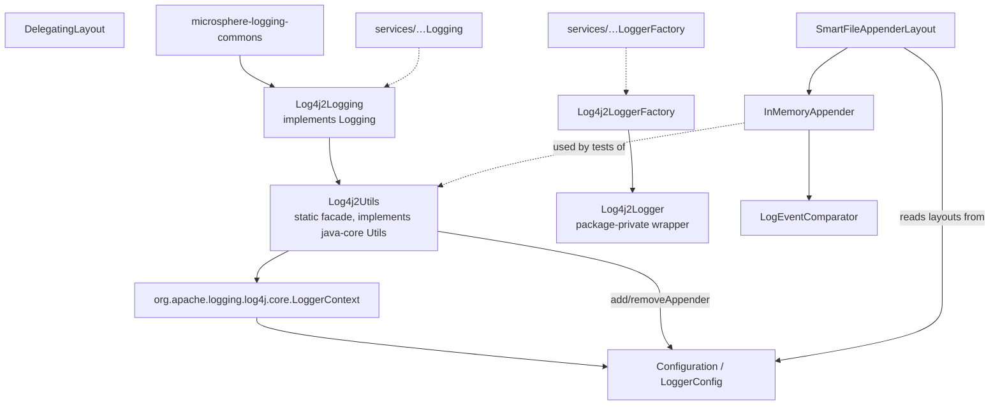
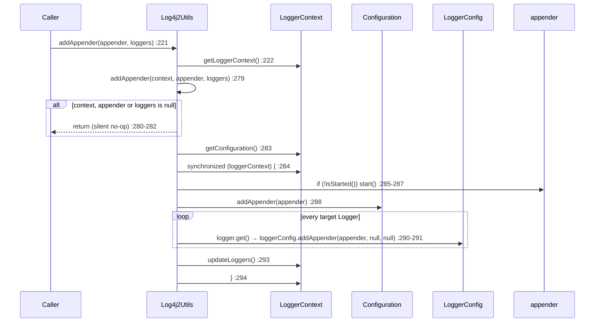
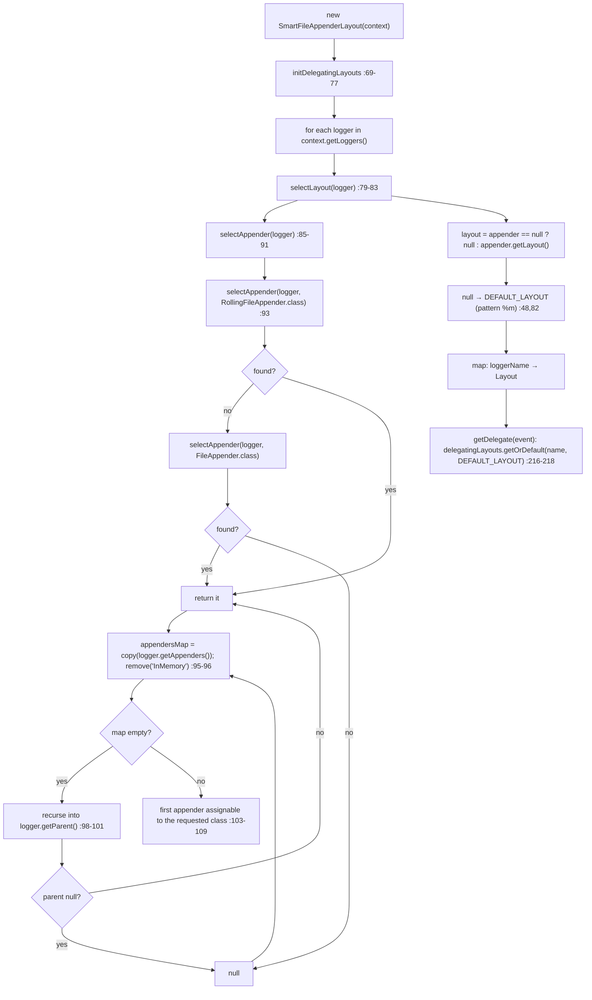

# microsphere-log4j2 — Source Analysis

[中文版](./zh/log4j2.md)

> Maven module: `io.github.microsphere-projects:microsphere-log4j2` · Branch `release` · Version `0.2.3-SNAPSHOT` ·
> Java 8 · log4j-api / log4j-core **2.9.1** · 7 production classes — the largest module in the repository.

User-facing reference: [../../user-guide/current/log4j2.md](../../user-guide/current/log4j2.md)

---

## 1. Position in the architecture

This module is the only adapter that goes beyond level management and touches Log4j2's **appender/layout machinery**.
That extra surface is what makes it the repository's de-facto capture-for-testing toolkit.



Service registrations (both files under `src/main/resources/META-INF/services/`):

| Service file | Implementation |
|--------------|----------------|
| `io.microsphere.logging.Logging` | `io.microsphere.logging.log4j2.Log4j2Logging` |
| `io.microsphere.logging.LoggerFactory` | `io.microsphere.logging.log4j2.Log4j2LoggerFactory` |

`Log4j2LoggerFactory.getPriority()` reuses `Log4j2Logging.PRIORITY` (`Log4j2LoggerFactory.java:23,76-77`), so
management and logging roles always move together. Because that priority is `NORMAL_PRIORITY - 5 = -5`
(`Log4j2Logging.java:46`) and `Prioritized.COMPARATOR` sorts ascending, **`LoggingUtils.load()` returns
`Log4j2Logging` whenever log4j2 is on the classpath** — including in a JUL-based application.

## 2. `Log4j2Utils` — no cached registry, unlike Logback and Log4j 1.x

```java
// Log4j2Utils.java:179-181
public static LoggerContext getLoggerContext() {
    return (LoggerContext) LogManager.getContext(false);
}
```

The `false` argument means *non-current-thread / use the existing context* — Log4j2 returns the same
`LoggerContext` object each call, which the test confirms with `assertSame(LogManager.getContext(false),
getLoggerContext())` (`Log4j2UtilsTest.java:65`). Contrast the two sibling adapters:

| Module | Registry handle | When resolved | Failure mode if the framework is absent / foreign |
|--------|-----------------|---------------|---------------------------------------------------|
| `microsphere-logback` | `static final LoggerContext` (`LogbackUtils.java:38`) | class-init | `ExceptionInInitializerError` (from `ClassCastException`) |
| `microsphere-log4j` | `static final LoggerRepository` (`Log4jUtils.java:39`) | class-init | `ExceptionInInitializerError` |
| `microsphere-log4j2` | **none** — `LogManager.getContext(false)` per call (`:179-181`) | every call | `IllegalStateException` from Log4j2 itself, at call time |

This is why the Log4j2 adapter survives a late `Log4j2CoreContext` reset and the other two do not survive a
`LoggerContext` replacement.

### `getLevel` — neither declared nor effective, but "config-resolved"

```java
// Log4j2Utils.java:97-103
public static Level getLevel(@Nullable Logger logger) {
    Level level = null;
    if (logger != null) {
        level = logger.getLevel();
    }
    return level;
}
```

`org.apache.logging.log4j.core.Logger#getLevel()` resolves the *matching* `LoggerConfig` and returns its level, so
the adapter reports what Log4j2's configuration says applies to the name — not a per-logger declared field, and not an
explicit `getEffectiveLevel()` walk as in Logback/Log4j 1.x. The tests read levels for names that were never
configured and get the root's answer:

```java
// test-case evidence — Log4j2UtilsTest.java:78-84
assertNull(getLevel((Logger) null));        // the only null path
assertEquals(INFO,  getLevel("io.microsphere.logging"));  // explicitly configured
assertEquals(TRACE, getLevel("io"));                     // resolved to the root LoggerConfig
```

### `setLoggerLevel(null)` really does pin DEBUG — and the test says so

```java
// test-case evidence — Log4j2UtilsTest.java:128-130
// null string -> toLevel(null) => DEBUG
Log4j2Utils.setLoggerLevel(logger, (String) null);
assertEquals(Level.DEBUG, Log4j2Utils.getLevel(logger));
```

`setLoggerLevel(Logger, String)` (`:122-124`) always calls `Level.toLevel(levelString)` (static import at `:33`),
whose default for both `null` and an unparseable name is `DEBUG`. So `Logging.setLoggerLevel(name, null)` violates the
`Logging.java:90-93` promise of "restore inheritance" on this backend — the logger ends up **explicitly at DEBUG**,
and a `setX … read … restore` cycle built on `getLoggerLevel()` is therefore not neutral. Passing a `null` **`Level`
object** to `setLoggerLevel(Logger, Level)` (`:132-136`) is the only route that reaches `logger.setLevel(null)` and
genuinely re-establishes inheritance.

## 3. Appender surgery — the most stateful code in the repository

`addAppender` / `removeAppender` are published as two public entry points plus two package-private workers that take
the context explicitly (so tests can drive them without a live lookup):



Reading `:279-314` closely, four decisions stand out:

1. **The lock is the `LoggerContext` itself** (`synchronized (loggerContext)`), not a private mutex. That is the same
   monitor Log4j2 uses internally when it reconfigures, so the module is cooperating with the framework rather than
   inventing its own — but it also means an application that locks the context can deadlock against this code.
2. **Life-cycle is managed for you**: `addAppender` calls `appender.start()` when needed (`:285-287`), and
   `removeAppender` calls `appender.stop()` unless already stopped (`:304-306`). A caller that already started the
   appender is unaffected; a caller that forgot to is silently rescued.
3. **Two registries must both be mutated.** The appender goes into `Configuration` (`:288`) *and* into each
   `LoggerConfig` (`:291`), and removal does the mirror image — `configuration.getAppenders().remove(name)` (`:307`)
   plus `loggerConfig.removeAppender(name)` (`:310`). Missing either half is the classic way to end up with a
   "phantom" appender that `findAppender` still returns.
4. **Nothing is persisted.** `updateLoggers()` (`:293`, `:312`) rebuilds the live loggers only; a reconfiguration or a
   restart from XML wipes the change. `addAppender(..., null, null)` also passes a `null` level filter and a `null`
   `Filter`, i.e. "accept everything the logger already accepts".

The null-guard at `:280-282` / `:298-300` returns silently. Combined with
`Log4j2Utils.addAppenderForAllLoggers(appender)` (`:238-241`) — which passes `loggerContext.getLoggers()`, i.e. the
loggers that exist **at that moment** — a logger created later never receives the appender. For full coverage you
need to attach to the root `LoggerConfig` or re-apply after creation.

`findAppender` (`:169-172`) is one line over `configuration.getAppender(name)`, so it only sees appenders declared in
the configuration (or added through the methods above), and returns `null` otherwise — the generic `<T extends Appender>`
makes it an unchecked cast at the call site.

## 4. `InMemoryAppender` — ordered buffer with two sharp edges

```java
// InMemoryAppender.java:38,43,45
public class InMemoryAppender extends AbstractLifeCycle implements Appender {
    public static final String NAME = "InMemory";
    private final ConcurrentSkipListSet<LogEvent> logEvents = new ConcurrentSkipListSet<>(INSTANCE);
```

`append(LogEvent)` (`:65-68`) is just `logEvents.add(event)`. Three consequences follow from that single data
structure:

- **Ordering is by timestamp, not arrival.** `LogEventComparator.compare` (`LogEventComparator.java:59-65`) compares
  `getInstant().getEpochMillisecond()` and, on a tie, `getNanoOfMillisecond()`. Events are therefore replayed in
  time order even if `ConcurrentAppender` delivery was out of order.
- **Same-nanosecond events are dropped.** `ConcurrentSkipListSet` is a *Set*: two events whose instant is identical
  compare `0`, so the second `add` returns `false` and the event is silently lost. A high-throughput capture test can
  under-report; this is the reason to prefer Log4j2's own `ListAppender` when exact counts matter.
- **There is no read API.** The buffer is private and unexposed; the only way out is
  `transfer(Appender)` (`:215-220`), which **drains** via `pollFirst()` in time order into another appender.
  `stop()` (`:195-198`) calls `super.stop()` then `logEvents.clear()`, so stopping discards everything captured.

`getLayout()` (`:100-102`), `getHandler()` and `ignoreExceptions()` (`:117-118`) are the "no layout, no error
handler, do not ignore exceptions" triplet — which means `InMemoryAppender` inherits `AbstractLifeCycle`'s
started/stopped semantics only, and `Log4j2Utils.addAppender` will happily start it for you.

`findInMemoryAppender()` (`:237-239`) is `findAppender(NAME)`: it returns the instance **declared in the Log4j2
configuration** under the name `InMemory`, or `null`. It is not a registry of instances the code created — calling
`new InMemoryAppender()` twice and then `findInMemoryAppender()` yields `null` unless one was added through
`Log4j2Utils.addAppender` (which inserts into `Configuration`).

## 5. `SmartFileAppenderLayout` — per-logger format reuse

The class exists so one layout can format each event with the pattern the *owning logger's file appender* would use.
Two halves: an eager index built at construction, and a per-event lookup against it.



Points that only the source reveals:

- **`InMemory` is excluded by name.** `appendersMap.remove(NAME)` (`:96`, `NAME` statically imported from
  `InMemoryAppender` at `:33`) prevents the capture appender from ever being chosen as a formatting source — otherwise
  `SmartFileAppenderLayout` would try to read a layout that `InMemoryAppender.getLayout()` deliberately returns `null`
  for. This is what makes the two classes composable.
- **Rolling beats plain.** `RollingFileAppender` is tried first (`:86`), `FileAppender` second (`:88`) — the check is
  `appenderClass.isAssignableFrom(appender.getClass())` (`:105`), and since `RollingFileAppender` *is* a
  `FileAppender`, trying the more specific class first is what keeps the selection deterministic.
- **Selection is "first match in map iteration order"**, not "most specific" or "largest" (`:103-109` breaks on the
  first hit). A logger with two file appenders therefore gets a layout chosen by `HashMap` order — the reason
  `SmartFileAppenderLayoutTest` asserts the Rolling-over-File preference rather than multi-appender tie-breaking
  (`shouldPreferRollingFileAppenderOverFileAppender`, `:119`).
- **Missing loggers fall back to `DEFAULT_LAYOUT`.** `getDelegate(event)` uses
  `delegatingLayouts.getOrDefault(loggerName, DEFAULT_LAYOUT)` (`:216-218`), so events from loggers that did not exist
  when the index was built are formatted with the `%m` pattern (`:48`). The test pins exactly this orphan case
  (`SmartFileAppenderLayoutTest.java:101-106`).
- **The index is built once, eagerly** (`:65-67`, `:69-77`): later loggers, later appenders and reconfigurations are
  invisible to an already-constructed instance.
- `getHeader`/`getFooter`/`getContentType`/`getContentFormat` (`:125-140,183-198`) always delegate to
  `DEFAULT_LAYOUT`, never to a per-logger layout — header/footer are stream-level concepts and a per-event map cannot
  answer them coherently.

## 6. `DelegatingLayout` and `LogEventComparator`

`DelegatingLayout<T extends Serializable>` forwards `toByteArray` / `toSerializable` / `encode` / header / footer to
its wrapped layout. Its no-arg constructor leaves the delegate `null`, so an instance built that way throws NPE on
first use — it exists for subclass/binding convenience rather than direct use.

`LogEventComparator` is a stateless singleton (`LogEventComparator.java:30-38`, `INSTANCE` at `:35`, private
constructor) exposing exactly one behaviour (`:59-65`). It is consumed by `InMemoryAppender` (`:45`) and is public so
applications can build their own ordered buffers with the same rule.

## 7. Method map for `Log4j2Logging`

| Method | Line | Behaviour |
|--------|------|-----------|
| `getRootLoggerName` | `:66-68` | `org.apache.logging.log4j.LogManager.ROOT_LOGGER_NAME` → `""` (static import `:32`) |
| `getLoggerNames` | `:80-85` | `getLoggers().stream().map(Logger::getName)` — the loggers currently registered in the context |
| `getSupportedLoggingLevels` | `:98-100` | `ALL_LEVELS`, eight names including `FATAL` (`:53`) |
| `getLoggerLevel` | `:113-114` | `getLevelString(name)` |
| `setLoggerLevel` | `:127-129` | `Log4j2Utils.setLoggerLevel(name, level)` |
| `getParentLoggerName` | — | not overridden → lexical default |
| `getName` | `:142-144` | `"Log4j2"` → JMX `io.microsphere.logging:type=Log4j2` |
| `getPriority` | `:157-159` | `-5` |

`Log4j2LoggingTest.testGetLoggerLevel` (`:81-85`) and `testSetLoggerLevel` (`:88-98`) additionally show the adapter
and the native `org.apache.logging.log4j.Logger` agreeing: setting through `Logging` flips
`logger.isDebugEnabled()` (`:93,97`), i.e. mutations are not shadowed by a facade copy.

## 8. Tests as specification

| Assertion | File:line | Pins |
|-----------|-----------|------|
| `assertSame(LogManager.getContext(false), getLoggerContext())` | `Log4j2UtilsTest.java:65` | one shared context per call |
| null name / null class → NPE | `:72-73` | failure happens inside `getLogger`, before Log4j2 |
| `getLevel("io") == TRACE`, `getLevel("io.microsphere.logging") == INFO` | `:78-84` | config-resolved levels |
| `setLoggerLevel(logger, (String) null)` → `DEBUG` | `:128-130` | the inheritance-restoration trap |
| `findAppender("findMe")` after `configuration.addAppender` | `:146-171` | `Configuration` is the lookup source |
| Rolling preferred over File | `SmartFileAppenderLayoutTest.java:119` | `:86-89` ordering |
| orphan + unknown logger events use `DEFAULT_LAYOUT` | `:101-106` | `getOrDefault` fallback at `:216-218` |
| header/footer/content-type equal `DEFAULT_LAYOUT`'s | `:88-91` | stream-level metadata is never per-logger |
