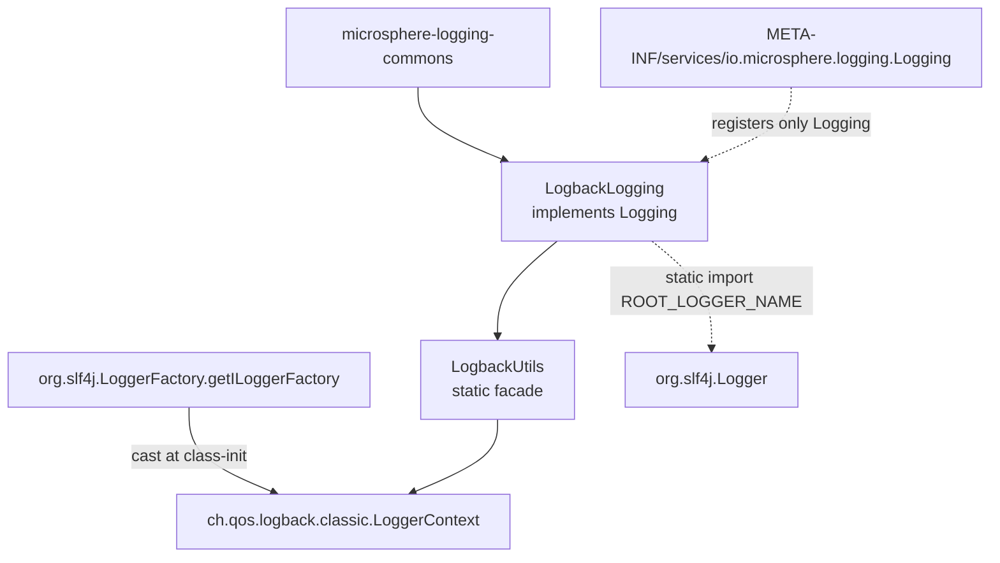
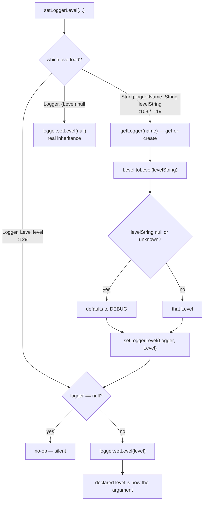

# microsphere-logback — Source Analysis

[中文版](./zh/logback.md)

> Maven module: `io.github.microsphere-projects:microsphere-logback` · Branch `release` · Version `0.2.3-SNAPSHOT` ·
> Java 8 · 2 production classes (`LogbackLogging`, `LogbackUtils`) · Logback `1.6.3` / slf4j-api `2.0.18`.

User-facing reference: [../../user-guide/current/logback.md](../../user-guide/current/logback.md)

---

## 1. Position in the architecture



`microsphere-logback/pom.xml` declares `microsphere-logging-commons` (`${revision}`) as the only mandatory compile
dependency; `microsphere-java-annotations`, `microsphere-java-core`, `slf4j-api` and `logback-classic` are all
`<optional>true</optional>`. Tests additionally use `microsphere-java-test`.

Unlike Log4j and Log4j2, this module registers **one** service —
`META-INF/services/io.microsphere.logging.Logging` → `io.microsphere.logging.logback.LogbackLogging` — and no
`io.microsphere.logging.LoggerFactory`. The logger *writing* path is therefore not bridged here: on a Logback-only
classpath, `io.microsphere.logging.LoggerFactory.getLogger(...)` resolves through java-core's `Sfl4jLoggerFactory`
(priority `0`), which delegates to SLF4J and hence to Logback anyway. Only the *management* path is added by this
module.

## 2. `LogbackLogging` — a thin, but not symmetric, adapter

| Method | Line | Implementation |
|--------|------|----------------|
| `getRootLoggerName` | `:66-68` | returns `ROOT_LOGGER_NAME` — **statically imported from `org.slf4j.Logger`** (`:32`) |
| `getLoggerNames` | `:80-85` | `getLoggerContext().getLoggerList()` streamed to `Logger::getName` |
| `getSupportedLoggingLevels` | `:98-100` | returns `ALL_LEVELS` |
| `getLoggerLevel` | `:112-114` | `LogbackUtils.getLevelString(loggerName)` |
| `setLoggerLevel` | `:126-128` | `LogbackUtils.setLoggerLevel(loggerName, levelName)` |
| `getParentLoggerName` | — | **not overridden** → the lexical default from `Logging.java:118-128` |
| `getName` | `:140-142` | `"Logback"` |
| `getPriority` | `:155-157` | `PRIORITY = NORMAL_PRIORITY` (`:46`), i.e. `0` |

Two consequences are structural rather than incidental:

1. **Root name is `"ROOT"`.** `org.slf4j.Logger.ROOT_LOGGER_NAME` is the only reason `slf4j-api` is a compile
   dependency of this module — a constant, not behaviour. `LogbackLoggingTest.testGetRootLoggerName` asserts the value
   (`:68-70`), and the JMX `ObjectName` built by `LoggingMXBeanRegistrar` keys off `getName()` = `"Logback"`, not off
   the root name.
2. **`getParentLoggerName` inherits the lexical default.** So even though Logback's own hierarchy has a real
   "nearest existing parent" notion, the adapter returns the dotted prefix:

```java
// test-case evidence — LogbackLoggingTest.java:100-107
assertEquals("io.microsphere.logging", logging.getParentLoggerName("io.microsphere.logging.logback"));
assertEquals(ROOT_LOGGER_NAME, logging.getParentLoggerName("io"));  // "ROOT"
assertNull(logging.getParentLoggerName(ROOT_LOGGER_NAME));          // root's parent is null, not ""
```

`getLoggerNames()` (`:80-85`) is a projection of *runtime* state: `LoggerContext.getLoggerList()` reflects the
loggers that exist in the context at call time, so the result grows as code creates loggers. That is why the test can
only assert non-emptiness (`LogbackLoggingTest.java:73-75`) — the set is not a stable, config-derived list.

## 3. `LogbackUtils` — one eager static cast, then pure delegation

```java
// LogbackUtils.java:38
static final LoggerContext loggerContext = (LoggerContext) getILoggerFactory();
```

This single line is the module's tightest coupling:

- It runs during **class initialisation** of `LogbackUtils`, which happens the first time `LogbackLogging` calls any
  `LogbackUtils` method (the static imports at `LogbackLogging.java:29-30` trigger it).
- It **assumes the SLF4J provider is Logback**. On any other provider the cast throws `ClassCastException`, and —
  because the failure is inside a static initialiser — callers see `ExceptionInInitializerError`, with the
  `ClassCastException` as the cause. Importing `io.microsphere.logging.logback.*` into an application that binds
  SLF4J to Simple or to a NOP provider therefore fails hard and early, at first logger-level call.
- `assertSame(getILoggerFactory(), getLoggerContext())` (`LogbackUtilsTest.java:49`) confirms the field is the live
  context object, not a copy: level mutations are visible immediately through `org.slf4j.LoggerFactory` too.

### Declared level vs effective level

`getLevel(Logger)` (`LogbackUtils.java:91-100`) is the only genuinely conditional code in the module:

```java
Level level = null;
if (logger != null) {
    level = logger.getLevel();          // declared level, null when inherited
    if (level == null) {
        level = logger.getEffectiveLevel();   // walk up to the nearest declared ancestor
    }
}
return level;
```

So `getLevel` answers *"what level applies to this logger?"*, never *"what does this logger itself declare?"* —
and it can only return `null` when the argument is `null`. Combined with `getLogger(String)` (which is Logback's
get-or-create), the adapter **cannot** honour `Logging`'s documented "`null` when the logger does not exist"
(`Logging.java:79-80`): an unknown name is created on the spot and reported with its inherited level. Verified by the
tests, which read levels for loggers that were never configured:

```java
// test-case evidence — LogbackUtilsTest.java:54,62-68
assertNull(getLevel((Logger) null));                  // only the null logger yields null
assertEquals(TRACE, getLevel("io.microsphere.logging.logback.util"));  // inherited, not declared
assertEquals(INFO, getLevel("io"));                   // falls through to the root's level
assertNotNull(getLogger("test"));                     // get-or-create, never null
assertThrows(IllegalArgumentException.class, () -> getLogger((String) null));
assertThrows(NullPointerException.class, () -> getLogger((Class<?>) null));  // requestClass.getName()
```

Note the two different failure modes for null arguments: the name overload fails inside Logback
(`IllegalArgumentException`), the class overload fails inside this module (`NullPointerException` at
`LogbackUtils.java:69`, before Logback is ever reached).

### The two `setLoggerLevel` overloads are not equivalent



`setLoggerLevel(Logger, String)` (`:119-121`) always routes through `Level.toLevel(levelString)`, whose documented
default for both `null` and unparseable input is **`DEBUG`**; the javadoc says so explicitly (`:106`, `:117`). The
`Level`-typed overload (`:129-133`) is the escape hatch: passing a `null` **`Level` object** reaches
`logger.setLevel(null)` and genuinely re-establishes inheritance. Two different meanings of "no level" therefore live
in one adapter, distinguished only by the argument's static type — the overload to be careful about when writing
generic "reset the level" code:

```java
LogbackUtils.setLoggerLevel(byName, (String) null); // → DEBUG, logger is pinned
LogbackUtils.setLoggerLevel(byName, (Level) null);  // → inherits again
```

The `Logger`-null guard (`:130`) makes the whole setter chain null-safe by degradation rather than validation:
`setLoggerLevel((Logger) null, "DEBUG")` simply does nothing and is asserted as such
(`LogbackUtilsTest.java:80`).

## 4. Why `LogbackLogging` loses `load()` on a mixed classpath

`PRIORITY = NORMAL_PRIORITY = 0` (`LogbackLogging.java:46`, asserted at `LogbackLoggingTest.java:62-63`). With
`Prioritized.COMPARATOR` ascending, Log4j2 (`-5`) and Log4j (`-3`) both outrank it, while JUL (`+10`) trails it. So on
a classpath with Logback + Log4j2, `LoggingUtils.load()` returns `Log4j2Logging`, and `LogbackLogging` is reachable
only through `loadAll()` + `getName()` filtering. `LogbackLoggingTest.setUp` can safely cast `(LogbackLogging) load()`
(`:57`) only because that module's test classpath contains no other `Logging` provider.

## 5. Patterns

| Pattern | Where | Note |
|---------|-------|------|
| Facade (non-instantiable) | `LogbackUtils.java:36,159` | abstract class + private constructor; every method `static` |
| Eager static registry handle | `LogbackUtils.java:38` | cheaper than a per-call cast, but converts a wiring mistake into `ExceptionInInitializerError` |
| Null-safe degradation | `getLevel` `:91-100`, `setLoggerLevel` `:130`, `getLevelString` `:155-157` | return `null` / no-op instead of throwing |
| Overload-as-strategy | `setLoggerLevel(String,String)` vs `(Logger,Level)` | the DEBUG-vs-inherit divergence above |
| Template via static import | `LogbackLogging.java:29-30` | the adapter reads like inlined utility code; no field, no constructor |
| Composed delegation | `getLoggerLevel` → `getLevelString(String)` → `getLogger` → `getLevel(Logger)` | four single-purpose hops, each individually testable |

## 6. Tests as specification

| Assertion | File:line | Pins |
|-----------|-----------|------|
| `assertSame(getILoggerFactory(), getLoggerContext())` | `LogbackUtilsTest.java:49` | the static field is the live context |
| `getLogger((String) null)` → IAE, `getLogger((Class<?>) null)` → NPE | `:56-57` | where each null argument fails |
| `getLevel("io") == INFO`, `getLevel("io.microsphere") == TRACE` | `:63-68` | declared-else-effective resolution |
| `assertNull(getLevel((Logger) null))` | `:62` | the only null-returning path |
| `setLoggerLevel((Logger) null, "DEBUG")` does not throw | `:80` | silent degradation |
| `assertEquals(LOGBACK_LEVELS, ALL_LEVELS)` | `LogbackLoggingTest.java:64` | seven names, **no `FATAL`** |
| `assertEquals("INFO", getLoggerLevel(ROOT_LOGGER_NAME))` | `:84-88` | root reports its effective level |
| `getParentLoggerName` chain incl. `assertNull(root)` | `:95-107` | lexical default is what ships |
