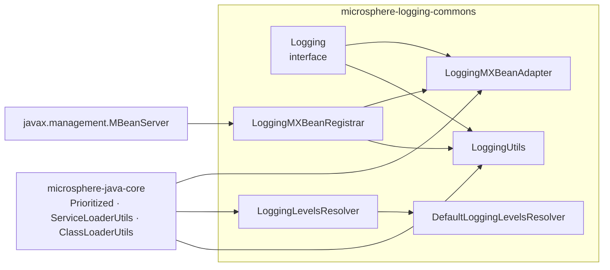
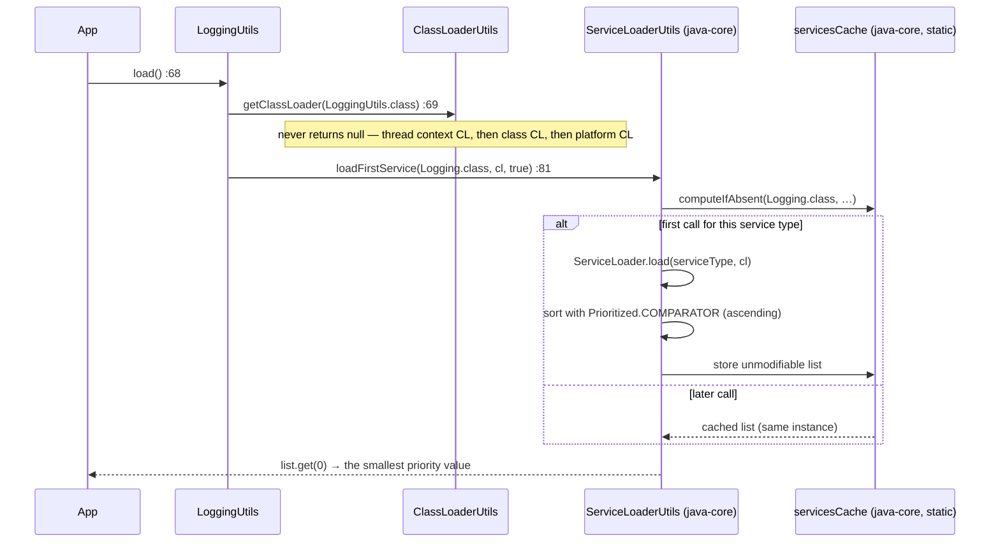
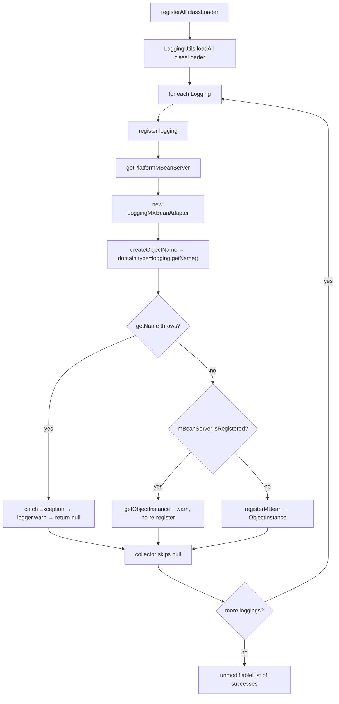

# microsphere-logging-commons — Source Analysis

[中文版](./zh/logging-commons.md)

> Maven module: `io.github.microsphere-projects:microsphere-logging-commons` · Branch `release` ·
> Version `0.2.3-SNAPSHOT` · Java 8 · 6 production classes, no framework dependency other than
> `microsphere-java-core`.

User-facing API reference: [../../user-guide/current/logging-commons.md](../../user-guide/current/logging-commons.md)

---

## 1. Position in the architecture

This module is the **only abstraction** in the project. Every backend adapter depends on it; it depends on none of
them. Its POM is unusual: **every** compile-scope dependency is marked `<optional>true</optional>` —
`microsphere-java-core`, `commons-logging`, `slf4j-api`, `log4j`, `log4j-api`, `log4j-core` and `logback-classic`.
Optionality is what lets `microsphere-logging-commons` sit *above* the backends without dragging any of them into an
application's classpath; the adapters re-declare the framework they actually need. Note that the adapters mark
`microsphere-java-annotations` and `microsphere-java-core` `<optional>true</optional>` as well
(`microsphere-logback/pom.xml`, `microsphere-java-logging/pom.xml`), so **nothing** in this project reaches an
application transitively: the consumer must provide `microsphere-java-core` itself, otherwise `LoggingUtils` cannot
even load `ClassLoaderUtils` / `ServiceLoaderUtils`.



## 2. `Logging` — the contract, and where it is lossy

`Logging.java:39` declares `interface Logging extends Prioritized`, and its javadoc states the design intent
explicitly: *"The most methods are compatible with `LoggingMXBean`"* (`Logging.java:31-34`). The six abstract methods
are `getRootLoggerName` (`:47`), `getLoggerNames` (`:56`), `getSupportedLoggingLevels` (`:64`),
`getLoggerLevel(String)` (`:83`) and `setLoggerLevel(String, String)` (`:103`), plus inherited `getPriority()` and
the backend name from `getName()` (`:136`).

Two contract details drive most cross-backend surprises:

1. **`getLoggerLevel` is three-valued by contract, not two.** Its javadoc (`Logging.java:66-81`) promises `null` for
   a non-existent logger and *an empty string* when the logger exists but has no declared level (inherited).
   `setLoggerLevel(name, null)` is documented to restore inheritance (`:90-93`). Only JUL actually implements that
   reading; the other three adapters route the string through `Level.toLevel(...)`-style parsing.
2. **`getParentLoggerName` has a default implementation** (`Logging.java:118-128`) that is pure string arithmetic:

```java
default String getParentLoggerName(String loggerName) {
    if (Objects.equals(getRootLoggerName(), loggerName)) {
        return null;                        // :119-121
    }
    int lastDotIndex = loggerName.lastIndexOf(DOT);
    if (lastDotIndex == -1) {
        return getRootLoggerName();         // :123-125
    }
    return loggerName.substring(0, lastDotIndex);
}
```

`JavaLogging` is the only adapter that **overrides** it, delegating to the JDK registry so the answer is the nearest
*existing* parent rather than the lexical prefix (`JavaLogging.java:141-143`). Consequently `Log4j2Logging` reports
`"a.b.c" → "a.b"` even when `a.b` was never created — correct for the framework's own hierarchy walk, but it means
the default cannot be used to enumerate an existing subtree.

Note the asymmetry the default introduces: asking for the parent of the root returns `null` (`:120`), while the
javadoc of `LoggingMXBean` says the root's parent is an empty string. Verified against Logback:

```java
// test-case evidence — LogbackLoggingTest.java:106-107
assertEquals(ROOT_LOGGER_NAME, logging.getParentLoggerName("io")); // "ROOT"
assertNull(logging.getParentLoggerName(ROOT_LOGGER_NAME));         // not ""
```

## 3. `LoggingUtils` — SPI loading, and what is *not* cached here



The three methods are pure delegation with a fixed classloader (`LoggingUtils.java:45-82`):

| Method | Line | Delegates to |
|--------|------|--------------|
| `loadAll()` | `:45-47` | `loadAll(getClassLoader(LoggingUtils.class))` |
| `loadAll(ClassLoader)` | `:57-59` | `loadServicesList(Logging.class, cl, true)` |
| `load()` | `:68-70` | `load(getClassLoader(LoggingUtils.class))` |
| `load(ClassLoader)` | `:80-82` | `loadFirstService(Logging.class, cl, true)` |

Two implementation facts worth pinning:

- The class is an **abstract class with a private constructor** (`LoggingUtils.java:37,84`) — the "non-instantiable
  utility" idiom used consistently across the project (`LogbackUtils.java:36,159`, `LoggingMXBeanRegistrar.java:52,140`).
- The third argument is the **`cached` flag**, not a sort flag (`loadServicesList(serviceType, classLoader, cached)`).
  Priority sorting happens unconditionally inside the uncached loader, via `Prioritized.COMPARATOR`.
  The cache lives in `ServiceLoaderUtils.servicesCache` (`microsphere-java-core:0.3.19`, `ServiceLoaderUtils.java:843-856`)
  and is keyed by the **service type only**:
  `servicesCache.computeIfAbsent(serviceType, type -> loadServicesAsList(type, classLoader))` — on a cache hit the
  `classLoader` argument is ignored. Once any caller has loaded `Logging` services, later calls through a different
  classloader observe the earlier result. `loadServicesList` returns a freshly built `unmodifiableList` wrapper, so
  the equality below is content equality:

```java
// test-case evidence — LoggingUtilsTest.java
@Test
void testLoadAll() {
    List<Logging> loggings = loadAll();
    assertEquals(2, loggings.size());
    assertEquals(loadAll(), loggings);   // stable content across calls => the type-keyed SPI cache is in play
}

@Test
void testLoad() {
    assertInstanceOf(TestingLogging.class, load());   // MAX_PRIORITY wins
}
```

`ThrowableLogging` is also in the test `META-INF/services` file, which proves that `loadAll()` **instantiates** every
provider (its `getName()` throws only when called, not at load time). Therefore: a broken backend never disappears
from the list — it fails on first use. `load()` is safer precisely because it touches only one implementation.

`Prioritized` semantics are the single most-misread detail in the repository: `MAX_PRIORITY == Integer.MIN_VALUE`
and `Prioritized.COMPARATOR` sorts **ascending**, so a *smaller* int wins `load()`. The registered values are
Log4j2 `-5`, Log4j `-3`, Logback `0`, JUL `+10`.

## 4. `DefaultLoggingLevelsResolver` — reflection instead of hand-maintained lists

```java
// DefaultLoggingLevelsResolver.java:52-59
public Set<String> resolve(Class<?> levelClass) {
    return unmodifiableSet(of(levelClass.getFields())
            .filter(MemberUtils::isStatic)
            .filter(MemberUtils::isFinal)
            .filter(field -> field.getType().equals(levelClass))
            .map(field -> field.getName())
            .collect(toSet()));
}
```

The three filters are load-bearing. `java.util.logging.Level` exposes public fields that are not all levels —
keeping only `static final` fields **of type `Level`** yields exactly nine names. The sets below are the ones the
project's own tests assert (`DefaultLoggingLevelsResolverTest.java:41-61`):

| `levelClass` | Resolved names | Count |
|--------------|----------------|-------|
| `java.util.logging.Level` | `OFF SEVERE WARNING INFO CONFIG FINE FINER FINEST ALL` | 9 |
| `ch.qos.logback.classic.Level` | `OFF ERROR WARN INFO DEBUG TRACE ALL` | 7 |
| `org.apache.log4j.Level` | `OFF FATAL ERROR WARN INFO DEBUG TRACE ALL` | 8 |
| `org.apache.logging.log4j.Level` | `OFF FATAL ERROR WARN INFO DEBUG TRACE ALL` | 8 |
| `org.slf4j.event.Level` | `ERROR WARN INFO DEBUG TRACE` | 5 |

Two instructive absences: Logback resolves **no `FATAL`** (its `Level` class has no such field) yet does have `ALL`,
and `ch.qos.logback.classic.Level.NULL_VALUE` is excluded because it is declared as a `String` constant, which the
`field.getType().equals(levelClass)` filter drops. Conversely `slf4j-api` is not a real backend here — `JavaLogging`
and friends do not use it — but the resolver test uses `org.slf4j.event.Level` precisely to prove the filter works on
an **enum** (its `public static final` constants are of the enum type itself, so they pass all three filters).

Design notes from the source:

- **Eager singleton via a mutable public field**: `public static DefaultLoggingLevelsResolver INSTANCE`
  (`DefaultLoggingLevelsResolver.java:37`) is *not* `final`. Adapters capture it statically at class-initialisation
  time (`JavaLogging.java:54`, `LogbackLogging.java:53`, `Log4jLogging.java:57`, `Log4j2Logging.java:53`), so all four
  share one resolver object — replacing the field would not affect already-initialised adapters.
- **`protected` constructor** (`:39-40`) makes subclassing possible while `INSTANCE` stays the only shipped
  implementation — a Template-Method seam rather than a Strategy swap.
- The result is a `HashSet` wrapped by `unmodifiableSet` (`:53,58`): iteration order is unspecified, so any code that
  relies on the sequence of `getSupportedLoggingLevels()` is relying on undefined behaviour. Assert membership, not
  order. `DefaultLoggingLevelsResolverTest.testResolve` asserts all five sets with `assertEquals(Set, Set)`, i.e.
  membership only.

## 5. JMX layer — `LoggingMXBeanAdapter` and `LoggingMXBeanRegistrar`

`LoggingMXBeanAdapter` (`LoggingMXBeanAdapter.java:34`) implements the JDK's
`java.util.logging.LoggingMXBean` and `io.microsphere.lang.DelegatingWrapper`. Every MBean method is one line of
forwarding (`:64-113`), so the adapter never converts values — meaning the MBean exposes exactly the (sometimes
inconsistent) behaviour of the wrapped backend. `getDelegate()` returns the `Logging` itself (`:126-128`), and
`hashCode`/`equals`/`toString` are all defined in terms of the delegate (`:141-184`), so two adapters over the same
backend compare equal.

Registration is where the module's fault-tolerance lives:



Reading the source (`LoggingMXBeanRegistrar.java:77-114`):

- `registerAll` accumulates only non-`null` results (`:82-84`) and returns `unmodifiableList` (`:86`) — a failed
  backend is invisible in the return value but visible in the warn log.
- The whole `ObjectName` construction *and* registration sit inside one `try { … } catch (Exception e)` (`:101-112`).
  Because `createObjectName(logging)` calls `logging.getName()` (`:132-134`), a `Logging` whose `getName()` throws is
  neutralised by the same catch. That is exactly the `ThrowableLogging` scenario, and the test pins the observable
  consequence:

```java
// test-case evidence — LoggingMXBeanRegistrarTest.java:53-65
List<ObjectInstance> instances = registerAll();
assertEquals(1, instances.size());                       // two providers on the classpath, one registers
assertEquals("io.microsphere.logging:type=Testing",
        instances.get(0).getObjectName().toString());
assertTrue(getPlatformMBeanServer().isRegistered(objectName));
```

- Repeated registration is idempotent by name, not by instance (`:103-105`): the second call returns the
  `ObjectInstance` of the *already registered* MBean and logs a warning instead of throwing
  `InstanceAlreadyExistsException`.
- `getRegisteredLoggingObjectInstances()` (`:122-130`) queries with the wildcard `io.microsphere.logging:type=*`
  (`:125` + `:136-138`), so it sees MBeans registered by *other* code too, not only by `registerAll`. The whole query
  is wrapped in `ThrowableSupplier.execute` (`:124`), which converts a checked `MalformedObjectNameException` into a
  runtime failure without a local `try/catch`.

`JMX_DOMAIN` is a public constant `"io.microsphere.logging"` (`:56`), asserted in the test at line `:49`.

## 6. Patterns and their cost

| Pattern | Applied to | Trade-off visible in the source |
|---------|-----------|---------------------------------|
| Service Provider Interface | `Logging` lookup (`LoggingUtils.java:58,81`) | No dependency on any backend; but the cache is class-wide and keyed by service type |
| Adapter | `LoggingMXBeanAdapter` (`:34`) | Reuses a deprecated JDK interface (`LoggingMXBean` is deprecated since Java 9) to stay tool-compatible |
| Facade (static) | `LoggingUtils`, `LoggingMXBeanRegistrar` | Callers cannot inject behaviour — you cannot pass your own `MBeanServer` |
| Registry | `LoggingMXBeanRegistrar.registerAll` (`:77`) | Fault isolation per backend; no unregister API at all |
| Reflective resolution | `DefaultLoggingLevelsResolver.resolve` (`:52`) | Zero maintenance when a backend adds a level; but silently includes any public static final field of the level type |
| Immutable view | `unmodifiableSet` / `unmodifiableList` (`:58`, `:86`) | Cheap safety; callers who need mutation must copy |

## 7. Tests as specification

| Test | What it pins |
|------|--------------|
| `LoggingUtilsTest.testLoadAll/testLoad` | two providers load, cached list identity, `MAX_PRIORITY` wins `load()` |
| `LoggingMXBeanRegistrarTest.testRegisterAll` | one of two providers registers; `type=Testing` naming; MBean really present |
| `LoggingMXBeanRegistrarTest.testGetRegisteredLoggingObjectInstances` | wildcard query returns the instance `registerAll` produced |
| `DefaultLoggingLevelsResolverTest` | the reflective filter's per-backend level sets |
| `LoggingTest` | the `getParentLoggerName` default's lexical behaviour |
| `ThrowableLogging` / `TestingLogging` (test fixtures) | the fault-isolation contract documented in section 5 |
