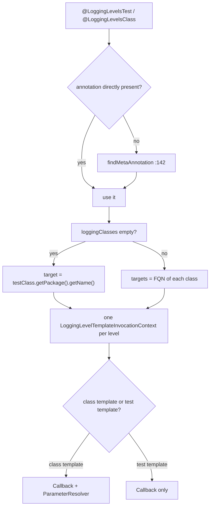
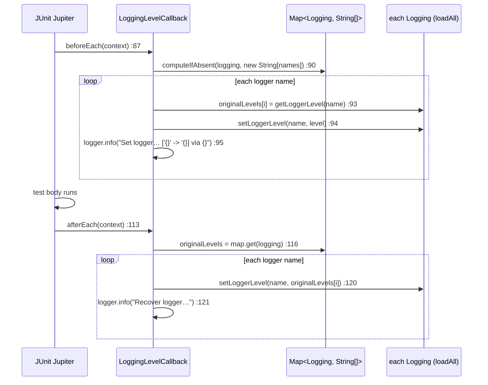

# microsphere-logging-test — Source Analysis

[中文版](./zh/logging-test.md)

> Maven module: `io.github.microsphere-projects:microsphere-logging-test` · Branch `release` · Version
> `0.2.3-SNAPSHOT` · Java 8 · JUnit 4 **13.2** / JUnit Jupiter **5.13.1** · 10 production classes.

User-facing reference: [../../user-guide/current/logging-test.md](../../user-guide/current/logging-test.md)

---

## 1. Position in the architecture

```mermaid
graph TD
    subgraph jupiter["Jupiter support"]
        ALT["@LoggingLevelsTest<br/>@Target METHOD"]
        ALC["@LoggingLevelsClass<br/>@Target TYPE"]
        TE[LoggingLevelsTestExtension]
        CE[LoggingLevelsClassExtension]
        EXT[LoggingLevelsExtension&lt;A&gt;<br/>abstract base]
        CTX[LoggingLevelTemplateInvocationContext]
        CB[LoggingLevelCallback]
        PR[LoggingLevelParameterResolver]
        AT[LoggingLevelsAttributes]
    end

    subgraph junit4["JUnit 4 support"]
        RULE[LoggingLevelsRule<br/>implements TestRule]
        ST[LoggingLevelsStatement<br/>extends Statement]
    end

    ALT -->|@ExtendWith :45| TE
    ALC -->|@ExtendWith :45| CE
    TE -->|extends| EXT
    CE -->|extends| EXT
    EXT -->|builds 1 per level| CTX
    EXT -->|reads attributes| AT
    CTX -->|registers| CB
    CTX -->|"registers only when isClassTemplate"| PR
    RULE -->|apply| ST
    EXT -->|LoggingUtils.loadAll| COMMONS[microsphere-logging-commons]
    CB --> COMMONS
    ST --> COMMONS
```

The module depends on `microsphere-logging-commons` (`${revision}`) and marks `microsphere-java-core`, `junit`,
`junit-jupiter` and `junit-jupiter-engine` **optional** — the whole design rests on that: a consumer chooses JUnit 4 or
Jupiter (or both), and the unused flavour simply never loads. Its own test scope adds `microsphere-logback`,
`logback-classic`, `slf4j-api`, `microsphere-java-test` and `junit-vintage-engine`, which is why the repository's
level-matrix tests exercise exactly one backend.

## 2. Annotations are carriers, extensions do the work

```java
// LoggingLevelsTest.java:40-46 (LoggingLevelsClass.java:40-46 is the TYPE-level twin)
@Target({ANNOTATION_TYPE, METHOD})
@Retention(RUNTIME)
@ExtendWith(LoggingLevelsTestExtension.class)
public @interface LoggingLevelsTest {
    Class<?>[] loggingClasses() default {};   // :53
    String[] levels();                        // :60
}
```

`ANNOTATION_TYPE` in the `@Target` list is what makes composition work — the repository's own example:

```java
// test-case evidence — DefaultLoggingLevelsClass.java
@LoggingLevelsClass(loggingClasses = {...}, levels = {...})
@Retention(RUNTIME)
@Target(TYPE)
public @interface DefaultLoggingLevelsClass {}
```

Both `levels()` are **required** (no default), so a bare `@LoggingLevelsTest` is a compile error; `loggingClasses()`
defaults to an empty array, which triggers the package-name fallback (section 4).

## 3. `LoggingLevelsExtension<A>` — one class, two JUnit 5 SPIs

The base class implements **both** provider interfaces at once (`LoggingLevelsExtension.java:56-57`):
`ClassTemplateInvocationContextProvider` *and* `TestTemplateInvocationContextProvider`. The two concrete subclasses are
32-line shells that only supply the generic argument; the annotation type is recovered reflectively from that
parameter:

```java
// LoggingLevelsExtension.java:70-78
public LoggingLevelsExtension() {
    this.annotationType = resolveAnnotationType();
}

private Class<A> resolveAnnotationType() {
    return from(getClass()).as(LoggingLevelsExtension.class).getGenericType(0).toClass();
}
```

`supportsClassTemplate` / `supportsTestTemplate` both return `true` unconditionally (`:91-92`, `:105-106`) — the
extension does not self-select. That is safe only because registration happens through `@ExtendWith` on the annotation,
so JUnit asks the extension precisely where the annotation is present. Both entry points funnel into one method with a
boolean flag (`:121`, `:163`):

```java
// LoggingLevelsExtension.java:180-197
protected Stream<LoggingLevelTemplateInvocationContext> provideInvocationContexts(ExtensionContext context, boolean isClassTemplate) {
    ClassLoader classLoader = getClassLoader(getClass());        // :181 the *extension's* CL, not the test's
    List<Logging> loggins = loadAll(classLoader);                // :182 every backend, not load()
    LoggingLevelsAttributes attributes = getLoggingLevelsAttributes(context, isClassTemplate);
    String[] levels = attributes.levels;
    String[] loggerNames = getLoggerNames(context, attributes);
    ...
    for (int i = 0; i < length; i++) {
        contexts.add(i, new LoggingLevelTemplateInvocationContext(loggins, loggerNames, levels[i], i, isClassTemplate));
    }
}
```

Three design decisions are visible here and all three are load-bearing:

- **`loadAll()`, not `load()`** (`:182`): one level matrix drives *every* backend on the classpath, which is why level
  names must be valid for all of them.
- **One context per level, indexed** (`:191-194`): `index` is carried into the context, so the display name and the
  injected parameter agree with the `levels` array position.
- The classloader used is `getClassLoader(getClass())` — the extension class' own loader, which under Surefire's
  non-system-classloader mode is what makes cross-backend discovery work at all.

### Attribute resolution, including meta-annotations

```java
// LoggingLevelsExtension.java:138-149
AnnotatedElement annotatedElement = isClassTemplate ? context.getRequiredTestClass() : context.getRequiredTestMethod();
A annotation = annotatedElement.getAnnotation(annotationType);
if (annotation == null) {                       // :141-143
    annotation = findMetaAnnotation(annotatedElement, annotationType);
}
Map<String, Object> annotationAttributes = getAttributesMap(annotation);
attributes.loggingClasses = (Class<?>[]) annotationAttributes.get("loggingClasses");
attributes.levels = (String[]) annotationAttributes.get("levels");
```

The `findMetaAnnotation` fallback (`:142`) is what lets `@DefaultLoggingLevelsClass` behave exactly like
`@LoggingLevelsClass`. The two attribute names are read as **string literals** off the attribute map (`:146-147`), so
renaming an annotation member silently yields `null` arrays here rather than a compile error — a maintenance trap
worth knowing before touching the annotation.

### Logger-name fallback

```java
// LoggingLevelsExtension.java:213-220
if (isEmpty(loggingClasses)) {
    return ofArray(context.getRequiredTestClass().getPackage().getName());
}
return of(loggingClasses).map(Class::getName).toArray(String[]::new);
```

Empty `loggingClasses` ⇒ the **whole test-class package** becomes the single target logger name. Non-empty ⇒ one name
per class. Never empty, so `LoggingLevelCallback` always has at least one name to set.



## 4. `LoggingLevelTemplateInvocationContext` — the `isClassTemplate` gate

One class implements both context interfaces (`LoggingLevelTemplateInvocationContext.java:39`,`:100-107`) and returns
`"[" + level + "]"` as the display name, ignoring `invocationIndex` (`:86-88`) — which is why reports read
`[TRACE]`, `[DEBUG]` rather than `[1]`, `[2]`.

The interesting line is how many extensions it registers:

```java
List<Extension> extensions = newArrayList(this.isClassTemplate ? 2 : 1);
extensions.add(new LoggingLevelCallback(this.loggins, this.loggerName, this.level));
if (this.isClassTemplate) {
    extensions.add(new LoggingLevelParameterResolver(this.level, this.index));
}
```

So **parameter injection only exists for class templates**. A `void test(String level, int index)` under
`@LoggingLevelsClass` works; the same signature under method-level `@LoggingLevelsTest` fails parameter resolution,
because the method flavour registers only the callback. That asymmetry is not documented on the annotation itself —
it is a consequence of `getAdditionalExtensions()`, and it is the reason
`LoggingLevelsTestTest.test()` is declared with no parameters (`LoggingLevelsTestTest.java:34-41`).

`LoggingLevelParameterResolver` itself is trivial and package-private (`LoggingLevelParameterResolver.java:35`):
`supportsParameter` accepts exactly `String.class` or `int.class` (`:68-71`), `resolveParameter` returns the level name
for `String` and the index otherwise (`:84-90`). Any other parameter type is simply unsupported, so a `char`/enum
parameter produces the usual Jupiter "no ParameterResolver" error rather than a conversion attempt.

## 5. `LoggingLevelCallback` — record, apply, restore (and why restore is not neutral)



Reading `:87-124` gives four concrete implications:

1. **Original levels are captured per backend, per name** in a `Map<Logging, String[]>` (`:50`, filled at `:90`). The
   map is a plain `HashMap` field, so a `@LoggingLevelsClass` matrix run under JUnit's parallel execution would race;
   nothing in the class synchronises.
2. **Restore is only as good as what was recorded.** `getLoggerLevel` can legitimately return `null` (contract:
   logger absent) or `""` (contract: level inherited), and both are fed straight back into `setLoggerLevel(name, …)`.
   On Logback/Log4j/Log4j2 `null` reaches `Level.toLevel(null)` ⇒ **DEBUG**, so the logger ends up pinned at DEBUG
   instead of inheriting — `Log4j2UtilsTest` proves the mechanism directly:

   ```java
   // test-case evidence — Log4j2UtilsTest.java:128-130
   // null string -> toLevel(null) => DEBUG
   Log4j2Utils.setLoggerLevel(logger, (String) null);
   assertEquals(Level.DEBUG, Log4j2Utils.getLevel(logger));
   ```

   On JUL the mirror problem appears with `""`: `Level.parse("")` does not resolve a level, and the resulting
   `NumberFormatException` *is* an `IllegalArgumentException`, so `afterEach` can throw for a logger that never had a
   declared level. This is why the shipped tests assert only on levels they explicitly set.
3. **`afterEach` assumes `beforeEach` ran** — `loggingsWithoriginalLevels.get(logging)` (`:116`) is dereferenced at
   `:119` without a null check, so a callback whose before-hook was skipped (or a backend added between the two)
   fails with NPE.
4. The info message at `:95` is `Set logger[name :'{}']s' level ['{}' -> '{}] via {}` — the closing quote after
   `levelName` is missing in the source, so log-parsing rules must not assume a well-formed pattern. `:121` repeats the
   same wording for the recovery line.

## 6. JUnit 4: `LoggingLevelsRule` and the Statement loop

`LoggingLevelsRule` is a two-method class: a factory `levels(String...)` (`LoggingLevelsRule.java:68-70`) and
`apply(base, description)` returning a `LoggingLevelsStatement` (`:51-53`). There is **no** `loggingClasses`
equivalent — the JUnit 4 flavour can only target the test class' package.

```java
// LoggingLevelsStatement.java:81-99
String loggerName = testClass.getPackage().getName();
List<Logging> loggins = loadAll(getClassLoader(testClass));
for (Logging logging : loggins) {                       // outer loop: backends
    String originalLevel = logging.getLoggerLevel(loggerName);
    try {
        for (String level : levels) {                   // inner loop: levels
            description.addChild(createTestDescription(... + " with logging level - " + level));
            logging.setLoggerLevel(loggerName, level);
            next.evaluate();
        }
    } finally {
        logging.setLoggerLevel(loggerName, originalLevel);
    }
}
```

Three properties follow directly:

- `this.levels = ofSet(levels)` in the constructor (`:66`) **de-duplicates**, so `"DEBUG","DEBUG"` iterates once — and
  because it is a `Set`, iteration order is the set's own, not the declaration order.
- The nesting means the body runs **backends × levels** times, not `levels` times. With one backend and three levels
  you get three evaluations; add a second backend and you get six.
- `description.addChild(...)` (`:90`) synthesises child descriptions *during* evaluation, so reports show one entry per
  level even though JUnit 4 has no native template concept. The `finally` at `:94-97` restores per backend, which means
  an exception in one backend's loop still lets later backends run their own restore.

## 7. Why Jupiter 5.13+ is required

`LoggingLevelsExtension` implements `ClassTemplateInvocationContextProvider` (`:56`), an interface introduced by
JUnit's class-template support; a Jupiter version without it cannot compile the module. The **method-level** flavour
needs only the long-standing `TestTemplateInvocationContextProvider`, so a project that never uses
`@LoggingLevelsClass` technically only exercises that half — but the artifact itself is compiled against 5.13.1, so
that is the floor for the dependency.

## 8. Tests as specification

| Test | Pins |
|------|------|
| `LoggingLevelsTestTest` (`:29-41`) | method-level matrix with two `loggingClasses`; body has **no injected parameters**; asserts through `loadAll()` that neither backend reports `"INFO"` |
| `LoggingLevelsClassTest` + `DefaultLoggingLevelsClass` | composed meta-annotation resolves through `findMetaAnnotation`; `void test(String level, int index)` receives the level name and index |
| `LoggingLevelsRuleTest` | `@ClassRule` usage with `levels("TRACE","DEBUG","INFO")` |
| `LoggingLevelParameterResolverTest` | `String`/`int` support, other types rejected |
