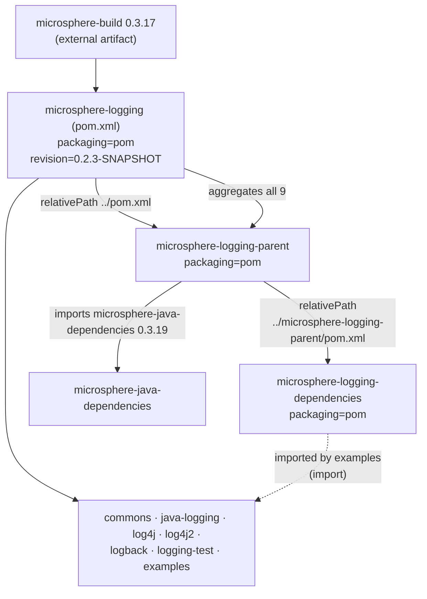
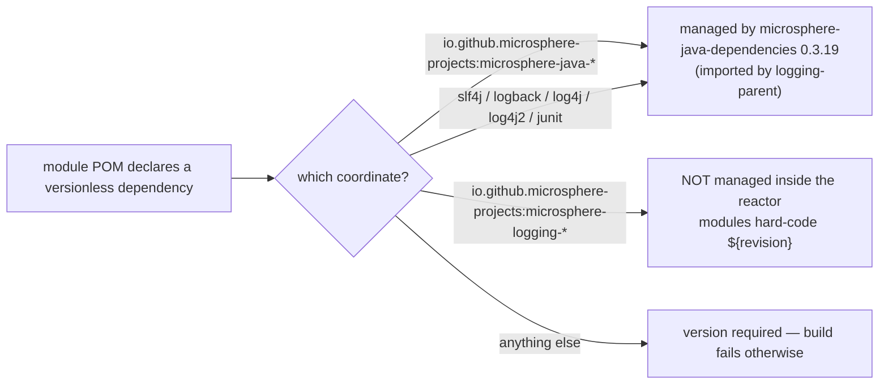
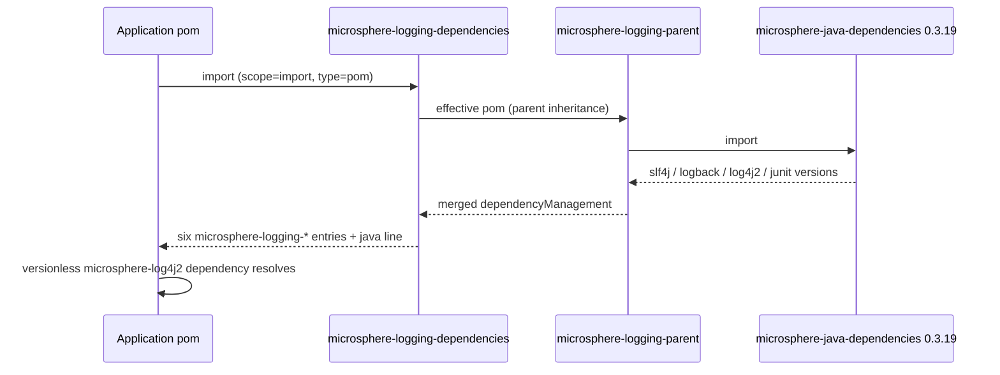

# microsphere-logging-parent & microsphere-logging-dependencies — Source Analysis

[中文版](./zh/parent-and-dependencies.md)

> Build-layer modules: `microsphere-logging-parent` and `microsphere-logging-dependencies`, plus the root aggregator
> `microsphere-logging`. Branch `release` · `${revision}` = `0.2.3-SNAPSHOT` · no Java sources in any of the three.

User-facing reference: [../../user-guide/current/parent-and-dependencies.md](../../user-guide/current/parent-and-dependencies.md)

---

## 1. Three POMs, three different jobs



| POM | artifactId | Packaging | Role | Has `<modules>`? | Has `<dependencyManagement>`? |
|-----|-----------|-----------|------|------------------|-------------------------------|
| root `pom.xml` | `microsphere-logging` | `pom` | aggregator **and** grandparent | yes, 9 (`:58-68`) | no |
| `microsphere-logging-parent` | `microsphere-logging-parent` | `pom` | shared parent for library modules | **no** | yes — imports `microsphere-java-dependencies` (`:25-38`) |
| `microsphere-logging-dependencies` | `microsphere-logging-dependencies` | `pom` | BOM for consumers | no | yes — six project artifacts (`:25-61`) |

The split between root and parent is the first thing to understand: the **root** owns reactor membership and project
identity (licenses, developers, SCM — `pom.xml:18-52`), while **`microsphere-logging-parent`** owns only dependency
versions. That is why the parent POM declares `<relativePath>../pom.xml</relativePath>` (`:9`) instead of the other
way round, and why it holds no `<modules>` element: adding a module to the reactor means editing the root, never the
parent.

## 2. Version flow — `${revision}` end to end

```
properties: revision = 0.2.3-SNAPSHOT        (root pom.xml:55)
      ↓ inherited by every module
module <version>${revision}</version>         (parent :16, BOM :14, every jar module)
      ↓ used verbatim for intra-project deps
<dependency><artifactId>microsphere-logging-commons</artifactId>
            <version>${revision}</version></dependency>      (adapters' POMs)
      ↓ and for BOM entries
BOM dependencyManagement → <version>${revision}</version>    (BOM :25-61)
```

Two consequences that matter when changing versions:

- **CI overwrites `revision`**: `.github/workflows/maven-build.yml:38-44` passes `-Drevision=0.0.1-SNAPSHOT`, so the
  reactor never builds or publishes the literal POM value during CI. Bumping `revision` in `pom.xml:55` is a release
  step, not a build step.
- **Adapters do not consume the BOM.** Inside the reactor they hard-code `${revision}` on their `commons`
  dependency; the BOM exists for *external* consumers. So a module version bump is a one-property change, but a BOM
  that has drifted from `${revision}` would not be caught by the build.

`microsphere-logging-parent` and `microsphere-logging-examples` are themselves **absent** from the BOM's managed list:
the BOM covers the six artifacts intended for consumption (`commons`, `java-logging`, `logback`, `log4j2`, `log4j`,
`logging-test`).

## 3. The parent's single job: pinning the `microsphere-java` line

```xml
<!-- microsphere-logging-parent/pom.xml:21-38 -->
<properties>
    <microsphere-java.version>0.3.19</microsphere-java.version>
</properties>

<dependencyManagement>
    <dependencies>
        <dependency>
            <groupId>io.github.microsphere-projects</groupId>
            <artifactId>microsphere-java-dependencies</artifactId>
            <version>${microsphere-java.version}</version>
            <type>pom</type>
            <scope>import</scope>
        </dependency>
    </dependencies>
</dependencyManagement>
```

This import is why every module POM can write `<artifactId>microsphere-java-core</artifactId>` **without a version**,
and why third-party versions (slf4j `2.0.18`, logback `1.6.3`, log4j `1.2.17`, log4j2 `2.9.1`, JUnit `4.13.2`,
Jupiter `5.13.1`) also resolve without a version in this repository: they are all governed transitively by
`microsphere-java-dependencies`.



The single knob for upgrading the whole third-party stack is therefore
`microsphere-logging-parent/pom.xml:22` (`microsphere-java.version`). Changing it is a cross-module change: the level
vocabulary resolved by `DefaultLoggingLevelsResolver` depends on the concrete Logback/Log4j/Log4j2 versions that come
out of the imported BOM, so the per-backend `ALL_LEVELS` sets can shift.

## 4. The BOM

`microsphere-logging-dependencies` inherits `microsphere-logging-parent` (BOM `:4-10`) and does nothing else: its
entire body is a `<dependencyManagement>` block of six `${revision}` entries. Being a child of the parent means the
BOM also inherits the `microsphere-java-dependencies` import — so an application that imports **only**
`microsphere-logging-dependencies` still gets the java-line versions resolved, which is what makes the versionless
consumer snippet in the user guide work.



## 5. Reactor order and why it is not the `<modules>` order

The root lists modules in declaration order (`pom.xml:58-68`):

```
microsphere-logging-parent, microsphere-logging-dependencies, microsphere-logging-commons,
microsphere-java-logging, microsphere-log4j, microsphere-log4j2, microsphere-logback,
microsphere-logging-test, microsphere-logging-examples
```

Maven reorders by dependency graph, so the actual build runs `parent → dependencies → commons → {java-logging, log4j,
log4j2, logback} → logging-test → examples`. The four adapters are mutually independent siblings and may build in
either relative order — nothing may be assumed about them.

## 6. Invariants to preserve when editing these POMs

| Invariant | How it breaks |
|-----------|---------------|
| Every module keeps `<version>${revision}</version>` and `<relativePath>` pointing at its real parent | a literal version turns every future release into a multi-file edit |
| New published artifact ⇒ add it to the BOM | consumers must know the version themselves; the versionless snippet in the docs becomes wrong |
| `microsphere-logging-parent` stays free of `<modules>` | the reactor silently splits; a module can be built by CI and missed by releases |
| BOM version equals `${revision}` | mixing `microsphere-logging-*` artifacts of different versions, which the user guide explicitly rules out |
| The `microsphere-java.version` property lives in the parent, not the root | the java line stops applying to the modules |
