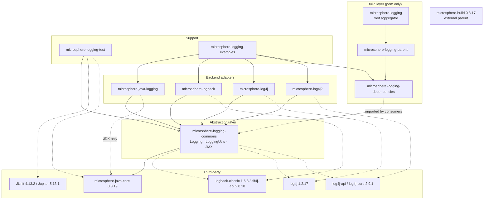
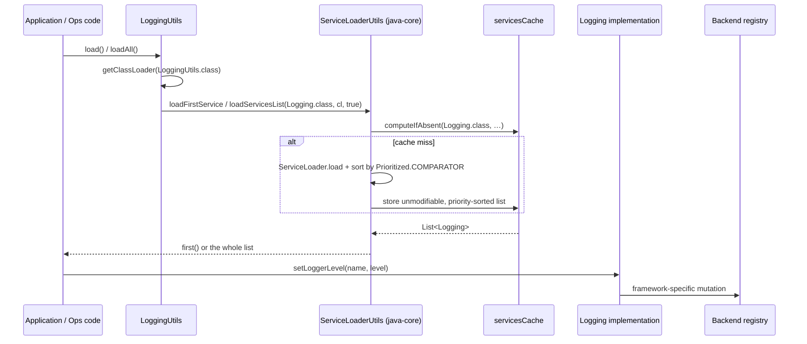
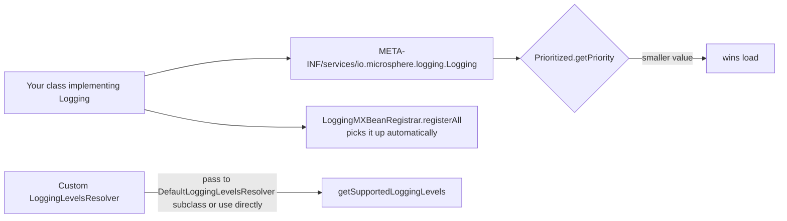

# 架构

[English version](../architecture.md)

> 分析的分支：`release` · 版本 `0.2.3-SNAPSHOT`（最新已发布版本 `0.2.2`）
> Java **8** 基线 —— 本仓库中没有任何 POM 声明 compiler release，它继承自外部
> `microsphere-build` 父 POM（`pom.xml:6-10`，`release` 分支上的版本为 `0.3.17`）。CI 构建 Java 8、11、17、21、25
> （`.github/workflows/maven-build.yml:25`）。

---

## 1. 设计目标

本项目把**被管理的对象**（某个日志设施的运行期配置）与**管理它的方式**
（框架相关的注册表访问）分离开来。这条接缝之上的一切都与具体框架无关：

```
callers (ops code / JMX / JUnit)  ->  Logging SPI  ->  backend adapter  ->  Logback / Log4j / Log4j2 / JUL registry
```

这一拆分带来的后果：

- 新增后端永远不会触及 `microsphere-logging-commons`；
- 一个应用可以同时携带多个后端，却仍然只有一个管理入口；
- 这层抽象是有意*有损*的 —— 它只建模级别查询/修改与 logger 枚举，因此
  后端特有的能力（appender、filter、marker）只能通过该后端自己的 utils 触达。

## 2. 模块依赖图

箭头表示“编译期依赖”。`optional` 的 Maven 依赖以虚线绘制；它们的存在是为了让模块可以针对某个框架编译，而该框架
必须由使用者自行提供。



根据各模块 POM 验证过的关键结构事实：

- **根** `pom.xml` 是聚合模块（`<revision>0.2.3-SNAPSHOT</revision>`，`:52`）；它继承
  `microsphere-build`（`:6-9`），并列出全部九个模块（`:56-66`）。
- `microsphere-logging-parent/pom.xml` **并不是**聚合模块：它通过
  `<relativePath>../pom.xml</relativePath>`（`:5-10`）继承根 POM，并且只导入
  `microsphere-java-dependencies` `${microsphere-java.version}` = `0.3.19`（`:22`、`:28-34`）。它**没有**声明
  `<modules>` 段，也没有为项目自身构件声明 `<dependencyManagement>`。
- `microsphere-logging-dependencies/pom.xml` 是 BOM：它通过
  `<relativePath>../microsphere-logging-parent/pom.xml</relativePath>`（`:4-10`）继承
  `microsphere-logging-parent`，并把六个已发布的构件锁定到 `${revision}`（`:26-61`）。
- `microsphere-logback` 与 `microsphere-log4j2` **彼此不依赖**；它们是兄弟模块，通过不同的第三方 API 抵达同一个
  `Logging` 接口。

## 3. 运行期分层



这些 `Logging` 实现是某个框架*当前*配置之上的**无状态门面**：它们自己都不持有一份 logger 注册表。
`JavaLogging` 借用 JDK 的 `LoggingMXBean`（`JavaLogging.java:56`），而 `LogbackLogging`、`Log4jLogging` 和
`Log4j2Logging` 委托给 `LogbackUtils` / `Log4jUtils` / `Log4j2Utils`，
后者每一个都会在类初始化时把注册表缓存到一个静态字段中
（`LogbackUtils.java:38`、`Log4jUtils.java:39`）。

## 4. 使用的设计模式

| 模式 | 位置 | 证据 |
|---------|-------|----------|
| **策略 + 提供者（Java SPI）** | 通过 `META-INF/services` 发现的 `Logging` 实现 | `microsphere-java-logging/…/META-INF/services/io.microsphere.logging.Logging`、`…/LoggingUtils.java:57-59` |
| **按优先级排序的解析** | `Prioritized` + `Prioritized.COMPARATOR`（升序） | `LoggingUtils.java:68-70` → `ServiceLoaderUtils.loadFirstService` |
| **门面** | `LogbackUtils`、`Log4jUtils`、`Log4j2Utils`、`LoggingUtils`、`LoggingMXBeanRegistrar` | 抽象类 + 私有构造器（`LoggingUtils.java:84`、`LogbackUtils.java:159`） |
| **适配器** | `LoggingMXBeanAdapter` 把 `Logging` 映射到 `java.util.logging.LoggingMXBean` | `LoggingMXBeanAdapter.java:34` |
| **委托包装器（Delegating Wrapper）** | `Log4j2Logger`、`Log4jLogger`、`LoggingMXBeanAdapter` 实现 `DelegatingWrapper#getDelegate()` | `Log4j2Logger` + `LoggingMXBeanAdapter.java:126` |
| **单例（饿汉式、公有字段）** | `DefaultLoggingLevelsResolver.INSTANCE` | `DefaultLoggingLevelsResolver.java:37`（不是 `final`） |
| **模板方法** | `DefaultLoggingLevelsResolver.resolve()` 骨架，配合为子类化准备的 `protected` 构造器 | `DefaultLoggingLevelsResolver.java:39-40,52-59` |
| **注册表 / 注册器** | `LoggingMXBeanRegistrar.register/registerAll` | `LoggingMXBeanRegistrar.java:96,77` |
| **以接口默认方法充当共享模板** | `Logging.getParentLoggerName()` 的默认实现，仅被 `JavaLogging` 覆盖 | `Logging.java:118-128` |
| **空值安全降级** | `LogbackUtils.getLevel(null)` → `null`；`setLoggerLevel(null, …)` → 空操作 | `LogbackUtils.java:91-99,119-131` |
| **不可变的防御性视图** | `unmodifiableSet` / `unmodifiableList` 返回值 | `DefaultLoggingLevelsResolver.java:52-59`、`LoggingMXBeanRegistrar.java:86` |
| **语句链（Chain of Statements，JUnit 4）** | `LoggingLevelsRule` → `LoggingLevelsStatement` | `LoggingLevelsRule#apply`、`LoggingLevelsStatement#evaluate` |
| **扩展 + InvocationContext + 回调 + 参数解析器（Jupiter）** | `LoggingLevelsExtension`、`LoggingLevelTemplateInvocationContext`、`LoggingLevelCallback`、`LoggingLevelParameterResolver` | `microsphere-logging-test/…/jupiter/extension/logging/*` |
| **组合（元）注解** | `@LoggingLevelsTest` / `@LoggingLevelsClass` 携带 `@ExtendWith`；`@DefaultLoggingLevelsClass` 将二者组合 | `microsphere-logging-test/src/test/...` 下的测试源码 |

有意**不**使用的模式：级别变更上的 Observer/监听器（级别修改是拉取式的）、用于构造 `Logging`
的 Builder，以及除 java-core 中那个 SPI 缓存之外的任何形式的全局可变配置缓存。

## 5. 扩展点



新增一个后端恰好需要四样东西：

1. 一个实现 `io.microsphere.logging.Logging` 的类
   （`getRootLoggerName`、`getLoggerNames`、`getSupportedLoggingLevels`、`getLoggerLevel`、`setLoggerLevel`、
   `getName`、`getPriority`）；
2. 一条 `META-INF/services/io.microsphere.logging.Logging` 条目 —— 没有它 `LoggingUtils.load()` 会抛出
   `IllegalArgumentException`；
3. 一个优先级数值，并记住**越小越优先**；
4. 如果你还希望 `getLogger(...)` 通过统一门面路由，可选地提供一条 `io.microsphere.logging.LoggerFactory` 服务条目。
   `microsphere-log4j` 和 `microsphere-log4j2` 注册了两个服务，并且为这一对复用同一个优先级常量
   （`Log4jLogging.PRIORITY`、`Log4j2Logging.PRIORITY`）。

JMX 层不需要任何注册工作：`LoggingMXBeanRegistrar.registerAll()` 会遍历 SPI
加载器返回的全部内容。

## 6. 构建与测试命令

```bash
# the reactor's own test invocation, as run by CI (Java 8 / 11 / 17 / 21 / 25)
mvn --batch-mode --update-snapshots --file pom.xml \
    -Drevision=0.0.1-SNAPSHOT \
    -Dsurefire.useSystemClassLoader=false \
    test --activate-profiles test,coverage
```

依据 POM 与 workflow 验证过的说明：

- 反应堆中没有任何 POM 设置 `skipTests`，因此 `mvn test` 会运行各模块测试，包括来自 `microsphere-logging-test` 的
  `@LoggingLevelsClass` 与 `@LoggingLevelsRule` 模板。
- `-Dsurefire.useSystemClassLoader=false` 在这里很关键：适配器是通过 `ServiceLoader` 发现的，而
  测试断言的是类加载器可见的注册表。
- `-Drevision=0.0.1-SNAPSHOT` 覆盖了 `${revision}` 属性（`pom.xml:55`），因此 CI 绝不会发布真实的
  版本；本地 `mvn package` 会解析为 `0.2.3-SNAPSHOT`。
- `microsphere-logging-examples` **没有**配置 `exec-maven-plugin`；请从 IDE 运行它的 `main` 类，或者
  先构建反应堆，再使用 `mvn -pl microsphere-logging-examples -am package` 加上普通的 `java -cp`。

## 7. 各模块文档

- [microsphere-logging-commons](./logging-commons.md) —— 抽象层、SPI 加载、级别解析、JMX
- [microsphere-java-logging](./java-logging.md) —— JUL 委托
- [microsphere-logback](./logback.md) —— Logback 适配器与 utils
- [microsphere-log4j](./log4j.md) —— Log4j 1.x 适配器、`LoggerFactory` SPI
- [microsphere-log4j2](./log4j2.md) —— Log4j2 适配器、appender/layout 机制
- [microsphere-logging-test](./logging-test.md) —— JUnit 4 规则与 Jupiter 模板扩展
- [microsphere-logging-parent 与 -dependencies](./parent-and-dependencies.md) —— 构建层
- [microsphere-logging-examples](./examples.md) —— 四后端演示
