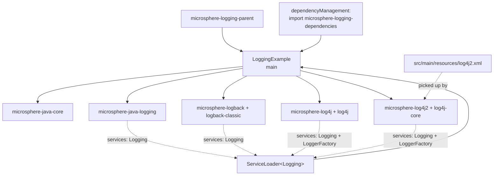
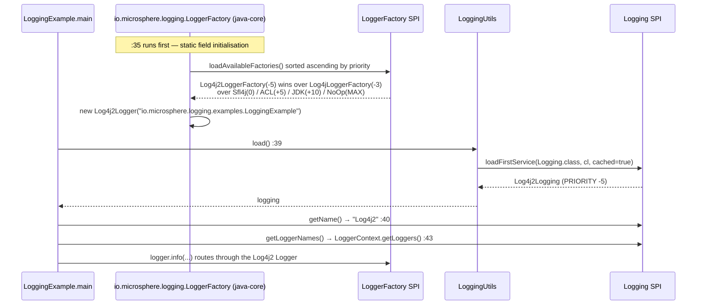

# microsphere-logging-examples — 源码分析

[English version](../examples.md)

> Maven 模块：`io.github.microsphere-projects:microsphere-logging-examples` · 分支 `release` · 版本
> `0.2.3-SNAPSHOT` · **一个生产类，没有测试** —— 仓库的集成冒烟检查。

面向用户的参考文档：[../../../user-guide/current/zh/examples.md](../../../user-guide/current/zh/examples.md)

---

## 1. 在架构中的位置

本模块刻意成为全部四个适配器共存于一条 classpath 上的*唯一*场所。其它任何地方，每个适配器都只
针对自己的后端做隔离测试；这里则真实地演练了 SPI 优先级顺序。



`microsphere-logging-examples/pom.xml` 就是本仓库对使用者指南中记录的消费方模式的实战示例：它继承
`microsphere-logging-parent`（`:5-10`），在自己的 `<dependencyManagement>` 中导入
`microsphere-logging-dependencies`（`:21-34`），然后声明每一个依赖时都**不带版本**（`:36+`）：
`microsphere-java-core`、`microsphere-java-logging`、`microsphere-logback`、`logback-classic`、`microsphere-log4j`、
`log4j`、`microsphere-log4j2`、`log4j-core`。

该列表中有两个细节至关重要且容易被忽略：

- `microsphere-java-core` 是**显式**声明的。其它模块都把它标为 `optional`，所以没有任何东西会把它传递地
  带进来 —— 忘记声明它的消费方会在 `LoggingUtils` 上遇到 `NoClassDefFoundError`。
- 适配器的框架依赖是手工声明的（`logback-classic`、`log4j`、`log4j-core`），原因相同：适配器也把自己的
  那些依赖标为 optional。

## 2. 示例本身

```java
// LoggingExample.java:33-45
public class LoggingExample {

    private static final Logger logger = getLogger(LoggingExample.class);   // :35

    public static void main(String[] args) {
        Logging logging = load();                                           // :39
        logger.info("The name of Logging : {}", logging.getName());         // :40
        logger.info("All logger names of Logging : {}", logging.getLoggerNames());  // :43
    }
}
```

方法体只有四行，但它们走遍了项目的每一层，并且解析出**两个彼此独立的 SPI 决策**，而
这两者常常被混淆：



- **第 `:35` 行选择的是一个 `LoggerFactory`**，不是 `Logging`。java-core 用同一个升序的
  `Prioritized.COMPARATOR` 对已注册的工厂排序，并丢弃那些其框架无法加载的工厂，因此 `Log4j2LoggerFactory`
  （`-5`）会排在 `Log4jLoggerFactory`（`-3`）、`Sfl4jLoggerFactory`（`0`）、`ACLLoggerFactory`（`+5`）、
  `JDKLoggerFactory`（`+10`）和 `NoOpLoggerFactory`（`MIN_PRIORITY`）之前被选中。
- **第 `:39` 行选择的是一个 `Logging`**，在 `Logging` 服务文件上使用完全相同的规则：`Log4j2Logging`（`-5`）
  胜过 `Log4jLogging`（`-3`）、`LogbackLogging`（`0`）和 `JavaLogging`（`+10`）。

由于这两个决策使用同一套排序，示例自己打印出的那行日志和它输出的被管理对象来自*同一个*后端 ——
这正是读者应当能够一眼验证的性质。

给定 `log4j2.xml`（root 级别 `INFO`，`Console` appender `STDOUT`，pattern `[%t] %p %c - %m%n`），两次
`logger.info` 调用都高于 root 阈值，因此会被打印，于是期望的输出形态是：

```
[main] INFO io.microsphere.logging.examples.LoggingExample - The name of Logging : Log4j2
[main] INFO io.microsphere.logging.examples.LoggingExample - All logger names of Logging : [...]
```

第二行的列表来自那一刻的 `LoggerContext.getLoggers()`，也就是 Log4j2 当时已注册的内容 ——
它是运行时状态而非配置，跨运行并不稳定。这是 API 固有的性质
（`Logging.getLoggerNames()` 定义在*当前已注册*的 logger 之上），而不是示例的缺陷。

## 3. 为什么该模块只带有 `log4j2.xml`

`src/main/resources` 恰好只有一个文件，`log4j2.xml`。Logback 与 Log4j 1.x 在 classpath 上没有任何
属于自己的配置，于是回退到各自的默认值。这是有意为之：示例演示 `load()` 解析到优先级最高的后端，
打印出的 `Log4j2` 就是证明，而其它后端保持沉默。若再加一个 `logback.xml` 或
`log4j.properties`，同一次运行就会为一次调用发出三套输出，
从而把要点淹没掉。

## 4. 该模块**不做**什么

| 缺失 | 后果 |
|--------|-------------|
| `src/test/java` | reactor 从不对本模块做任何断言；CI 只编译它 |
| `exec-maven-plugin`（reactor 配置中没有 POM 配置它） | 运行它需要 IDE 的运行配置，或在 `mvn -pl microsphere-logging-examples -am package` 之后手工执行 `java -cp` |
| 每个后端各一个 `main` | 它无法演示 `loadAll()` 或仅有 JUL/Logback 的视角；[logging-test 指南](./logging-test.md) 改为覆盖按后端的级别矩阵 |
| `microsphere-logging-test` 依赖 | 该示例不是测试支撑的消费方 —— 这两个角色永不相交 |

## 5. 模式

| 模式 | 位置 | 说明 |
|---------|-------|------|
| BOM 消费方，实战示例 | `microsphere-logging-examples/pom.xml:22-33` + 无版本的依赖 | 使用者指南照抄的规范片段 |
| 静态初始化顺序 | `LoggingExample.java:35` vs `:39` | `Logger` 在 `load()` 被调用之前就已存在；两次独立的 SPI 查找 |
| 最高优先级者胜的演示 | 整个类 | `load()` 打印 `Log4j2` 就是那张优先级表的可观测证明 |
| 配置即文档 | `log4j2.xml` | 一个 console appender，root `INFO`，`%p %c` pattern，让打印出的那一行能识别后端 |
