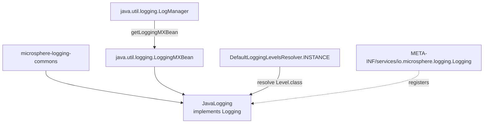

# microsphere-java-logging — 源码解析

[English version](../java-logging.md)

> Maven 模块：`io.github.microsphere-projects:microsphere-java-logging` · 分支 `release` · 版本
> `0.2.3-SNAPSHOT` · Java 8 · **只有一个生产类**：`io.microsphere.logging.jdk.JavaLogging`。

面向用户的参考：[../../../user-guide/current/zh/java-logging.md](../../../user-guide/current/zh/java-logging.md)

---

## 1. 在架构中的位置

这是*参考实现*适配器：它完全不需要任何第三方库。它的 POM 把 `microsphere-logging-commons`
（`${revision}`）作为唯一非可选的 compile 依赖，把 `microsphere-java-annotations` 与
`microsphere-java-core` 标记为 `<optional>true</optional>`，并在 test 作用域引入 `junit-jupiter` + `junit-jupiter-engine`。



只注册 `Logging` 服务（而*不*注册 `io.microsphere.logging.LoggerFactory`）是一种刻意的不对称 ——
见第 5 节。

## 2. `JavaLogging` —— 一次静态绑定，七处一行委托

```java
// JavaLogging.java:42,47,54,56
public static final String ROOT_LOGGER_NAME = "";
public static final int PRIORITY = NORMAL_PRIORITY + 10;
public static final Set<String> ALL_LEVELS = INSTANCE.resolve(Level.class);
static final LoggingMXBean loggingMXBean = getLoggingMXBean();
```

第四行在结构上最值得关注：

- `loggingMXBean` 是**包级私有、`static`、且在类初始化时完成初始化**的
  （`JavaLogging.java:56`）。因此 `JavaLogging` 没有任何构造器状态，也没有实例字段；访问 JDK 注册表
  只能通过这一个共享句柄。倘若 `LogManager.getLoggingMXBean()` 曾经失败，这一失败会以
  `ExceptionInInitializerError` 的形式出现在**首次触碰该类的时刻**，也就是
  `LoggingUtils.loadAll()` 内部 `ServiceLoader` 实例化期间 —— 而不是在某个 `Logging` 方法内部。
- 绑定的类型 `java.util.logging.LoggingMXBean` **自 Java 9 起已废弃**（SE 11 的 javadoc 在该接口和
  `LogManager.getLoggingMXBean()` 上都带有 `@Deprecated(since = "9")`）。它在 Java 8 中仍然存在
  —— 而 Java 8 是本项目的编译基线 —— 所以这一选择在 CI 矩阵运行的所有版本上都是合法的
  （Java 8/11/17/21/25），代价是从 Java 9 开始会有一个废弃警告。`Logging.java:31-34` 把同一个接口
  称为整套抽象的范本，因此这是一以贯之的选择，而非偶然。

每个实例方法都原封不动地委托出去：

| 方法 | 行号 | 目标 |
|--------|------|--------|
| `getRootLoggerName` | `:69-71` | 返回 `ROOT_LOGGER_NAME` 常量，不调用 MXBean |
| `getLoggerNames` | `:83-85` | `loggingMXBean.getLoggerNames()` |
| `getSupportedLoggingLevels` | `:98-100` | 返回 `ALL_LEVELS`，不调用 MXBean |
| `getLoggerLevel` | `:112-114` | `loggingMXBean.getLoggerLevel(name)` |
| `setLoggerLevel` | `:126-128` | `loggingMXBean.setLoggerLevel(name, levelName)` |
| `getParentLoggerName` | `:141-143` | `loggingMXBean.getParentLoggerName(name)` —— **覆写了接口默认实现** |
| `getName` | `:155-157` | 字面量 `"Java Logging"` |
| `getPriority` | `:170-172` | `PRIORITY` |

## 3. 为什么只有这里覆写了 `getParentLoggerName`，别处没有

三个框架适配器都接受 `Logging` 默认的词法实现（`Logging.java:118-128`：去掉最后一个 `.`
之后的全部内容）。`JavaLogging.getParentLoggerName`（`:141-143`）改为询问 JDK，而后者的契约是
*“最近的**已存在**父日志器的名称”*。可观察到的差异：

```
logger "a.b.c" exists, "a.b" does not, "" (root) does
  lexical default   → "a.b"
  JavaLogging (JUL) → ""        (the root, because a.b was never created)
```

这就是为什么本模块是唯一一个父级解析可信赖到树遍历程度的模块，也是为什么不能用默认实现
来枚举真实存在的祖先。测试针对每个已注册的日志器断言其与 MXBean 相等，
这把委托关系固定了下来，而不是那段字符串运算：

```java
// test-case evidence — JavaLoggingTest.java:101-106
List<String> loggerNames = this.logging.getLoggerNames();
for (String loggerName : loggerNames) {
    assertEquals(this.logging.getParentLoggerName(loggerName),
                 loggingMXBean.getParentLoggerName(loggerName));
}
```

## 4. `null` 与 `""` —— 接口契约唯一被真正遵守的地方

`Logging.getLoggerLevel` 承诺：未知日志器返回 `null`，级别为继承而来的日志器返回 `""`
（`Logging.java:66-81`）；`setLoggerLevel(name, null)` 承诺恢复继承关系（`:90-93`）。JUL 是唯一
真正这样表现的后端，因为 MXBean 实现了该语义。

整个测试套件正是围绕这一特性编写的：

```java
// test-case evidence — JavaLoggingTest.java:85-98
for (String loggerName : loggerNames) {
    String level = this.logging.getLoggerLevel(loggerName);
    if (isBlank(level)) {
        continue;                 // JUL reports "" for inherited loggers — skip, do not "restore" ""
    }
    for (String newLevel : ALL_LEVELS) {
        this.logging.setLoggerLevel(loggerName, newLevel);
        assertEquals(newLevel, this.logging.getLoggerLevel(loggerName));
    }
    this.logging.setLoggerLevel(loggerName, level);
}
```

关于那个 `continue`，有两点值得留意：

1. `isBlank` 防的是 JUL 为继承而来的日志器返回的 `""`。把 `""` 再喂给 `setLoggerLevel` 会走到
   `Level.parse("")` 并抛出 `IllegalArgumentException` —— 这正是 `microsphere-logging-test` 暴露的
   失败：当级别矩阵的*恢复*步骤遇到没有已声明级别的 JUL 日志器时就会如此。
2. 内层循环对**全部九个**级别名称断言往返相等，所以 `JavaLogging` 是唯一一个可保证整个
   `ALL_LEVELS` 集合都可写的适配器。同样的循环在 Logback/Log4j/Log4j2 上之所以能跑通，只是因为
   `Level.toLevel(...)` 把名称映射为级别时并不校验后端自身的级别词汇表。

推论就是用户指南中记录的那处分歧：`setLoggerLevel(name, null)` 在 JUL 上确实重新继承了，
但在 Logback / Log4j / Log4j2 上会解析为 `DEBUG`（它们的 `toLevel` 风格解析对 null 或未知字符串
默认取 DEBUG）；而未知名称在 JUL 上会*抛异常*，那三个后端则静默降级。

## 5. 本模块刻意**不**提供什么

`JavaLogging` 只注册为 `Logging` 服务：

```
microsphere-java-logging/src/main/resources/META-INF/services/io.microsphere.logging.Logging
  → io.microsphere.logging.jdk.JavaLogging
```

与 `microsphere-log4j` 和 `microsphere-log4j2` 不同，这里没有 `io.microsphere.logging.LoggerFactory` 条目。
这不是遗漏：`Logger`/`LoggerFactory` 门面位于 `microsphere-java-core` 中，后者已经在自己的服务文件里
按优先级升序注册了四个工厂：

| 已注册的 `LoggerFactory` | 优先级 | 作用 |
|----------------------------|----------|--------|
| `Log4j2LoggerFactory` *（本仓库，`microsphere-log4j2`）* | `-5`（`Log4j2Logging.PRIORITY`） | 当 log4j2 core 可加载时胜出 |
| `Log4jLoggerFactory` *（本仓库，`microsphere-log4j`）* | `-3`（`Log4jLogging.PRIORITY`） | log4j 1.x 可加载时优先于 slf4j |
| `Sfl4jLoggerFactory` *（java-core）* | `0` | 当 `org.slf4j.Logger` 存在时使用 |
| `ACLLoggerFactory` *（java-core）* | `+5` | commons-logging |
| `JDKLoggerFactory` *（java-core）* | `+10` | `java.util.logging` —— JUL 这条路径不需要适配器模块 |
| `NoOpLoggerFactory` *（java-core）* | `MIN_PRIORITY`（`Integer.MAX_VALUE`） | 始终可用，最后兜底 |

`LoggerFactory.loadAvailableFactories()` 会丢弃任何 `isAvailable()` 为 false 的工厂，而默认的
`isAvailable()` 通过一次防御性的类加载来解析工厂所委托的 logger 类名 —— 因此框架缺失的工厂
会被过滤掉，而不是抛异常。为 JUL 再添加一个 `LoggerFactory` 只会在同一个 `+10` 档位上与
`JDKLoggerFactory` 相冲突，并且毫无收益。

相比之下，管理侧没有 java-core 兜底：classpath 上缺少本模块时，
`LoggingUtils.load()` 永远不会返回基于 JUL 的 `Logging`，`getSupportedLoggingLevels()` 也不会向
任何调用方暴露 `CONFIG`/`FINE`/`FINER`/`FINEST`。

## 6. 优先级：JUL 按设计*落败*的原因

`PRIORITY = NORMAL_PRIORITY + 10 = 10`（`JavaLogging.java:47`，在
`JavaLoggingTest.java:59` 中按字面值断言）。由于 `Prioritized.COMPARATOR` 按**升序**排序，而 `load()` 返回列表的
头部元素，`+10` 使 `JavaLogging` 在四个适配器中成为*最后*的选择：

| 适配器 | 优先级表达式 | 值 |
|---------|-------------------|-------|
| `Log4j2Logging` | `NORMAL_PRIORITY - 5` | `-5` |
| `Log4jLogging` | `NORMAL_PRIORITY - 3` | `-3` |
| `LogbackLogging` | `NORMAL_PRIORITY` | `0` |
| `JavaLogging` | `NORMAL_PRIORITY + 10` | `10` |

在同时携带多个后端的 classpath 上，`load()` 因此报告的是功能最丰富的*第三方*后端，而不是 JDK
那个 —— 而 `LoggingUtils.loadAll()` + `getName()` 是显式取到 `JavaLogging` 的唯一途径。这正是
阅读源码者最常见的意外来源，所以值得再强调一遍：**更小的 int = 更强的主张**
（`Prioritized.MAX_PRIORITY == Integer.MIN_VALUE`）。

## 7. 作为规格说明的测试

| 断言 | 文件:行号 | 固定下来的行为 |
|-----------|-----------|------|
| `assertEquals("", ROOT_LOGGER_NAME)` | `JavaLoggingTest.java:58` | 根日志器是空字符串，而不是 `"root"` |
| `assertEquals(10, PRIORITY)` | `:59` | 那个落败的优先级取值 |
| `assertEquals(JAVA_LOGGING_LEVELS, ALL_LEVELS)` | `:60,47` | 反射式解析器得到的九个 JDK 名称 |
| `logging.getLoggerX(...) == loggingMXBean.getLoggerX(...)` | `:70,81,104` | 纯委托，无任何转换 |
| 完整的 `ALL_LEVELS` 写/读往返 | `:85-98` | 每个 JDK 级别名称都被接受，继承而来的日志器被跳过 |
| `assertEquals("Java Logging", getName())` | `:110` | 来自 `LoggingMXBeanRegistrar` 的 JMX `type=` 键 |
