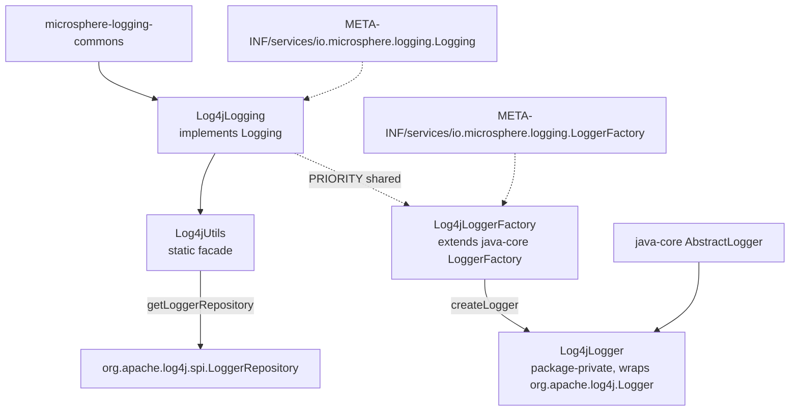

# microsphere-log4j — 源码分析

[English version](../log4j.md)

> Maven 模块：`io.github.microsphere-projects:microsphere-log4j` · 分支 `release` · 版本 `0.2.3-SNAPSHOT` ·
> Java 8 · Log4j **1.2.17** · 4 个生产类：`Log4jLogging`、`Log4jUtils`、`Log4jLoggerFactory`、`Log4jLogger`。

面向用户的参考文档：[../../../user-guide/current/zh/log4j.md](../../../user-guide/current/zh/log4j.md)

---

## 1. 在架构中的位置



这是仅有的两个同时注册**两个** SPI 服务的模块之一 —— 管理（`Logging`）*以及* logger 门面
（`LoggerFactory`）。`microsphere-log4j` 和 `microsphere-log4j2` 是唯一能让
`io.microsphere.logging.LoggerFactory.getLogger(...)` 返回由原生实现支撑的 `Logger` 的模块；
`microsphere-java-logging` 和 `microsphere-logback` 只注册 `Logging`。

这两处注册刻意共用同一个优先级常量：`Log4jLoggerFactory.getPriority()` 返回
`Log4jLogging.PRIORITY`（`Log4jLoggerFactory.java:76-77`，在 `:23` 从 `Log4jLogging` 导入），因此把管理适配器
在优先级序列中挪动，logger 工厂会随之一起移动。两个角色不会因为优先级错位
而落到不同的后端。

## 2. `Log4jUtils` — 两个急切的静态字段，以及一个*计算出来的*根名称

```java
// Log4jUtils.java:39,44
static final LoggerRepository loggerRepository = LogManager.getLoggerRepository();
public static final String ROOT_LOGGER_NAME = getRootLogger().getName();
```

当你把本模块与 `microsphere-logback` 放在一起阅读时，第二行才是那个要紧的差异：

- `LogbackUtils.ROOT_LOGGER_NAME` 是**从 slf4j 借来的常量**（`"ROOT"`）。
- `Log4jUtils.ROOT_LOGGER_NAME` 是**在类初始化时从活的配置仓库中读出的值**，即 `"root"`
  （`Log4JLoggingTest.java:61` 断言 `assertEquals("root", ROOT_LOGGER_NAME)`）。

由于它是 `static final` 并且只初始化一次，该常量实际上是 Log4j 1.x 自身 root logger 名称的一份
快照 —— 实践中是稳定的（`Hierarchy.getRootLogger()` 总是返回名为 `"root"` 的 logger），但这确实意味着
类加载 `Log4jUtils` 会在任何调用方开口之前触发 `LogManager.getLoggerRepository()` **以及** `getRootLogger()`。
在配置错误的 classpath 上，第一个症状是 `ExceptionInInitializerError`，而不是
一次日志调用。

`getLogger(String)`（`:63-65`）转发给 `loggerRepository.getLogger(...)`，即 get-or-create。测试固定了
空参数下的行为，它与 Logback 的不同：

```java
// test-case evidence — Log4jUtilsTest.java:54-57
assertNotNull(getLogger("test"));                                                  // get-or-create
assertThrows(NullPointerException.class, () -> getLogger((Class<?>) null));       // :75 requestClass.getName()
assertThrows(NullPointerException.class, () -> getLogger((String) null));         // repository rejects null
```

Logback 对同样的空名称调用抛出 `IllegalArgumentException`；Log4j 抛出 `NullPointerException`。任何
通用的“重置这个列表里的每个 logger”的代码都必须同时容忍这两种情况。

### `getLevel` 从不上报继承

```java
// Log4jUtils.java:97-103
public static Level getLevel(@Nullable Logger logger) {
    Level level = null;
    if (logger != null) {
        level = logger.getEffectiveLevel();   // no logger.getLevel() probe at all
    }
    return level;
}
```

`org.apache.log4j.Logger` *确实*有 `getLevel()`（继承时返回 `null`，因为 `Level` 是 `Category` 上一个
可能为 null 的字段），但这个工具类跳过它，无条件返回 `getEffectiveLevel()`。后果是结构性的：
通过这个适配器你**无法区分“已声明”和“继承”**，并且 `Logging.getLoggerLevel(name)` 只有在 `Logger`
参数为 `null` 时才可能返回 `null` —— 未知的 logger 名称不会，正在继承的
logger 也不会：

```java
// test-case evidence — Log4jUtilsTest.java:62-68
assertNull(getLevel((Logger) null));                       // the only null path
assertEquals(INFO, getLevel("io.microsphere.logging"));    // inherited value surfaced as if declared
assertEquals(TRACE, getLevel("io"));                       // falls through to the configured root
```

与 Logback 适配器对比，后者的 `getLevel` 先尝试 `getLevel()`，只有在那之后才用
`getEffectiveLevel()`（`LogbackUtils.java:91-100`）。相同的方法名，相同形态的 javadoc，不同的可观测语义 ——
这就是开发者指南保留一张按后端的矩阵，而不是把 `Logging` 描述得仿佛行为
统一的原因。

### 三个 `setLoggerLevel` 重载

```
setLoggerLevel(String loggerName, String levelString)  :111-114   get-or-create, then delegate
setLoggerLevel(Logger, String levelString)             :122-124   Level.toLevel(levelString)  → DEBUG for null/unknown
setLoggerLevel(Logger, Level level)                    :132-136   null logger → silent no-op; else logger.setLevel(level)
```

`org.apache.log4j.Level.toLevel(String)` 应用与 Logback 和 Log4j2 的 `toLevel` 相同的“默认取 `DEBUG`”规则，
所以 `Logging.setLoggerLevel(name, null)` 会把 logger **钉死在 DEBUG**，而不是恢复继承 ——
这直接违背 `Logging.java:90-93`。`Level` 类型的重载同样是通过传入真正的 `null` 取回继承的唯一途径，
与 Logback 模块完全一致。

## 3. `Log4jLogging.getLoggerNames()` — 不包含 root

```java
// Log4jLogging.java:83-89
LoggerRepository loggerRepository = getLoggerRepository();
Enumeration loggers = loggerRepository.getCurrentLoggers();
Iterable<Logger> iterable = toIterable(loggers);
return stream(iterable.spliterator(), false).map(Logger::getName).collect(toList());
```

`Hierarchy.getCurrentLoggers()` 返回 root 之下的 logger —— root 自身**不在**该枚举之中。
于是 `getRootLoggerName()`（`:69-70`）给出 `"root"`，而 `getLoggerNames()` 永远不包含 `"root"`。
`Logging` 契约并不禁止这一点，但这意味着一个遍历 `getLoggerNames()` 的级别矩阵会静默跳过 root，
因此 `Log4JLoggingTest.testGetLoggerNames` 只能断言非空（`:72-73`）。

`Enumeration → Iterable → Stream` 这个阶梯（`toIterable` 来自 java-core，`:28` 静态导入）之所以存在，
纯粹是因为 Log4j 1.x 早于集合框架的整合；`microsphere-log4j2` 不需要这样的阶梯。

## 4. logger 门面那一侧：`Log4jLoggerFactory` 与 `Log4jLogger`

| 类 | 可见性 | 角色 |
|-------|-----------|------|
| `Log4jLoggerFactory` (`:32`) | `public` | `extends` java-core 的抽象 `LoggerFactory`；实现可用性探测与创建钩子 |
| `Log4jLogger` (`:36`) | **package-private** | `extends AbstractLogger implements DelegatingWrapper`；包装一个 `final org.apache.log4j.Logger` 字段（`:38`），由 logger 名称构造（`:51`） |

`Log4jLogger` 是 package-private，这是刻意的封装：应用从不引用它，它们只会从 `LoggerFactory.getLogger(...)`
拿到一个实例。`Log4jLoggerFactory` 向 java-core 提供两个钩子：

```java
// Log4jLoggerFactory.java:47-48,61-62,76-77
protected String getDelegateLoggerClassName() { return LOG4J_LOGGER_CLASS_NAME; } // "org.apache.log4j.Logger"
public Logger createLogger(String name)      { return new Log4jLogger(name); }
public int getPriority()                     { return PRIORITY; }                  // Log4jLogging.PRIORITY = -3
```

`getDelegateLoggerClassName()` 正是 java-core 默认的 `isAvailable()` 所使用的 —— 它会尝试对
`org.apache.log4j.Logger` 做一次防御性类加载，如果该框架缺失，这个工厂就会被从候选列表中过滤掉，
而不是抛异常。这就是为什么单个 jar 可以位于 classpath 上而没有 Log4j 1.x，
却仍然不会破坏 `LoggerFactory.getLogger`。

优先级的选择正是 `load()` 在混合 classpath 上**不会**返回 Log4j 的原因：`-3` 输给 Log4j2 的 `-5`，
而 `Log4j2 (-5) < Log4j (-3) < Logback (0) < JUL (+10)` 这个顺序在 `Prioritized.COMPARATOR` 下
意味着升序者胜出。

## 5. 方法映射

| `Logging` 方法 | 行号 | 行为 |
|------------------|------|-----------|
| `getRootLoggerName` | `:69-70` | `Log4jUtils.ROOT_LOGGER_NAME` → `"root"` |
| `getLoggerNames` | `:83-89` | `getCurrentLoggers()`，排除 root |
| `getSupportedLoggingLevels` | `:103-104` | `ALL_LEVELS` — 八个名称，**包含 `FATAL`**（`:57`） |
| `getLoggerLevel` | `:117-118` | `getLevelString(name)` → 生效级别 |
| `setLoggerLevel` | `:131-133` | `Log4jUtils.setLoggerLevel(name, level)` |
| `getParentLoggerName` | — | 未覆盖 → 词法默认实现 |
| `getName` | `:145-146` | `"Log4j"` → JMX `io.microsphere.logging:type=Log4j` |
| `getPriority` | `:160-161` | `-3` |

## 6. 作为规约的测试

| 断言 | 文件:行号 | 固定的行为 |
|-----------|-----------|------|
| `assertSame(LogManager.getLoggerRepository(), getLoggerRepository())` | `Log4jUtilsTest.java:49` | 静态句柄就是活的配置仓库 |
| 空名称 / 空 class 都 → NPE | `:56-57` | Log4j 的失败模式与 Logback 的 IAE 不同 |
| `getLevel("io")` 返回继承到的 root 级别 | `:67-68` | 仅生效级别的语义 |
| `assertEquals("root", ROOT_LOGGER_NAME)` | `Log4JLoggingTest.java:61` | 计算得来，而非 slf4j 的 `"ROOT"` |
| `assertEquals(-3, PRIORITY)` | `:62` | 仅被 Log4j2 超越 |
| `LOG4J_LEVELS` = 8 个名称，含 `FATAL` | `:52,63` | 反射式解析器的输出 |
| `getLoggerLevel(ROOT_LOGGER_NAME)` = `"TRACE"` | `:83` | root 可通过适配器读取 |
| `getParentLoggerName` 词法链 | `:99-103` | 接口默认实现，不是 Log4j 的父级遍历 |

注意测试类名是 `Log4JLoggingTest`（大写 `J`），而生产类是 `Log4jLogging` ——
在 grep 或新增用例时值得知道这一点。
