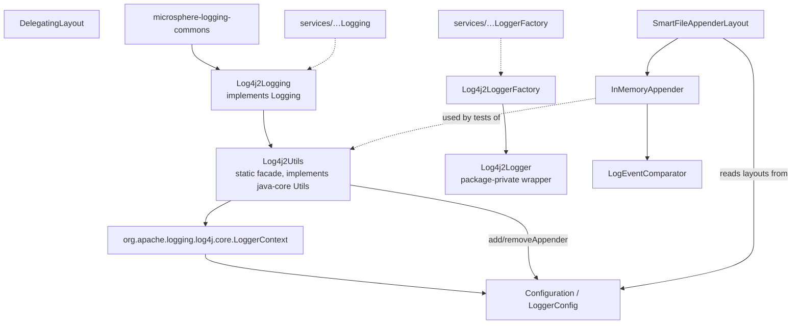
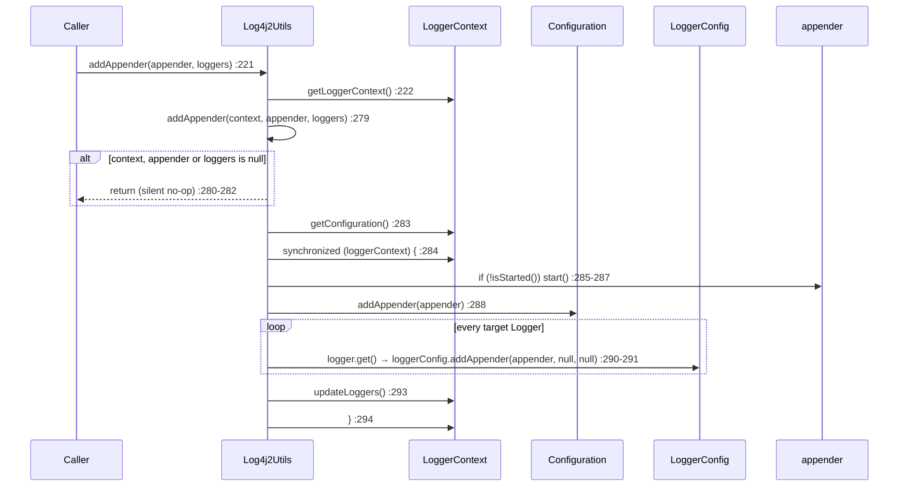
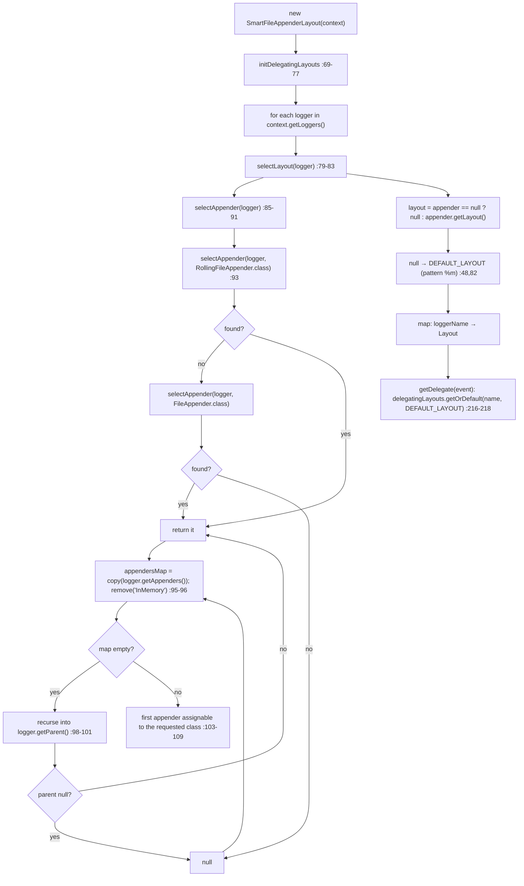

# microsphere-log4j2 —— 源码解析

[English version](../log4j2.md)

> Maven 模块：`io.github.microsphere-projects:microsphere-log4j2` · 分支 `release` · 版本 `0.2.3-SNAPSHOT` ·
> Java 8 · log4j-api / log4j-core **2.9.1** · 7 个生产类 —— 仓库中最大的模块。

面向用户的参考文档：[../../../user-guide/current/zh/log4j2.md](../../../user-guide/current/zh/log4j2.md)

---

## 1. 在架构中的位置

本模块是唯一一个越过级别管理、真正触及 Log4j2 **追加器/布局机制** 的适配器。
正是这部分额外的能力面，使它成为仓库中事实上的“用于测试的日志捕获”工具包。



服务注册（两个文件都位于 `src/main/resources/META-INF/services/` 下）：

| 服务文件 | 实现 |
|--------------|----------------|
| `io.microsphere.logging.Logging` | `io.microsphere.logging.log4j2.Log4j2Logging` |
| `io.microsphere.logging.LoggerFactory` | `io.microsphere.logging.log4j2.Log4j2LoggerFactory` |

`Log4j2LoggerFactory.getPriority()` 复用 `Log4j2Logging.PRIORITY`（`Log4j2LoggerFactory.java:23,76-77`），因此
管理与日志这两种角色总是同步变动。由于该优先级为 `NORMAL_PRIORITY - 5 = -5`
（`Log4j2Logging.java:46`），而 `Prioritized.COMPARATOR` 按升序排序，**只要 log4j2 在 classpath 上，
`LoggingUtils.load()` 就会返回 `Log4j2Logging`** —— 在基于 JUL 的应用中也不例外。

## 2. `Log4j2Utils` —— 与 Logback 和 Log4j 1.x 不同，没有缓存的注册表

```java
// Log4j2Utils.java:179-181
public static LoggerContext getLoggerContext() {
    return (LoggerContext) LogManager.getContext(false);
}
```

`false` 参数的含义是 *非当前线程 / 使用已存在的上下文* —— Log4j2 每次调用都返回同一个
`LoggerContext` 对象，测试用 `assertSame(LogManager.getContext(false),
getLoggerContext())`（`Log4j2UtilsTest.java:65`）证实了这一点。与两个同级适配器对比：

| 模块 | 注册表句柄 | 解析时机 | 框架缺失或为其他框架时的失败模式 |
|--------|-----------------|---------------|---------------------------------------------------|
| `microsphere-logback` | `static final LoggerContext`（`LogbackUtils.java:38`） | 类初始化 | `ExceptionInInitializerError`（由 `ClassCastException` 引发） |
| `microsphere-log4j` | `static final LoggerRepository`（`Log4jUtils.java:39`） | 类初始化 | `ExceptionInInitializerError` |
| `microsphere-log4j2` | **没有** —— 每次调用 `LogManager.getContext(false)`（`:179-181`） | 每次调用 | 调用时由 Log4j2 自身抛出的 `IllegalStateException` |

这就是为什么 Log4j2 适配器能够挺过晚发生的 `Log4j2CoreContext` 重置，而另外两个适配器无法在
`LoggerContext` 被替换之后存活。

### `getLevel` —— 既不是声明级别也不是生效级别，而是“按配置解析出的级别”

```java
// Log4j2Utils.java:97-103
public static Level getLevel(@Nullable Logger logger) {
    Level level = null;
    if (logger != null) {
        level = logger.getLevel();
    }
    return level;
}
```

`org.apache.logging.log4j.core.Logger#getLevel()` 会解析*匹配*的 `LoggerConfig` 并返回它的级别，因此
适配器报告的是 Log4j2 配置针对该名称所认定的级别 —— 既不是每个 logger 的声明字段，也不是像
Logback/Log4j 1.x 那样显式执行 `getEffectiveLevel()` 逐级上溯。测试读取从未被配置过的名称的级别，
得到的是根配置的答案：

```java
// test-case evidence — Log4j2UtilsTest.java:78-84
assertNull(getLevel((Logger) null));        // the only null path
assertEquals(INFO,  getLevel("io.microsphere.logging"));  // explicitly configured
assertEquals(TRACE, getLevel("io"));                     // resolved to the root LoggerConfig
```

### `setLoggerLevel(null)` 确实会把级别钉死为 DEBUG —— 测试也明明白白这么写

```java
// test-case evidence — Log4j2UtilsTest.java:128-130
// null string -> toLevel(null) => DEBUG
Log4j2Utils.setLoggerLevel(logger, (String) null);
assertEquals(Level.DEBUG, Log4j2Utils.getLevel(logger));
```

`setLoggerLevel(Logger, String)`（`:122-124`）总是调用 `Level.toLevel(levelString)`（`:33` 处的静态导入），
该方法对 `null` 和无法解析的名称都默认返回 `DEBUG`。因此在这个后端上，
`Logging.setLoggerLevel(name, null)` 违背了 `Logging.java:90-93` 关于“恢复继承”的承诺 —— logger 最终会
**显式地处于 DEBUG**，于是基于 `getLoggerLevel()` 构造的 `setX … read … restore` 循环就不再是中性的。
把 `null` 的 **`Level` 对象**传给 `setLoggerLevel(Logger, Level)`（`:132-136`）是唯一能走到
`logger.setLevel(null)` 并真正重新建立继承关系的路径。

## 3. 追加器手术 —— 仓库中状态最多的代码

`addAppender` / `removeAppender` 以两个公开入口加两个包私有的 worker 方法的形式发布，
后者显式接收上下文（这样测试无需真实查找就能驱动它们）：



仔细读 `:279-314`，有四个决策格外显眼：

1. **锁就是 `LoggerContext` 本身**（`synchronized (loggerContext)`），而不是私有互斥量。这与 Log4j2 内部重新配置时使用的
   监视器是同一个，所以本模块是在与框架协作而不是自创一套 —— 但这也意味着一个锁住上下文的
   应用可能与这段代码相互死锁。
2. **生命周期替你管理好了**：`addAppender` 在需要时调用 `appender.start()`（`:285-287`），
   `removeAppender` 除非已经停止否则调用 `appender.stop()`（`:304-306`）。已经启动过追加器的调用者不受影响；忘记启动的
   调用者会被悄无声息地补救。
3. **两个注册表都必须被修改。** 追加器既要进入 `Configuration`（`:288`），*也要*进入每个
   `LoggerConfig`（`:291`）；移除时做镜像操作 —— `configuration.getAppenders().remove(name)`（`:307`）
   加上 `loggerConfig.removeAppender(name)`（`:310`）。少做其中一半，就是得到一个 `findAppender` 仍然会返回的“幽灵”追加器的
   经典途径。
4. **什么都不持久化。** `updateLoggers()`（`:293`、`:312`）只重建当前活动的 logger；一次重新配置或者从 XML 重启都会
   抹掉这个改动。`addAppender(..., null, null)` 还传入了 `null` 级别过滤器和 `null`
   `Filter`，也就是“接受该 logger 本来接受的一切”。

`:280-282` / `:298-300` 处的 null 保护会静默返回。结合
`Log4j2Utils.addAppenderForAllLoggers(appender)`（`:238-241`）—— 它传入 `loggerContext.getLoggers()`，
也就是 **当时** 已存在的 logger —— 后来创建的 logger 永远收不到该追加器。想要全覆盖，你就得挂到根
`LoggerConfig` 上，或者在创建之后重新施加一次。

`findAppender`（`:169-172`）只是在 `configuration.getAppender(name)` 之上包了一层，所以它只能看到配置中声明的追加器
（或通过上面几个方法添加的追加器），其他情况返回 `null` —— 泛型 `<T extends Appender>`
使其在调用点成为一个未检查的强制转换。

## 4. `InMemoryAppender` —— 带有两处锋利边角的排序集合缓冲区

```java
// InMemoryAppender.java:38,43,45
public class InMemoryAppender extends AbstractLifeCycle implements Appender {
    public static final String NAME = "InMemory";
    private final ConcurrentSkipListSet<LogEvent> logEvents = new ConcurrentSkipListSet<>(INSTANCE);
```

`append(LogEvent)`（`:65-68`）就是 `logEvents.add(event)`。
由这一个数据结构导出三个后果：

- **排序依据是时间戳，而不是到达顺序。** `LogEventComparator.compare`（`LogEventComparator.java:59-65`）比较
  `getInstant().getEpochMillisecond()`，相等时再比较 `getNanoOfMillisecond()`。因此即使 `ConcurrentAppender` 的投递顺序是乱的，事件也会
  按时间顺序被重放。
- **同一纳秒的事件会被丢弃。** `ConcurrentSkipListSet` 是一个 *Set*：instant 完全相同的两个事件
  比较结果为 `0`，于是第二次 `add` 返回 `false`，事件被静默丢失。高吞吐的捕获测试可能会
  少报；这正是在意精确计数时应当优先选用 Log4j2 自带 `ListAppender` 的原因。
- **没有读取 API。** 缓冲区是私有的、不对外暴露；唯一的出口是
  `transfer(Appender)`（`:215-220`），它按时间顺序用 `pollFirst()` 逐个 **取出（drain）** 到另一个追加器。
  `stop()`（`:195-198`）先调用 `super.stop()` 再 `logEvents.clear()`，所以停止会丢弃所有已捕获的内容。

`getLayout()`（`:100-102`）、`getHandler()` 和 `ignoreExceptions()`（`:117-118`）构成“无布局、无错误处理器、
不忽略异常”三联组合 —— 这意味着 `InMemoryAppender` 只继承了 `AbstractLifeCycle` 的
started/stopped 语义，而 `Log4j2Utils.addAppender` 会很乐意替你把它启动起来。

`findInMemoryAppender()`（`:237-239`）就是 `findAppender(NAME)`：它返回按名称 `InMemory`
**在 Log4j2 配置中声明的** 实例，或者 `null`。它并不是代码所创建的实例的注册表 ——
`new InMemoryAppender()` 两次再调用 `findInMemoryAppender()` 仍然得到 `null`，
除非其中某个是通过 `Log4j2Utils.addAppender` 加入的（该方法会写入 `Configuration`）。

## 5. `SmartFileAppenderLayout` —— 按 logger 复用格式

这个类的存在，是为了让一个布局能够用*所属 logger 的文件追加器*所会使用的那个模式来格式化每个事件。
它分为两半：构造时急切建立索引，以及每个事件针对该索引做一次查找。



只有源码才会透露的几点：

- **`InMemory` 按名称被排除。** `appendersMap.remove(NAME)`（`:96`，`NAME` 在 `:33` 处从
  `InMemoryAppender` 静态导入）确保捕获追加器永远不会被选作格式化来源 —— 否则
  `SmartFileAppenderLayout` 就会试图去读一个 `InMemoryAppender.getLayout()` 故意返回 `null`
  的布局。正是这一点让这两个类能够组合使用。
- **Rolling 优先于普通文件。** 先尝试 `RollingFileAppender`（`:86`），再尝试 `FileAppender`（`:88`）—— 判断依据是
  `appenderClass.isAssignableFrom(appender.getClass())`（`:105`），而由于 `RollingFileAppender` *本身就是一种*
  `FileAppender`，先试更具体的那个类正是选择结果保持确定的原因。
- **选择规则是“map 迭代顺序中的第一个匹配”**，而不是“最具体”或“最大”（`:103-109` 在第一个命中处就
  break）。因此拥有两个文件追加器的 logger
  会得到由 `HashMap` 顺序决定的布局 —— 这也是 `SmartFileAppenderLayoutTest` 断言 Rolling 优于 File 的偏好、
  而不断言多追加器平分情形如何裁决的原因（`shouldPreferRollingFileAppenderOverFileAppender`，`:119`）。
- **索引里不存在的 logger 回退到 `DEFAULT_LAYOUT`。** `getDelegate(event)` 使用
  `delegatingLayouts.getOrDefault(loggerName, DEFAULT_LAYOUT)`（`:216-218`），所以来自那些构建索引时尚不存在的
  logger 的事件会用 `%m` 模式（`:48`）格式化。测试恰好钉住了这一孤儿情形
  （`SmartFileAppenderLayoutTest.java:101-106`）。
- **索引只急切地构建一次**（`:65-67`、`:69-77`）：后来出现的 logger、后来添加的追加器以及重新配置，对一个已经构造好的实例来说
  都是不可见的。
- `getHeader`/`getFooter`/`getContentType`/`getContentFormat`（`:125-140,183-198`）始终委托给
  `DEFAULT_LAYOUT`，从不委托给按 logger 的布局 —— header/footer 是流级别的概念，
  按事件的映射无法连贯地回答它们。

## 6. `DelegatingLayout` 与 `LogEventComparator`

`DelegatingLayout<T extends Serializable>` 把 `toByteArray` / `toSerializable` / `encode` / header / footer 转发给
它包装的那个布局。其无参构造器会让被委托对象为 `null`，所以用那种方式构造的实例在第一次使用时就抛 NPE —— 它的存在是为了子类化/绑定的
便利，而不是为了直接使用。

`LogEventComparator` 是一个无状态单例（`LogEventComparator.java:30-38`，`INSTANCE` 在 `:35`，私有构造器），
对外只提供唯一的一种行为（`:59-65`）。它被 `InMemoryAppender`（`:45`）消费，同时是公开的，以便应用程序能够用同一条规则构造自己的
排序集合缓冲区。

## 7. `Log4j2Logging` 方法一览

| 方法 | 行号 | 行为 |
|--------|------|-----------|
| `getRootLoggerName` | `:66-68` | `org.apache.logging.log4j.LogManager.ROOT_LOGGER_NAME` → `""`（静态导入 `:32`） |
| `getLoggerNames` | `:80-85` | `getLoggers().stream().map(Logger::getName)` —— 当前注册在上下文中的 logger |
| `getSupportedLoggingLevels` | `:98-100` | `ALL_LEVELS`，包含 `FATAL` 在内的八个级别名（`:53`） |
| `getLoggerLevel` | `:113-114` | `getLevelString(name)` |
| `setLoggerLevel` | `:127-129` | `Log4j2Utils.setLoggerLevel(name, level)` |
| `getParentLoggerName` | — | 未覆盖 → 使用默认实现 |
| `getName` | `:142-144` | `"Log4j2"` → JMX `io.microsphere.logging:type=Log4j2` |
| `getPriority` | `:157-159` | `-5` |

`Log4j2LoggingTest.testGetLoggerLevel`（`:81-85`）和 `testSetLoggerLevel`（`:88-98`）另外还展示了本适配器
与原生 `org.apache.logging.log4j.Logger` 的一致：通过 `Logging` 设置级别会翻转
`logger.isDebugEnabled()`（`:93,97`），也就是说修改没有被门面副本所遮蔽。

## 8. 作为规格说明的测试

| 断言 | 文件:行号 | 钉住的行为 |
|-----------|-----------|------|
| `assertSame(LogManager.getContext(false), getLoggerContext())` | `Log4j2UtilsTest.java:65` | 每次调用都是同一个共享上下文 |
| 名称为 null / 类为 null → NPE | `:72-73` | 失败发生在 `getLogger` 内部，早于 Log4j2 |
| `getLevel("io") == TRACE`、`getLevel("io.microsphere.logging") == INFO` | `:78-84` | 按配置解析出的级别 |
| `setLoggerLevel(logger, (String) null)` → `DEBUG` | `:128-130` | 恢复继承这个陷阱 |
| 在 `configuration.addAppender` 之后的 `findAppender("findMe")` | `:146-171` | `Configuration` 是查找的来源 |
| Rolling 优先于 File | `SmartFileAppenderLayoutTest.java:119` | `:86-89` 的顺序 |
| 孤儿与未知 logger 的事件使用 `DEFAULT_LAYOUT` | `:101-106` | `:216-218` 处的 `getOrDefault` 回退 |
| header/footer/content-type 与 `DEFAULT_LAYOUT` 的相同 | `:88-91` | 流级别的元数据从不按 logger 区分 |
