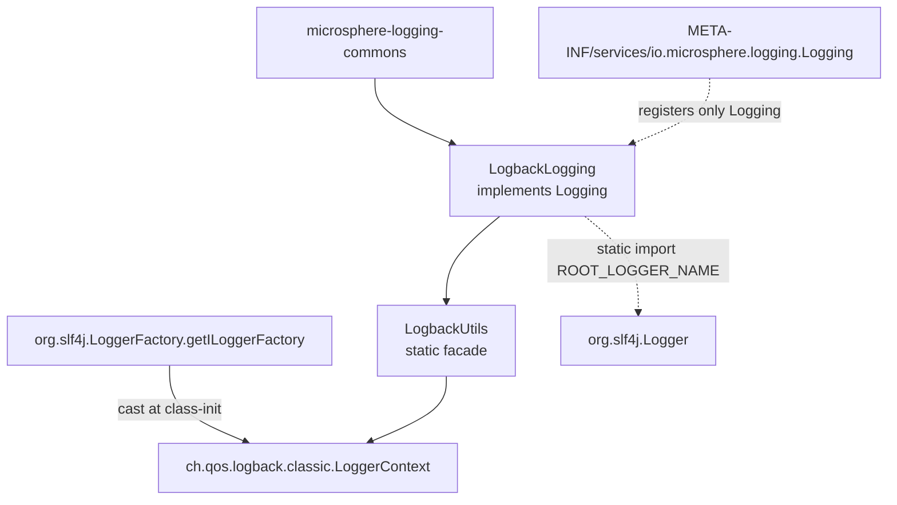
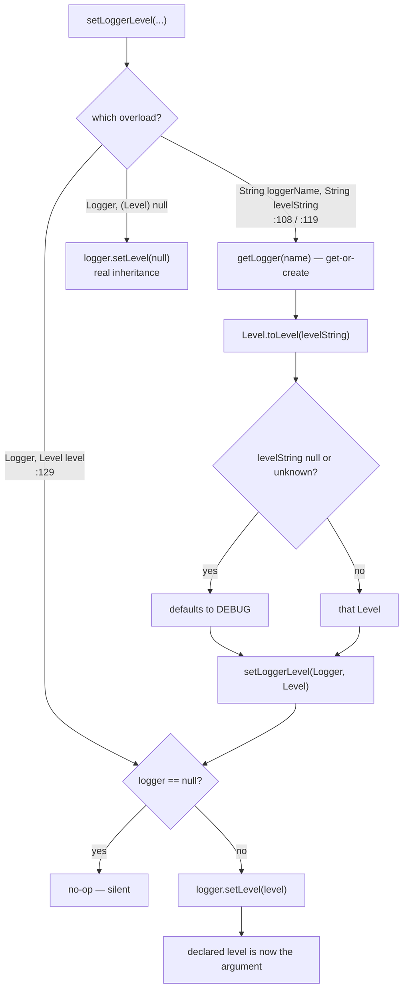

# microsphere-logback — 源码分析

[English version](../logback.md)

> Maven 模块：`io.github.microsphere-projects:microsphere-logback` · 分支 `release` · 版本 `0.2.3-SNAPSHOT` ·
> Java 8 · 2 个生产类（`LogbackLogging`、`LogbackUtils`）· Logback `1.6.3` / slf4j-api `2.0.18`。

面向用户的参考文档：[../../../user-guide/current/zh/logback.md](../../../user-guide/current/zh/logback.md)

---

## 1. 在架构中的位置



`microsphere-logback/pom.xml` 将 `microsphere-logging-commons`（`${revision}`）声明为唯一必需的编译
依赖；`microsphere-java-annotations`、`microsphere-java-core`、`slf4j-api` 与 `logback-classic` 全部是
`<optional>true</optional>`。测试另外使用 `microsphere-java-test`。

与 Log4j 和 Log4j2 不同，本模块只注册**一个**服务 —
`META-INF/services/io.microsphere.logging.Logging` → `io.microsphere.logging.logback.LogbackLogging`，并且没有
`io.microsphere.logging.LoggerFactory`。因此日志的*写入*路径并不在此桥接：在只有
Logback 的 classpath 上，`io.microsphere.logging.LoggerFactory.getLogger(...)` 会通过 java-core 的
`Sfl4jLoggerFactory`（优先级 `0`）解析，后者委派给 SLF4J，因而最终仍然落到 Logback。
本模块只增加了*管理*路径。

## 2. `LogbackLogging` — 轻薄但并不对称的适配器

| 方法 | 行号 | 实现 |
|--------|------|----------------|
| `getRootLoggerName` | `:66-68` | 返回 `ROOT_LOGGER_NAME` — **从 `org.slf4j.Logger` 静态导入**（`:32`） |
| `getLoggerNames` | `:80-85` | `getLoggerContext().getLoggerList()` 流经 `Logger::getName` |
| `getSupportedLoggingLevels` | `:98-100` | 返回 `ALL_LEVELS` |
| `getLoggerLevel` | `:112-114` | `LogbackUtils.getLevelString(loggerName)` |
| `setLoggerLevel` | `:126-128` | `LogbackUtils.setLoggerLevel(loggerName, levelName)` |
| `getParentLoggerName` | — | **未覆盖** → 使用 `Logging.java:118-128` 的词法默认实现 |
| `getName` | `:140-142` | `"Logback"` |
| `getPriority` | `:155-157` | `PRIORITY = NORMAL_PRIORITY`（`:46`），即 `0` |

有两个后果是结构性的，而非偶然：

1. **根名称是 `"ROOT"`。** `org.slf4j.Logger.ROOT_LOGGER_NAME` 是 `slf4j-api` 成为本模块编译依赖的唯一原因 —— 它
   只是一个常量，而非行为。`LogbackLoggingTest.testGetRootLoggerName` 断言了该值（`:68-70`），而
   `LoggingMXBeanRegistrar` 构造的 JMX `ObjectName` 依据的是 `getName()` = `"Logback"`，而非依据
   根名称。
2. **`getParentLoggerName` 继承词法默认实现。** 因此尽管 Logback 自身的层级确有真正的
   “最近现存父级”概念，该适配器返回的仍是点号前缀：

```java
// test-case evidence — LogbackLoggingTest.java:100-107
assertEquals("io.microsphere.logging", logging.getParentLoggerName("io.microsphere.logging.logback"));
assertEquals(ROOT_LOGGER_NAME, logging.getParentLoggerName("io"));  // "ROOT"
assertNull(logging.getParentLoggerName(ROOT_LOGGER_NAME));          // root's parent is null, not ""
```

`getLoggerNames()` (`:80-85`) 是对*运行时*状态的投影：`LoggerContext.getLoggerList()` 反映调用时刻上下文中
已存在的 logger，因此随着代码创建 logger，结果会不断增多。这正是测试只能断言非空
（`LogbackLoggingTest.java:73-75`）的原因 —— 该集合并不是一个稳定的、由配置推导出的列表。

## 3. `LogbackUtils` — 一次急切静态转换，随后纯委派

```java
// LogbackUtils.java:38
static final LoggerContext loggerContext = (LoggerContext) getILoggerFactory();
```

这一行代码是本模块最紧的耦合：

- 它在 **`LogbackUtils` 的类初始化**期间执行，也就是 `LogbackLogging` 首次调用任意
  `LogbackUtils` 方法时发生（`LogbackLogging.java:29-30` 的静态导入会触发它）。
- 它**假定 SLF4J 的 provider 就是 Logback**。换成任何其它 provider，该强制转换都会抛出 `ClassCastException`，且 ——
  由于失败发生在静态初始化器之中 —— 调用方看到的是 `ExceptionInInitializerError`，cause 为
  `ClassCastException`。因此把 `io.microsphere.logging.logback.*` 引入到一个把 SLF4J 绑定到 Simple 或 NOP provider
  的应用中，会在第一次 logger 级别调用时早早地硬失败。
- `assertSame(getILoggerFactory(), getLoggerContext())`（`LogbackUtilsTest.java:49`）确认该字段就是活的
  context 对象，而非副本：级别的修改通过 `org.slf4j.LoggerFactory` 也能立即看到。

### 已声明级别 vs 生效级别

`getLevel(Logger)`（`LogbackUtils.java:91-100`）是模块中唯一真正带条件的代码：

```java
Level level = null;
if (logger != null) {
    level = logger.getLevel();          // declared level, null when inherited
    if (level == null) {
        level = logger.getEffectiveLevel();   // walk up to the nearest declared ancestor
    }
}
return level;
```

因此 `getLevel` 回答的是*“这个 logger 适用什么级别？”*，永远不是*“这个 logger 自己声明了什么？”* ——
并且它只有在参数为 `null` 时才可能返回 `null`。结合 `getLogger(String)`（Logback 的
get-or-create 语义），该适配器**无法**履行 `Logging` 文档中承诺的“logger 不存在时返回 `null`”
（`Logging.java:79-80`）：未知的名称会被就地创建，并以继承到的级别上报。测试证实了这一点，它们读取的
是从未配置过的 logger 的级别：

```java
// test-case evidence — LogbackUtilsTest.java:54,62-68
assertNull(getLevel((Logger) null));                  // only the null logger yields null
assertEquals(TRACE, getLevel("io.microsphere.logging.logback.util"));  // inherited, not declared
assertEquals(INFO, getLevel("io"));                   // falls through to the root's level
assertNotNull(getLogger("test"));                     // get-or-create, never null
assertThrows(IllegalArgumentException.class, () -> getLogger((String) null));
assertThrows(NullPointerException.class, () -> getLogger((Class<?>) null));  // requestClass.getName()
```

注意空参数的两种不同失败模式：名称重载在 Logback 内部失败
（`IllegalArgumentException`），class 重载在本模块内部失败（`NullPointerException` at
`LogbackUtils.java:69`，尚未到达 Logback）。

### 两个 `setLoggerLevel` 重载并不等价



`setLoggerLevel(Logger, String)`（`:119-121`）总是经由 `Level.toLevel(levelString)` 路由，后者的文档规定，对 `null`
与无法解析的输入都默认取 **`DEBUG`**；javadoc 明确说明了这一点（`:106`、`:117`）。
`Level` 类型的重载（`:129-133`）是逃生通道：传入一个 `null` 的 **`Level` 对象**会抵达
`logger.setLevel(null)` 并真正重新建立继承关系。因此“没有级别”的两种不同含义
共存于同一个适配器中，仅由参数的静态类型区分 —— 编写通用的“重置级别”代码时
需要当心这一重载：

```java
LogbackUtils.setLoggerLevel(byName, (String) null); // → DEBUG, logger is pinned
LogbackUtils.setLoggerLevel(byName, (Level) null);  // → inherits again
```

`Logger` 为 null 的守卫（`:130`）让整条 setter 链通过“降级”而非“校验”来获得空值安全性：
`setLoggerLevel((Logger) null, "DEBUG")` 什么都不做，测试也正是这样断言的
（`LogbackUtilsTest.java:80`）。

## 4. 为什么在混合 classpath 上 `LogbackLogging` 会失去 `load()`

`PRIORITY = NORMAL_PRIORITY = 0`（`LogbackLogging.java:46`，在 `LogbackLoggingTest.java:62-63` 被断言）。在
`Prioritized.COMPARATOR` 升序排列下，Log4j2（`-5`）和 Log4j（`-3`）都胜过它，而 JUL（`+10`）落在其后。所以在
同时含有 Logback 与 Log4j2 的 classpath 上，`LoggingUtils.load()` 返回 `Log4j2Logging`，`LogbackLogging` 只能通过
`loadAll()` + `getName()` 过滤才能拿到。`LogbackLoggingTest.setUp` 之所以能安全地 `(LogbackLogging) load()`
（`:57`），只是因为该模块的测试 classpath 中没有其它 `Logging` 提供方。

## 5. 模式

| 模式 | 位置 | 说明 |
|---------|-------|------|
| Facade（不可实例化） | `LogbackUtils.java:36,159` | 抽象类 + 私有构造器；每个方法都是 `static` |
| 急切的静态注册表句柄 | `LogbackUtils.java:38` | 比每次调用都做转换更省，但会把一次装配错误变成 `ExceptionInInitializerError` |
| 空值安全降级 | `getLevel` `:91-100`、`setLoggerLevel` `:130`、`getLevelString` `:155-157` | 返回 `null` / 空操作而不是抛异常 |
| 重载即策略 | `setLoggerLevel(String,String)` 与 `(Logger,Level)` | 上文 DEBUG 与继承的分歧 |
| 通过静态导入实现模板 | `LogbackLogging.java:29-30` | 适配器读起来就像内联的工具代码；没有字段，没有构造器 |
| 组合式委派 | `getLoggerLevel` → `getLevelString(String)` → `getLogger` → `getLevel(Logger)` | 四段单一用途的跳转，每一段都可独立测试 |

## 6. 作为规约的测试

| 断言 | 文件:行号 | 固定的行为 |
|-----------|-----------|------|
| `assertSame(getILoggerFactory(), getLoggerContext())` | `LogbackUtilsTest.java:49` | 静态字段就是活的 context |
| `getLogger((String) null)` → IAE，`getLogger((Class<?>) null)` → NPE | `:56-57` | 每种空参数在哪里失败 |
| `getLevel("io") == INFO`、`getLevel("io.microsphere") == TRACE` | `:63-68` | 已声明优先、否则取生效级别的解析 |
| `assertNull(getLevel((Logger) null))` | `:62` | 唯一返回 null 的路径 |
| `setLoggerLevel((Logger) null, "DEBUG")` 不抛异常 | `:80` | 静默降级 |
| `assertEquals(LOGBACK_LEVELS, ALL_LEVELS)` | `LogbackLoggingTest.java:64` | 七个名称，**没有 `FATAL`** |
| `assertEquals("INFO", getLoggerLevel(ROOT_LOGGER_NAME))` | `:84-88` | root 上报其生效级别 |
| `getParentLoggerName` 链，含 `assertNull(root)` | `:95-107` | 出厂的是词法默认实现 |
