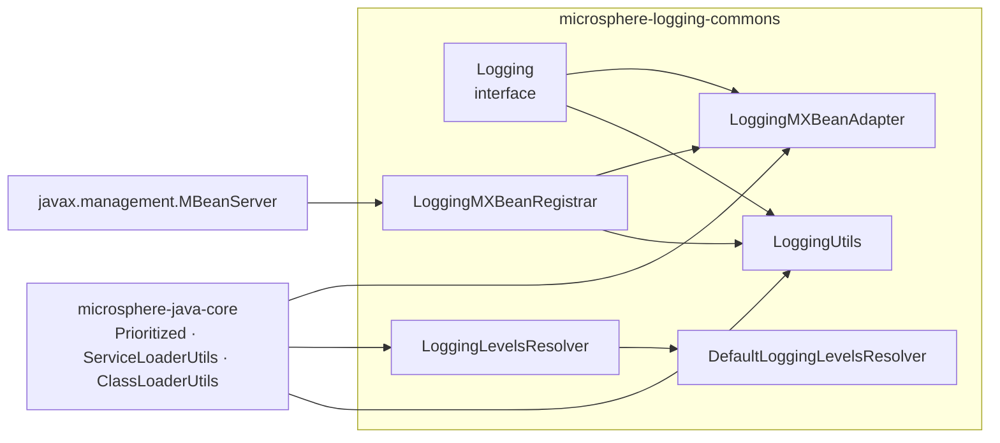
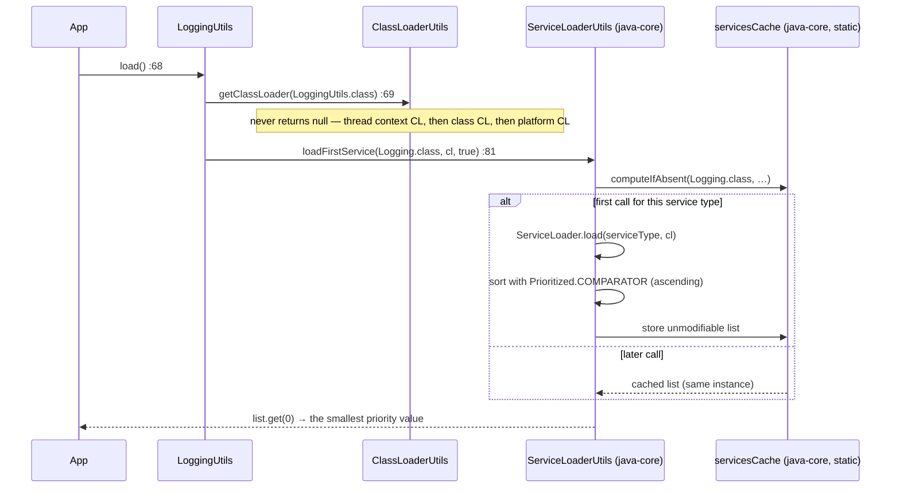
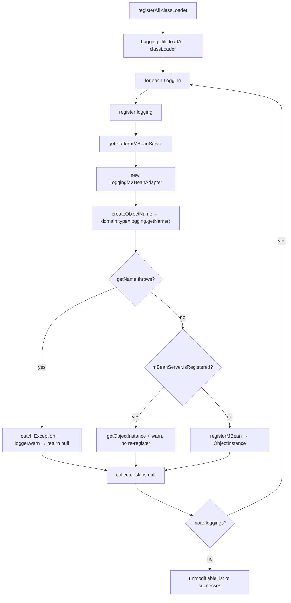

# microsphere-logging-commons — 源码解析

[English version](../logging-commons.md)

> Maven 模块：`io.github.microsphere-projects:microsphere-logging-commons` · 分支 `release` ·
> 版本 `0.2.3-SNAPSHOT` · Java 8 · 6 个生产类，除 `microsphere-java-core` 之外
> 无任何框架依赖。

面向用户的 API 参考：[../../../user-guide/current/zh/logging-commons.md](../../../user-guide/current/zh/logging-commons.md)

---

## 1. 在架构中的位置

本模块是项目中**唯一的抽象层**。所有后端适配器都依赖它，而它不依赖其中任何一个。它的 POM 很不寻常：
**所有** compile 作用域的依赖都被标记为 `<optional>true</optional>` —— `microsphere-java-core`、
`commons-logging`、`slf4j-api`、`log4j`、`log4j-api`、`log4j-core` 与 `logback-classic`。
正是这种可选性让 `microsphere-logging-commons` 得以位于各后端*之上*，而不把其中任何一个拖进应用的
classpath；各适配器会重新声明自己真正需要的框架。注意，适配器同样把
`microsphere-java-annotations` 和 `microsphere-java-core` 标记为 `<optional>true</optional>`
（`microsphere-logback/pom.xml`、`microsphere-java-logging/pom.xml`），因此本项目中**没有任何东西**
会传递到达应用：消费者必须自行引入 `microsphere-java-core`，否则 `LoggingUtils`
连 `ClassLoaderUtils` / `ServiceLoaderUtils` 都无法加载。



## 2. `Logging` — 契约及其有损之处

`Logging.java:39` 声明了 `interface Logging extends Prioritized`，其 javadoc 明确写出设计意图：
*"大多数方法与 `LoggingMXBean` 保持兼容"*（`Logging.java:31-34`）。六个抽象方法分别是
`getRootLoggerName`（`:47`）、`getLoggerNames`（`:56`）、`getSupportedLoggingLevels`（`:64`）、
`getLoggerLevel(String)`（`:83`）与 `setLoggerLevel(String, String)`（`:103`），再加上继承来的 `getPriority()`
以及由 `getName()`（`:136`）提供的后端名称。

两个契约细节造成了大多数跨后端的意外行为：

1. **按契约 `getLoggerLevel` 是三值的，而不是两值。** 其 javadoc（`Logging.java:66-81`）承诺：logger 不存在时返回
   `null`；logger 存在但没有已声明级别（即继承而来）时返回*空字符串*。`setLoggerLevel(name, null)` 按文档会恢复
   继承关系（`:90-93`）。只有 JUL 真正实现了这种读取语义；另外三个适配器都会把字符串交给
   `Level.toLevel(...)` 风格的解析。
2. **`getParentLoggerName` 有一个默认实现**（`Logging.java:118-128`），它是纯粹的字符串运算：

```java
default String getParentLoggerName(String loggerName) {
    if (Objects.equals(getRootLoggerName(), loggerName)) {
        return null;                        // :119-121
    }
    int lastDotIndex = loggerName.lastIndexOf(DOT);
    if (lastDotIndex == -1) {
        return getRootLoggerName();         // :123-125
    }
    return loggerName.substring(0, lastDotIndex);
}
```

`JavaLogging` 是唯一**覆写**它的适配器，它把调用委托给 JDK 注册表，因此返回的是最近的*已存在*父日志器，
而不是词法前缀（`JavaLogging.java:141-143`）。因此 `Log4j2Logging` 即使 `a.b` 从未创建也会报告
`"a.b.c" → "a.b"` —— 这对框架自身的层级遍历是正确的，但意味着不能用默认实现来枚举真实存在
的子树。

注意默认实现引入的不对称性：请求根日志器的父级会返回 `null`（`:120`），而 `LoggingMXBean` 的 javadoc
说根日志器的父级是空字符串。已在 Logback 上验证：

```java
// test-case evidence — LogbackLoggingTest.java:106-107
assertEquals(ROOT_LOGGER_NAME, logging.getParentLoggerName("io")); // "ROOT"
assertNull(logging.getParentLoggerName(ROOT_LOGGER_NAME));         // not ""
```

## 3. `LoggingUtils` — 服务加载（SPI），以及这里*没有*缓存什么



这三个方法都是固定类加载器上的纯委托（`LoggingUtils.java:45-82`）：

| 方法 | 行号 | 委托目标 |
|--------|------|--------------|
| `loadAll()` | `:45-47` | `loadAll(getClassLoader(LoggingUtils.class))` |
| `loadAll(ClassLoader)` | `:57-59` | `loadServicesList(Logging.class, cl, true)` |
| `load()` | `:68-70` | `load(getClassLoader(LoggingUtils.class))` |
| `load(ClassLoader)` | `:80-82` | `loadFirstService(Logging.class, cl, true)` |

有两个实现细节值得固定下来：

- 这个类是**带私有构造器的抽象类**（`LoggingUtils.java:37,84`）—— 即项目中一贯使用的“不可实例化
  工具类”惯例（`LogbackUtils.java:36,159`、`LoggingMXBeanRegistrar.java:52,140`）。
- 第三个参数是 **`cached` 标志**，而不是排序标志（`loadServicesList(serviceType, classLoader, cached)`）。
  优先级排序在无缓存的加载器内部无条件执行，通过 `Prioritized.COMPARATOR` 完成。
  缓存位于 `ServiceLoaderUtils.servicesCache`（`microsphere-java-core:0.3.19`、`ServiceLoaderUtils.java:843-856`）
  ，并且**只以服务类型为键**：
  `servicesCache.computeIfAbsent(serviceType, type -> loadServicesAsList(type, classLoader))` —— 缓存命中时
  `classLoader` 参数会被忽略。一旦任何调用方加载过 `Logging` 服务，后续通过不同类加载器发起的调用
  都会观察到先前的结果。`loadServicesList` 返回的是新构建的 `unmodifiableList` 包装，因此下面的
  相等判断是内容相等：

```java
// test-case evidence — LoggingUtilsTest.java
@Test
void testLoadAll() {
    List<Logging> loggings = loadAll();
    assertEquals(2, loggings.size());
    assertEquals(loadAll(), loggings);   // stable content across calls => the type-keyed SPI cache is in play
}

@Test
void testLoad() {
    assertInstanceOf(TestingLogging.class, load());   // MAX_PRIORITY wins
}
```

`ThrowableLogging` 也在测试的 `META-INF/services` 文件中，这证明 `loadAll()` 会**实例化**每一个
提供者（它的 `getName()` 只在被调用时抛异常，而不是在加载时）。因此：损坏的后端绝不会从列表中
消失 —— 它是在首次使用时才失败。`load()` 更安全，恰恰是因为它只触及一个实现。

`Prioritized` 的语义是整个仓库中最容易被误读的细节：`MAX_PRIORITY == Integer.MIN_VALUE`，
而 `Prioritized.COMPARATOR` 按**升序**排序，因此*更小*的 int 在 `load()` 中胜出。注册值分别为
Log4j2 `-5`、Log4j `-3`、Logback `0`、JUL `+10`。

## 4. `DefaultLoggingLevelsResolver` — 用反射取代手工维护的列表

```java
// DefaultLoggingLevelsResolver.java:52-59
public Set<String> resolve(Class<?> levelClass) {
    return unmodifiableSet(of(levelClass.getFields())
            .filter(MemberUtils::isStatic)
            .filter(MemberUtils::isFinal)
            .filter(field -> field.getType().equals(levelClass))
            .map(field -> field.getName())
            .collect(toSet()));
}
```

这三个过滤器都是关键所在。`java.util.logging.Level` 暴露的 public 字段并非全是级别 —— 只保留
**类型为 `Level`** 的 `static final` 字段，恰好得到九个名称。下面这些集合正是项目自身测试所
断言的（`DefaultLoggingLevelsResolverTest.java:41-61`）：

| `levelClass` | 解析出的名称 | 数量 |
|--------------|----------------|-------|
| `java.util.logging.Level` | `OFF SEVERE WARNING INFO CONFIG FINE FINER FINEST ALL` | 9 |
| `ch.qos.logback.classic.Level` | `OFF ERROR WARN INFO DEBUG TRACE ALL` | 7 |
| `org.apache.log4j.Level` | `OFF FATAL ERROR WARN INFO DEBUG TRACE ALL` | 8 |
| `org.apache.logging.log4j.Level` | `OFF FATAL ERROR WARN INFO DEBUG TRACE ALL` | 8 |
| `org.slf4j.event.Level` | `ERROR WARN INFO DEBUG TRACE` | 5 |

有两处颇具启发性的缺失：Logback 解析出的集合中**没有 `FATAL`**（它的 `Level` 类没有该字段）但确实有
`ALL`；而 `ch.qos.logback.classic.Level.NULL_VALUE` 被排除了，因为它声明为 `String` 常量，会被
`field.getType().equals(levelClass)` 过滤器丢弃。反过来，`slf4j-api` 在这里并不是真正的后端 —— `JavaLogging`
等适配类并不使用它 —— 但解析器测试偏偏使用了 `org.slf4j.event.Level`，这正是为了证明该过滤器在
**枚举**上同样有效（它的 `public static final` 常量就是枚举类型本身，因此能通过全部三个过滤器）。

来自源码的设计说明：

- **通过可变 public 字段实现的急加载单例**：`public static DefaultLoggingLevelsResolver INSTANCE`
  （`DefaultLoggingLevelsResolver.java:37`）并*不是* `final`。各适配器在类初始化时静态地捕获它
  （`JavaLogging.java:54`、`LogbackLogging.java:53`、`Log4jLogging.java:57`、`Log4j2Logging.java:53`），因此
  四个适配器共享同一个解析器对象 —— 替换该字段不会影响已完成初始化的适配器。
- **`protected` 构造器**（`:39-40`）使子类化成为可能，而 `INSTANCE` 仍是唯一随产物发布的实现 ——
  这是模板方法（Template-Method）缝隙，而非策略（Strategy）替换。
- 结果是被 `unmodifiableSet` 包装的 `HashSet`（`:53,58`）：迭代顺序未作规定，因此任何依赖
  `getSupportedLoggingLevels()` 顺序的代码都依赖了未定义行为。断言成员关系，而非顺序。
  `DefaultLoggingLevelsResolverTest.testResolve` 用 `assertEquals(Set, Set)` 断言全部五个集合，
  即只断言成员关系。

## 5. JMX 层 —— `LoggingMXBeanAdapter` 与 `LoggingMXBeanRegistrar`

`LoggingMXBeanAdapter`（`LoggingMXBeanAdapter.java:34`）实现了 JDK 的
`java.util.logging.LoggingMXBean` 与 `io.microsphere.lang.DelegatingWrapper`。每个 MBean
方法都只是一行转发（`:64-113`），因此适配器从不转换取值 —— 这意味着该 MBean 暴露的正是
被包装后端的（有时并不一致的）行为。`getDelegate()` 返回 `Logging` 本身（`:126-128`），
而 `hashCode`/`equals`/`toString` 全部以被委托对象来定义（`:141-184`），因此包装同一后端的
两个适配器相互 equals。

注册环节承载了这个模块的容错能力：



阅读源码（`LoggingMXBeanRegistrar.java:77-114`）：

- `registerAll` 只累积非 `null` 的结果（`:82-84`）并返回 `unmodifiableList`（`:86`）—— 失败的后端
  在返回值中不可见，但在 warn 日志中可见。
- 整个 `ObjectName` 的构造*以及*注册都位于同一个 `try { … } catch (Exception e)` 之内（`:101-112`）。
  由于 `createObjectName(logging)` 会调用 `logging.getName()`（`:132-134`），凡是 `getName()` 会抛异常的
  `Logging` 都会被同一个 catch 中和。这正是 `ThrowableLogging` 的场景，测试把可观察到的
  后果固定了下来：

```java
// test-case evidence — LoggingMXBeanRegistrarTest.java:53-65
List<ObjectInstance> instances = registerAll();
assertEquals(1, instances.size());                       // two providers on the classpath, one registers
assertEquals("io.microsphere.logging:type=Testing",
        instances.get(0).getObjectName().toString());
assertTrue(getPlatformMBeanServer().isRegistered(objectName));
```

- 重复注册是按名称而非按实例保证幂等（`:103-105`）：第二次调用返回*已注册* MBean 的
  `ObjectInstance`，并记录一条警告，而不是抛出
  `InstanceAlreadyExistsException`。
- `getRegisteredLoggingObjectInstances()`（`:122-130`）使用通配符 `io.microsphere.logging:type=*`
  （`:125` + `:136-138`）进行查询，因此它也能看到*其他*代码注册的 MBean，而不只是 `registerAll` 注册的。
  整个查询被包在 `ThrowableSupplier.execute`（`:124`）中，它把受检的 `MalformedObjectNameException`
  转换为运行时失败，无需局部 `try/catch`。

`JMX_DOMAIN` 是一个 public 常量 `"io.microsphere.logging"`（`:56`），测试在第 `:49` 行对其做了断言。

## 6. 设计模式及其代价

| 模式 | 应用位置 | 源码中可见的权衡 |
|---------|-----------|---------------------------------|
| 服务加载（SPI，Service Provider Interface） | `Logging` 查找（`LoggingUtils.java:58,81`） | 不依赖任何后端；但缓存是类级别的，且以服务类型为键 |
| 适配器 | `LoggingMXBeanAdapter`（`:34`） | 复用了一个已废弃的 JDK 接口（`LoggingMXBean` 自 Java 9 起废弃）以保持工具链兼容 |
| 门面（静态） | `LoggingUtils`、`LoggingMXBeanRegistrar` | 调用方无法注入行为 —— 你无法传入自己的 `MBeanServer` |
| 注册表 | `LoggingMXBeanRegistrar.registerAll`（`:77`） | 按后端做故障隔离；完全没有注销（unregister）API |
| 反射式解析 | `DefaultLoggingLevelsResolver.resolve`（`:52`） | 后端新增级别时零维护；但会静默纳入级别类型的任意 public static final 字段 |
| 不可变视图 | `unmodifiableSet` / `unmodifiableList`（`:58`、`:86`） | 低成本的防护；需要可变的调用方必须自行复制 |

## 7. 作为规格说明的测试

| 测试 | 固定下来的行为 |
|------|--------------|
| `LoggingUtilsTest.testLoadAll/testLoad` | 两个提供者都能加载、缓存列表的一致性、`MAX_PRIORITY` 在 `load()` 中胜出 |
| `LoggingMXBeanRegistrarTest.testRegisterAll` | 两个提供者中只有一个完成注册；`type=Testing` 命名；MBean 确实存在 |
| `LoggingMXBeanRegistrarTest.testGetRegisteredLoggingObjectInstances` | 通配符查询返回 `registerAll` 产生的那个实例 |
| `DefaultLoggingLevelsResolverTest` | 反射式过滤器针对每个后端得到的级别集合 |
| `LoggingTest` | `getParentLoggerName` 默认实现的词法行为 |
| `ThrowableLogging` / `TestingLogging`（测试夹具） | 第 5 节所记录的故障隔离契约 |
