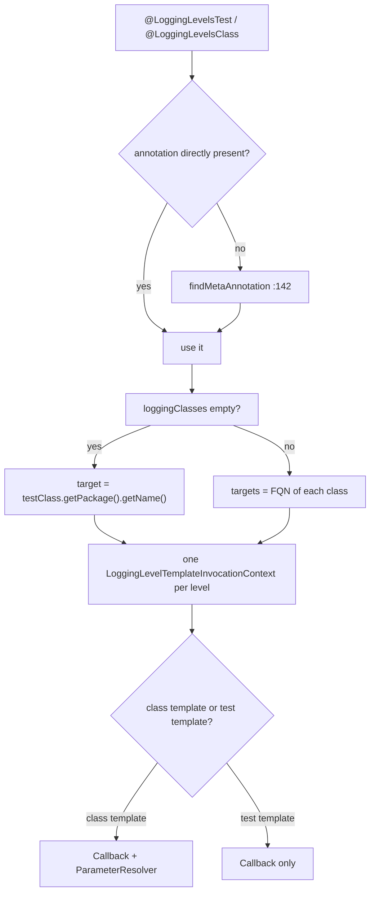
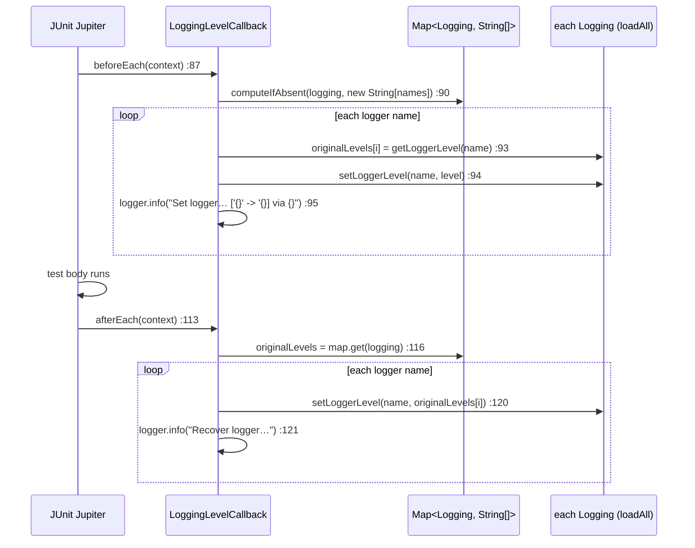

# microsphere-logging-test —— 源码解析

[English version](../logging-test.md)

> Maven 模块：`io.github.microsphere-projects:microsphere-logging-test` · 分支 `release` · 版本
> `0.2.3-SNAPSHOT` · Java 8 · JUnit 4 **13.2** / JUnit Jupiter **5.13.1** · 10 个生产类。

面向用户的参考文档：[../../../user-guide/current/zh/logging-test.md](../../../user-guide/current/zh/logging-test.md)

---

## 1. 在架构中的位置

```mermaid
graph TD
    subgraph jupiter["Jupiter support"]
        ALT["@LoggingLevelsTest<br/>@Target METHOD"]
        ALC["@LoggingLevelsClass<br/>@Target TYPE"]
        TE[LoggingLevelsTestExtension]
        CE[LoggingLevelsClassExtension]
        EXT[LoggingLevelsExtension&lt;A&gt;<br/>abstract base]
        CTX[LoggingLevelTemplateInvocationContext]
        CB[LoggingLevelCallback]
        PR[LoggingLevelParameterResolver]
        AT[LoggingLevelsAttributes]
    end

    subgraph junit4["JUnit 4 support"]
        RULE[LoggingLevelsRule<br/>implements TestRule]
        ST[LoggingLevelsStatement<br/>extends Statement]
    end

    ALT -->|@ExtendWith :45| TE
    ALC -->|@ExtendWith :45| CE
    TE -->|extends| EXT
    CE -->|extends| EXT
    EXT -->|builds 1 per level| CTX
    EXT -->|reads attributes| AT
    CTX -->|registers| CB
    CTX -->|"registers only when isClassTemplate"| PR
    RULE -->|apply| ST
    EXT -->|LoggingUtils.loadAll| COMMONS[microsphere-logging-commons]
    CB --> COMMONS
    ST --> COMMONS
```

本模块依赖 `microsphere-logging-commons`（`${revision}`），并把 `microsphere-java-core`、`junit`、`junit-jupiter` 和
`junit-jupiter-engine` 标记为**可选（optional）**——整套设计正是建立在这一点上：使用者自行选择 JUnit 4 或 Jupiter
（或两者都选），未使用的那一支永远不会被加载。它自身的测试作用域又引入了 `microsphere-logback`、`logback-classic`、
`slf4j-api`、`microsphere-java-test` 和 `junit-vintage-engine`，这就是仓库中的级别矩阵测试只针对单一后端进行验证的
原因。

## 2. 注解只是载体，扩展才真正干活

```java
// LoggingLevelsTest.java:40-46 (LoggingLevelsClass.java:40-46 is the TYPE-level twin)
@Target({ANNOTATION_TYPE, METHOD})
@Retention(RUNTIME)
@ExtendWith(LoggingLevelsTestExtension.class)
public @interface LoggingLevelsTest {
    Class<?>[] loggingClasses() default {};   // :53
    String[] levels();                        // :60
}
```

`@Target` 列表中出现 `ANNOTATION_TYPE`，组合之所以能够成立正是因为它——仓库自己的例子：

```java
// test-case evidence — DefaultLoggingLevelsClass.java
@LoggingLevelsClass(loggingClasses = {...}, levels = {...})
@Retention(RUNTIME)
@Target(TYPE)
public @interface DefaultLoggingLevelsClass {}
```

两处 `levels()` 都是**必填项**（没有默认值），因此只写一个光秃秃的 `@LoggingLevelsTest` 会直接编译报错；
`loggingClasses()` 的默认值是空数组，从而触发包名回退机制（见第 4 节）。

## 3. `LoggingLevelsExtension<A>` —— 一个类，两个 JUnit 5 SPI

基类一次性实现了**两个** provider 接口（`LoggingLevelsExtension.java:56-57`）：
`ClassTemplateInvocationContextProvider` *以及* `TestTemplateInvocationContextProvider`。
两个具体子类只是 32 行的空壳，仅负责提供泛型实参；
注解类型是从这个泛型参数上反射还原出来的：

```java
// LoggingLevelsExtension.java:70-78
public LoggingLevelsExtension() {
    this.annotationType = resolveAnnotationType();
}

private Class<A> resolveAnnotationType() {
    return from(getClass()).as(LoggingLevelsExtension.class).getGenericType(0).toClass();
}
```

`supportsClassTemplate` / `supportsTestTemplate` 都无条件返回 `true`（`:91-92`、`:105-106`）——扩展并不自行筛选。
只有在注册是通过注解上的 `@ExtendWith` 完成时这才是安全的，
因此 JUnit 恰好只在注解存在的位置调用该扩展。
两个入口都汇聚到同一个带布尔标志的方法（`:121`、`:163`）：

```java
// LoggingLevelsExtension.java:180-197
protected Stream<LoggingLevelTemplateInvocationContext> provideInvocationContexts(ExtensionContext context, boolean isClassTemplate) {
    ClassLoader classLoader = getClassLoader(getClass());        // :181 the *extension's* CL, not the test's
    List<Logging> loggins = loadAll(classLoader);                // :182 every backend, not load()
    LoggingLevelsAttributes attributes = getLoggingLevelsAttributes(context, isClassTemplate);
    String[] levels = attributes.levels;
    String[] loggerNames = getLoggerNames(context, attributes);
    ...
    for (int i = 0; i < length; i++) {
        contexts.add(i, new LoggingLevelTemplateInvocationContext(loggins, loggerNames, levels[i], i, isClassTemplate));
    }
}
```

这里能看出三个设计决定，而且三个都是承重的：

- **用 `loadAll()` 而不是 `load()`**（`:182`）：一套级别矩阵要驱动 classpath 上*每一个*后端，
  这就是级别名称必须对所有后端都有效的原因。
- **每个级别一个模板调用上下文，并带索引**（`:191-194`）：`index` 会被带入上下文，
  因此显示名称与注入的参数都和 `levels` 数组中的位置保持一致。
- 所用的类加载器是 `getClassLoader(getClass())`——扩展类自身的加载器；在 Surefire 的非系统类加载器模式下，
  正是它让跨后端发现成为可能。

### 属性解析，包含元注解

```java
// LoggingLevelsExtension.java:138-149
AnnotatedElement annotatedElement = isClassTemplate ? context.getRequiredTestClass() : context.getRequiredTestMethod();
A annotation = annotatedElement.getAnnotation(annotationType);
if (annotation == null) {                       // :141-143
    annotation = findMetaAnnotation(annotatedElement, annotationType);
}
Map<String, Object> annotationAttributes = getAttributesMap(annotation);
attributes.loggingClasses = (Class<?>[]) annotationAttributes.get("loggingClasses");
attributes.levels = (String[]) annotationAttributes.get("levels");
```

`findMetaAnnotation` 回退（`:142`）正是让 `@DefaultLoggingLevelsClass` 与 `@LoggingLevelsClass` 表现完全一致的原因。
两个属性名称是以**字符串字面量**的形式从属性映射里读出的（`:146-147`），
因此重命名注解成员时，这里不会编译报错，而是悄悄得到 `null` 数组——
这是改动注解之前值得先知道的维护陷阱。

### Logger 名称回退

```java
// LoggingLevelsExtension.java:213-220
if (isEmpty(loggingClasses)) {
    return ofArray(context.getRequiredTestClass().getPackage().getName());
}
return of(loggingClasses).map(Class::getName).toArray(String[]::new);
```

`loggingClasses` 为空 ⇒ 整个测试类所在的包成为唯一的目标 logger 名称。非空 ⇒ 每个类一个名称。绝不会为空，
因此 `LoggingLevelCallback` 至少总有一个名称可以设置。



## 4. `LoggingLevelTemplateInvocationContext` —— `isClassTemplate` 这道闸门

同一个类实现了两个上下文接口（`LoggingLevelTemplateInvocationContext.java:39`、`:100-107`），
并把 `"[" + level + "]"` 作为显示名称返回，忽略 `invocationIndex`（`:86-88`）——
这就是报告里读到的是 `[TRACE]`、`[DEBUG]` 而不是 `[1]`、`[2]` 的原因。

有意思的是它注册了多少个扩展：

```java
List<Extension> extensions = newArrayList(this.isClassTemplate ? 2 : 1);
extensions.add(new LoggingLevelCallback(this.loggins, this.loggerName, this.level));
if (this.isClassTemplate) {
    extensions.add(new LoggingLevelParameterResolver(this.level, this.index));
}
```

因此**参数注入只存在于类模板之中**。在 `@LoggingLevelsClass` 下写 `void test(String level, int index)` 是可用的；
同样的签名放在方法级 `@LoggingLevelsTest` 下会参数解析失败，因为方法那一支只注册了回调。
这一不对称性并没有写在注解自身的文档里——
它是 `getAdditionalExtensions()` 带来的结果，
也正是 `LoggingLevelsTestTest.test()` 声明为无参数的原因（`LoggingLevelsTestTest.java:34-41`）。

`LoggingLevelParameterResolver` 本身很简单，而且是包内可见的（`LoggingLevelParameterResolver.java:35`）：
`supportsParameter` 只接受 `String.class` 或 `int.class`（`:68-71`），`resolveParameter` 对 `String` 返回级别名称，
其余情况返回索引（`:84-90`）。其他任何参数类型都是不受支持的，
因此 `char`/枚举参数只会得到 Jupiter 常见的“no ParameterResolver”错误，而不是某次类型转换尝试。

## 5. `LoggingLevelCallback` —— 记录、应用、恢复原级别（以及为什么恢复并非中性的）



读一遍 `:87-124` 可以得到四条具体影响：

1. **原级别是按后端、按名称分别记录**在一个 `Map<Logging, String[]>` 里的（`:50`，在 `:90` 处填充）。
   这个映射是一个普通的 `HashMap` 字段，因此在 JUnit 并行执行下跑一套 `@LoggingLevelsClass` 矩阵就会发生竞争；
   该类中没有任何同步措施。
2. **恢复原级别的效果只取决于当初记录到了什么。** `getLoggerLevel` 可能合理地返回 `null`（契约：logger 不存在）或
   `""`（契约：级别为继承而来），两者都会被原样送回 `setLoggerLevel(name, …)`。
   在 Logback/Log4j/Log4j2 上，`null` 会走到 `Level.toLevel(null)` ⇒ **DEBUG**，于是该 logger 最终被钉在 DEBUG
   而不是继续继承——`Log4j2UtilsTest` 直接证明了这一机制：

   ```java
   // test-case evidence — Log4j2UtilsTest.java:128-130
   // null string -> toLevel(null) => DEBUG
   Log4j2Utils.setLoggerLevel(logger, (String) null);
   assertEquals(Level.DEBUG, Log4j2Utils.getLevel(logger));
   ```

   在 JUL 上，同样的镜像问题出现在 `""` 上：`Level.parse("")` 解析不出级别，而由此抛出的
   `NumberFormatException` *就是*一个 `IllegalArgumentException`，所以 `afterEach` 可能对一个从未显式声明过级别的
   logger 抛出异常。这就是随仓库发布的测试只断言它们显式设置过的级别的原因。
3. **`afterEach` 假定 `beforeEach` 已经执行过**——`loggingsWithoriginalLevels.get(logging)`（`:116`）在 `:119`
   处被直接解引用而没有判空，因此一个 before 钩子被跳过的回调
   （或者两个钩子之间新出现的后端）会以 NPE 失败。
4. `:95` 处的 info 消息是 `Set logger[name :'{}']s' level ['{}' -> '{}] via {}`——源码里 `levelName` 之后少了
   一个收尾引号，因此日志解析规则不能假定它是一个规整的模式。`:121`
   在恢复那一行重复了同样的措辞。

## 6. JUnit 4：`LoggingLevelsRule` 与 Statement 循环

`LoggingLevelsRule` 是一个只有两个方法的类：工厂方法 `levels(String...)`（`LoggingLevelsRule.java:68-70`）和
`apply(base, description)`，后者返回一个 `LoggingLevelsStatement` 包装语句（`:51-53`）。这里**没有**
`loggingClasses` 的对应物——JUnit 4 那一支只能把测试类所在的包作为目标。

```java
// LoggingLevelsStatement.java:81-99
String loggerName = testClass.getPackage().getName();
List<Logging> loggins = loadAll(getClassLoader(testClass));
for (Logging logging : loggins) {                       // outer loop: backends
    String originalLevel = logging.getLoggerLevel(loggerName);
    try {
        for (String level : levels) {                   // inner loop: levels
            description.addChild(createTestDescription(... + " with logging level - " + level));
            logging.setLoggerLevel(loggerName, level);
            next.evaluate();
        }
    } finally {
        logging.setLoggerLevel(loggerName, originalLevel);
    }
}
```

以下三个性质可以直接推出：

- 构造函数里的 `this.levels = ofSet(levels)`（`:66`）会**去重**，因此 `"DEBUG","DEBUG"` 只迭代一次——而且
  因为它是一个 `Set`，迭代顺序是集合自身的顺序，不是声明顺序。
- 这种嵌套意味着方法体运行的是**后端数 × 级别数**次，而不是 `levels` 次。一个后端三个级别会得到三次求值；
  再加上第二个后端就变成六次。
- `description.addChild(...)`（`:90`）是在求值*过程中*合成子描述的，因此尽管 JUnit 4 没有原生的模板概念，
  报告里仍能显示每个级别一条记录。`:94-97` 的 `finally` 按后端逐个恢复原级别，
  这意味着某个后端的循环里抛异常时，后面的后端仍会执行自己的恢复。

## 7. 为什么要求 Jupiter 5.13+

`LoggingLevelsExtension` 实现了 `ClassTemplateInvocationContextProvider`（`:56`），
这个接口由 JUnit 的类模板支持引入；没有它的 Jupiter 版本无法编译本模块。
**方法级**那一支只需要历史悠久的 `TestTemplateInvocationContextProvider`，
因此一个从不使用 `@LoggingLevelsClass` 的项目在技术上只用到这一半——
但构件本身是针对 5.13.1 编译的，所以依赖的下限就是它。

## 8. 测试即规格

| 测试 | 钉住的行为 |
|------|------|
| `LoggingLevelsTestTest`（`:29-41`） | 方法级矩阵，带两个 `loggingClasses`；方法体**没有注入参数**；通过 `loadAll()` 断言两个后端都不报告 `"INFO"` |
| `LoggingLevelsClassTest` + `DefaultLoggingLevelsClass` | 组合出的元注解经由 `findMetaAnnotation` 解析；`void test(String level, int index)` 收到级别名称与索引 |
| `LoggingLevelsRuleTest` | 以 `@ClassRule` 方式使用 `levels("TRACE","DEBUG","INFO")` |
| `LoggingLevelParameterResolverTest` | 支持 `String`/`int`，其他类型被拒绝 |
