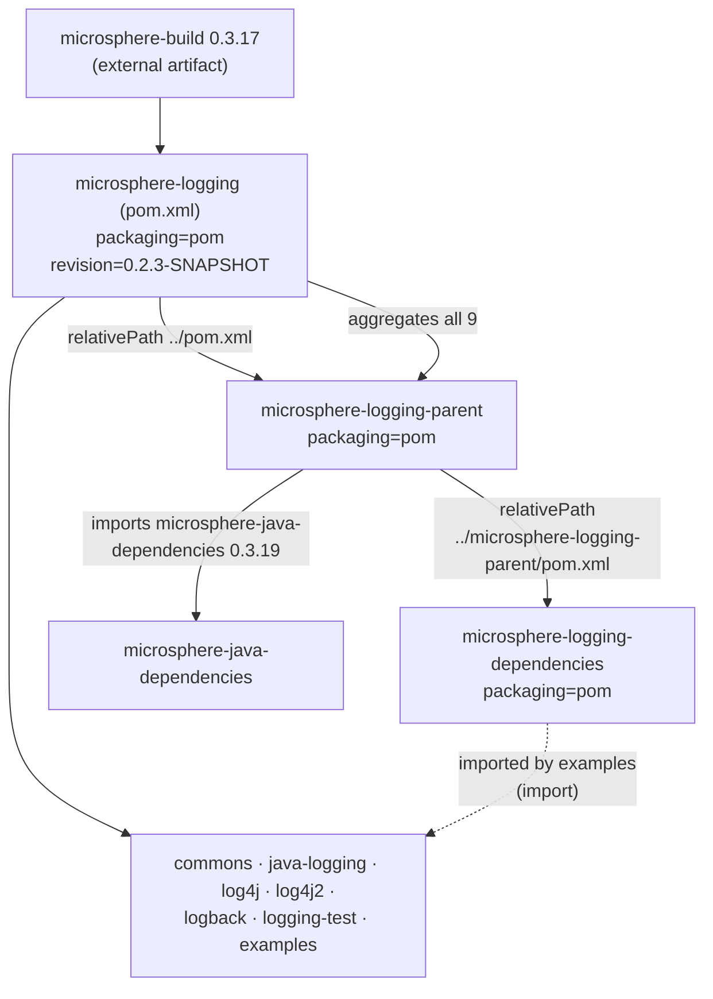
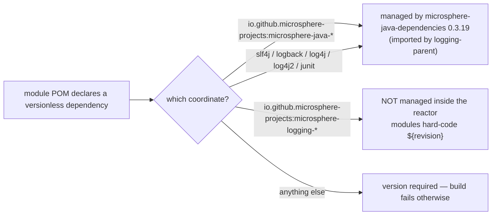
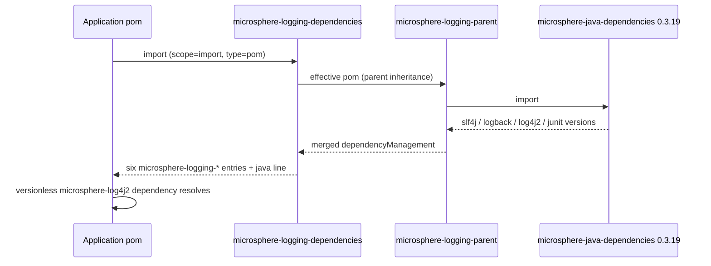

# microsphere-logging-parent 与 microsphere-logging-dependencies —— 源码分析

[English version](../parent-and-dependencies.md)

> 构建层的模块：`microsphere-logging-parent` 和 `microsphere-logging-dependencies`，再加上根聚合模块
> `microsphere-logging`。分支 `release` · `${revision}` = `0.2.3-SNAPSHOT` · 三者都没有 Java 源码。

面向使用者的参考文档：[../../../user-guide/current/zh/parent-and-dependencies.md](../../../user-guide/current/zh/parent-and-dependencies.md)

---

## 1. 三个 POM，三种不同的职责



| POM | artifactId | 打包方式 | 职责 | 有 `<modules>` 吗？ | 有 `<dependencyManagement>` 吗？ |
|-----|-----------|-----------|------|------------------|-------------------------------|
| 根 `pom.xml` | `microsphere-logging` | `pom` | 聚合模块**兼**祖父 POM | 有，9 个（`:58-68`） | 无 |
| `microsphere-logging-parent` | `microsphere-logging-parent` | `pom` | 各库模块共享的父 POM | **没有** | 有 —— 导入 `microsphere-java-dependencies`（`:25-38`） |
| `microsphere-logging-dependencies` | `microsphere-logging-dependencies` | `pom` | 供使用者引入的 BOM | 无 | 有 —— 六个项目构件（`:25-61`） |

根 POM 与父 POM 之间的分工是首先要理解的地方：**根**掌握反应堆成员资格与项目身份
（licenses、developers、SCM —— `pom.xml:18-52`），而 **`microsphere-logging-parent`** 只掌握依赖版本。
这就是父 POM 声明 `<relativePath>../pom.xml</relativePath>`（`:9`）而不是反过来的原因，
也是它不持有 `<modules>` 元素的原因：向反应堆添加一个模块意味着修改根 POM，
永远不会修改父 POM。

## 2. 版本流转 —— `${revision}` 的端到端路径

```
properties: revision = 0.2.3-SNAPSHOT        (root pom.xml:55)
      ↓ inherited by every module
module <version>${revision}</version>         (parent :16, BOM :14, every jar module)
      ↓ used verbatim for intra-project deps
<dependency><artifactId>microsphere-logging-commons</artifactId>
            <version>${revision}</version></dependency>      (adapters' POMs)
      ↓ and for BOM entries
BOM dependencyManagement → <version>${revision}</version>    (BOM :25-61)
```

改动版本时有两个后果值得关注：

- **CI 会覆盖 `revision`**：`.github/workflows/maven-build.yml:38-44` 传入 `-Drevision=0.0.1-SNAPSHOT`，所以在 CI
  期间反应堆绝不会构建或发布 POM 里那个字面值。
  把 `pom.xml:55` 的 `revision` 递增是一个发布步骤，而不是构建步骤。
- **适配器并不消费 BOM。** 在反应堆内部，它们在各自的 `commons` 依赖上硬编码 `${revision}`；
  BOM 是为*外部*使用者存在的。因此模块版本递增是一次单属性的改动，
  但 BOM 若已与 `${revision}` 发生漂移，构建并不会发现它。

`microsphere-logging-parent` 和 `microsphere-logging-examples` 本身**不在** BOM 的管理清单里：
BOM 覆盖的是六个供使用者消费的构件（`commons`、`java-logging`、`logback`、`log4j2`、`log4j`、
`logging-test`）。

## 3. 父 POM 的唯一职责：锁定 `microsphere-java` 版本线

```xml
<!-- microsphere-logging-parent/pom.xml:21-38 -->
<properties>
    <microsphere-java.version>0.3.19</microsphere-java.version>
</properties>

<dependencyManagement>
    <dependencies>
        <dependency>
            <groupId>io.github.microsphere-projects</groupId>
            <artifactId>microsphere-java-dependencies</artifactId>
            <version>${microsphere-java.version}</version>
            <type>pom</type>
            <scope>import</scope>
        </dependency>
    </dependencies>
</dependencyManagement>
```

正是这个导入，让每个模块 POM 都可以写出 `<artifactId>microsphere-java-core</artifactId>` **而不带版本**，
也是 slf4j `2.0.18`、logback `1.6.3`、log4j `1.2.17`、log4j2 `2.9.1`、JUnit `4.13.2`、
Jupiter `5.13.1` 这些第三方版本在本仓库中同样无需版本即可解析的原因：它们全部由
`microsphere-java-dependencies` 传递性地统一治理。



因此，升级整个第三方栈的单一旋钮就是
`microsphere-logging-parent/pom.xml:22`（`microsphere-java.version`）。改动它是一次跨模块的变更：`DefaultLoggingLevelsResolver`
解析出的级别词汇表取决于导入的 BOM 带出的具体 Logback/Log4j/Log4j2 版本，所以各后端的 `ALL_LEVELS`
集合可能会随之变动。

## 4. BOM

`microsphere-logging-dependencies` 继承 `microsphere-logging-parent`（BOM `:4-10`），除此之外什么都不做：它的
整个正文就是一个包含六条 `${revision}` 条目的 `<dependencyManagement>` 块。作为父 POM 的子级，BOM 也继承了
`microsphere-java-dependencies` 这个导入 —— 因此一个**只**导入
`microsphere-logging-dependencies` 的应用仍然会解析到 java 版本线的版本，这正是用户指南里那段
无版本的使用者片段能够生效的原因。



## 5. 反应堆顺序，以及它为何不等于 `<modules>` 的顺序

根 POM 按声明顺序列出模块（`pom.xml:58-68`）：

```
microsphere-logging-parent, microsphere-logging-dependencies, microsphere-logging-commons,
microsphere-java-logging, microsphere-log4j, microsphere-log4j2, microsphere-logback,
microsphere-logging-test, microsphere-logging-examples
```

Maven 会按依赖图重新排序，所以实际构建执行的是 `parent → dependencies → commons → {java-logging, log4j,
log4j2, logback} → logging-test → examples`。四个适配器是彼此独立的兄弟模块，可能以任意相对顺序构建
—— 不能对它们做任何假设。

## 6. 修改这些 POM 时需要保持的不变式

| 不变式 | 它如何被破坏 |
|-----------|---------------|
| 每个模块都保留 `<version>${revision}</version>`，且 `<relativePath>` 指向它真正的父 POM | 一个写死的版本会让之后每次发布都变成多文件编辑 |
| 新的已发布构件 ⇒ 加入 BOM | 使用者必须自己知道版本；文档里的无版本片段就会变成错的 |
| `microsphere-logging-parent` 保持不含 `<modules>` | 反应堆悄然分裂；某个模块可能被 CI 构建却被发布流程遗漏 |
| BOM 版本等于 `${revision}` | 混用不同版本的 `microsphere-logging-*` 构件，而用户指南明确排除了这种情况 |
| `microsphere-java.version` 属性位于父 POM 而不是根 POM | java 版本线不再作用于各模块 |
